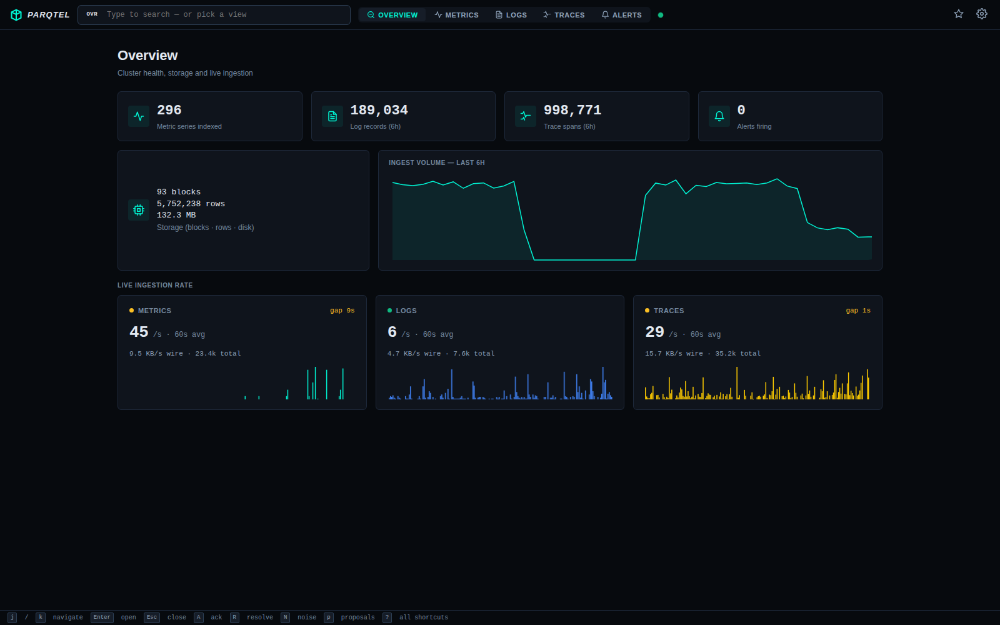
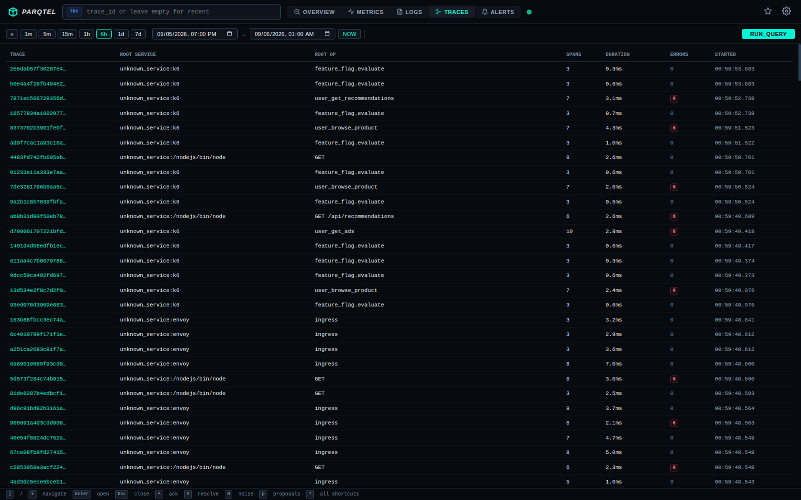
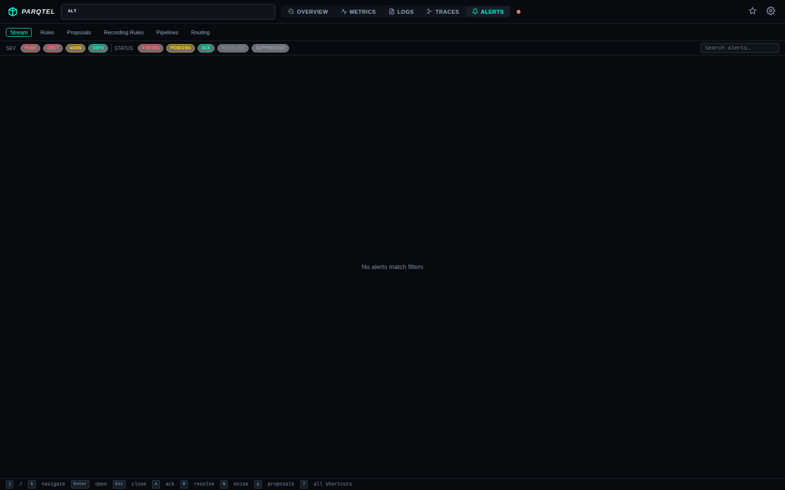

<p align="center">
  
</p>

<p align="center">
  <strong>OpenTelemetry metrics, logs and traces in compressed Parquet.</strong><br>
  One Rust binary. PromQL-compatible queries. Optional S3-compatible storage.
</p>

<p align="center">
  <a href="docs/getting-started/getting-started.md"><b>Get started</b></a> •
  <a href="docs/operations/configuration.md">Configure</a> •
  <a href="docs/operations/object-storage.md">S3 / object storage</a> •
  <a href="docs/operations/security.md">Security</a> •
  <a href="docs/development/architecture.md">Architecture</a> •
  <a href="docs/api/openapi.yaml">API</a>
</p>

<p align="center">
  <a href="https://github.com/parqtel/parqtel-oss/actions/workflows/ci.yml"></a>
  <a href="https://github.com/parqtel/parqtel-oss/actions/workflows/release.yml"></a>
  <a href="https://github.com/parqtel/parqtel-oss/blob/main/LICENSE"></a>
  <a href="https://ghcr.io/parqtel/parqtel-oss"></a>
  <a href="https://github.com/parqtel/parqtel-oss/pkgs/container/charts%2Fparqtel"></a>
  
  
  <a href="https://securityscorecards.dev/viewer/?uri=github.com/parqtel/parqtel-oss"></a>
  <a href="https://github.com/parqtel/parqtel-oss/security"></a>
  <a href="https://github.com/parqtel/parqtel-oss/actions/workflows/release.yml"></a>
  <a href="https://github.com/parqtel/parqtel-oss/releases"></a>
  <a href="https://parqtel.github.io"></a>
  
</p>

<p align="center">
  <a href="docs/getting-started/getting-started.md"><b>Getting Started</b></a> •
  <a href="docs/getting-started/tutorials.md">Tutorials</a> •
  <a href="CONTRIBUTING.md">Contributing</a> •
  <a href="#features">Features</a> •
  <a href="#architecture">Architecture</a> •
  <a href="#api-reference">API</a> •
  <a href="docs/guides/mcp.md">MCP</a> •
  <a href="docs/operations/deployment.md">Deployment</a> •
  <a href="docs/operations/troubleshooting.md">Troubleshooting</a>
</p>

---

## What is Parqtel?

Parqtel is a single-binary observability backend written in Rust. It ingests
OpenTelemetry metrics, logs and traces, stores them as compressed Apache
Parquet, and serves PromQL-compatible queries, log/trace search, pipelines,
dashboards, alerting, a web console and MCP. Local disk is the default; an
S3-compatible bucket with a shared catalog is optional.

**Key design goals:**
- **Minimal footprint** — one static binary, scratch-based container, no shell
- **Columnar storage** — Parquet + Zstd, with series and log skip indexes
- **Drop-in compatibility** — Prometheus API, Grafana SimpleJSON, OTLP
- **Durable by default** — WAL before acknowledgement, crash-safe replay
- **Operable at the edge or on S3** — bounded memory, optional shared object storage
- **AI-native** — MCP servers for LLM-driven incident response

## Common Use Cases

| Use Case | Solution |
|----------|----------|
| **Low-cost Archiving** | Stream OTel data to Parquet for long-term storage with 90% compression vs Prometheus TSDB. |
| **Edge Observability** | Deploy on resource-constrained edge devices (IoT, ARM) to local-first telemetry. |
| **Log-to-Metric Pipelines** | Extract business metrics from high-volume Nginx or app logs using YAML pipelines. |
| **AI Incident Response** | Use MCP servers to give LLMs direct access to your telemetry for automated RCAs. |
| **Serverless Monitoring** | Ingest ephemeral logs/metrics from Lambda/Cloud Run without managing a heavy cluster. |

## 🗺 Documentation Map

| Area | Guides |
|------|--------|
| **Onboarding** | [Getting Started](docs/getting-started/getting-started.md) • [Docs index](docs/README.md) • [Glossary](docs/development/glossary.md) • [FAQ](docs/getting-started/faq.md) |
| **Learning** | [Tutorials](docs/getting-started/tutorials.md) • [Ingestion on-ramps](docs/guides/ingestion.md) • [Use Cases](#common-use-cases) |
| **Querying** | [**PQL Guide**](docs/guides/pql-guide.md) — ParQL metrics, ParqtelQL log/trace search, cross-signal pipelines |
| **Deep Dive** | [Architecture](docs/development/architecture.md) • [Configuration](docs/operations/configuration.md) • [Developer Guide](docs/development/developer-guide.md) • [MCP Integrations](docs/guides/mcp.md) • [Query Functions](docs/guides/query-functions.md) • [Performance](docs/performance/README.md) • [CI/CD](docs/development/ci-cd.md) |
| **Operations** | [Deployment](docs/operations/deployment.md) • [Object storage](docs/operations/object-storage.md) • [Security](docs/operations/security.md) • [Alerting](docs/operations/alerting.md) • [Known Issues](docs/operations/known-issues.md) • [Troubleshooting](docs/operations/troubleshooting.md) • [Best Practices](docs/guides/best-practices.md) • [Testing & Validation](docs/development/testing.md) |
| **Brand** | [Brand identity](docs/brand/README.md) • [Logo and palette assets](docs/assets/brand/) |
| **Community** | [Contributing](CONTRIBUTING.md) • [Support](SUPPORT.md) • [Code of Conduct](CODE_OF_CONDUCT.md) • [Security policy](SECURITY.md) • [Changelog](CHANGELOG.md) |

## Features

| Category | Capabilities |
|----------|-------------|
| **Ingestion** | OTLP gRPC (`:4317`) + HTTP protobuf/JSON; generic JSON logs; Prometheus `remote_write`; Kafka JSON consumer |
| **Storage** | Block Parquet with Zstd/Snappy/LZ4; L0→L1 compaction; retention; series table and log skip index |
| **Object storage** | Optional S3-compatible upload, bounded read cache and CAS shared catalog; local disk remains the WAL staging area |
| **Query** | PromQL-compatible instant/range, labels, aggregations, subqueries, binary matching; ParqtelQL log/trace search; PQL pipelines |
| **Dashboards** | Persisted multi-panel dashboards; saved searches; live tail (SSE); chunked NDJSON log streaming |
| **Alerting** | YAML rules, threshold + median/MAD anomaly, dedicated scan slot, transition history and noise score; Alertmanager route tree, grouping, inhibition, silences, Slack/PagerDuty/Teams/webhook receivers |
| **Pipeline** | Live log pipelines (parse, enrich, mask, metric extract, route); recording rules executed on schedule |
| **Span-metrics (RED)** | Auto-derived `traces_service_{requests,errors,duration_ms}_total` per service/operation from server spans |
| **Tail sampling** | Trace-coherent: errors/slow traces kept; deterministic per-service ratio; RED metrics stay unsampled |
| **Security** | Optional scoped bearer tokens, OIDC login, in-process TLS, dataset isolation, audit trail, fail-closed alert egress |
| **Visualization** | Built-in web UI, Grafana SimpleJSON, Prometheus-compatible `/api/v1/*` |
| **MCP** | 7 AI tool servers (Slack, PagerDuty, Jira, Notion, Discord, Google Docs, Parqtel) |
| **Operations** | Health/readiness, `/metrics`, self-telemetry, profiling, graceful shutdown, CLI subcommands |

## Built-in Web UI

Parqtel ships with a zero-dependency embedded web console at `/ui` — no CDNs, no web fonts, no frameworks, works air-gapped. Single file, gzipped, soft budget 1000 KB, served with gzip + ETag caching at zero per-request server cost.

| Overview | Metrics |
|----------|---------|
|  |  |

| Logs | Traces |
|------|--------|
|  |  |

| Alerts (live firing) | Alert rules |
|---------------------|-------------|
|  |  |

**Features:** Overview pane with live per-signal ingestion-rate cards (60s average, spike/gap sparkline, status dot — backed by `/api/v1/ingest_rates`), deep-linkable URLs (share the exact query + time range), a metrics query builder with a **92-function catalog** covering the full engine surface — typed argument editors, `by`/`without` grouping, window-function wrapping, live PromQL preview, and label filters with bounded high-cardinality autocomplete — plus a Builder⇄Code toggle that reverse-parses a typed query, log field facets, trace-grouped browse list + waterfall, alert stream with Evidence tab (incident-window metric chart + correlated logs), form-based rule editor with YAML escape hatch, saved views, keyboard shortcuts (`?` for the reference), WCAG AA contrast and reduced-motion support.


## Performance

Benchmarked with sustained 1000 samples/sec (metrics + logs + traces) for 15 minutes:

| Metric | Result |
|--------|--------|
| **Sustained throughput** | 972 samples/sec (zero errors) |
| **Total ingested** | 875,100 samples in 15 min |
| **Ingest p50** | 4.4ms per batch |
| **Ingest p99** | 63ms per batch |
| **Query p50 (instant)** | 12.7ms |
| **Query p99 (range)** | 160ms |
| **Immediate queryability** | 1.7ms (in-memory buffer) |
| **Data durability** | ✅ Survives container restart |

Hot-path optimizations (non-blocking flushes, row-group pruning, label caching) are detailed in [docs/performance/README.md](docs/performance/README.md) — scan throughput +39%, narrow-range queries decode only matching row groups, and Parquet writes no longer stall async workers.

What changed, and what was measured rather than assumed, is in [docs/performance/README.md](docs/performance/README.md).

## Architecture


The same flow with the full component set is drawn in the
[architecture doc](docs/development/architecture.md). The motion is
self-contained SVG — no JavaScript, no Mermaid runtime, and it stops under
`prefers-reduced-motion`.

**Deep dive:** [Architecture](docs/development/architecture.md) • [PQL Guide](docs/guides/pql-guide.md)

---

## Quick Start

```bash
# Clone and build
git clone https://github.com/parqtel/parqtel-oss.git
cd parqtel-oss
cargo build --release

# Start the server
./target/release/parqtel serve

# Or with configuration
./target/release/parqtel --config config/default.toml serve
```

### Run with Docker

```bash
docker build -t parqtel:local .
docker run -p 8080:8080 -v parqtel_data:/var/lib/parqtel parqtel:local
```

### Install with Homebrew (Linux & macOS)

```bash
brew tap parqtel/tap
brew install parqtel-oss
parqtel serve
```

The formula downloads the compiled release binary for your platform (linux-amd64/arm64, darwin-amd64/arm64) from [GitHub releases](https://github.com/parqtel/parqtel-oss/releases) — no Rust toolchain required. The tap is updated automatically on every release.

### Run with Docker Compose (full stack)

```bash
# First-time setup: copies .env.example → .env and starts everything
make dev-setup

# Or manually
cp .env.example .env
docker compose -f deploy/compose/docker-compose.yml up -d
```

This starts Parqtel (port 9090), Grafana (port 3000), Prometheus (port 9091), a load generator and the Parqtel MCP server (port 3007). Additional MCP integrations use the same compose file; add their tokens to `.env` before enabling them.

### Verify

```bash
# Health check (compose stack runs on port 9090; raw docker run uses 8080)
curl http://localhost:9090/health

# Send a metric via OTLP JSON (stamp it "now" — instant queries look back 5 minutes)
TS=$(date +%s)000000000
curl -X POST http://localhost:9090/v1/metrics/json \
  -H "Content-Type: application/json" \
  -d '{"resourceMetrics":[{"resource":{"attributes":[{"key":"service.name","value":{"stringValue":"demo"}}]},"scopeMetrics":[{"metrics":[{"name":"http_requests_total","gauge":{"dataPoints":[{"asDouble":42,"timeUnixNano":"'$TS'","attributes":[{"key":"method","value":{"stringValue":"GET"}}]}]}}]}]}]}'

# Query it back (Prometheus API)
curl "http://localhost:9090/api/v1/query?query=http_requests_total"
```

Instant queries look back 5 minutes (`query.lookback_delta_ns`); older points become queryable via `/api/v1/query_range` after the block flush (default 2h blocks, checked every 5s). See [docs/getting-started/getting-started.md](docs/getting-started/getting-started.md) for the full walkthrough.

## API Reference

### Ingestion (OTLP)

OTel SDKs can export directly via **gRPC** at `:4317` (all three collector services, no collector sidecar needed), or via HTTP:

| Endpoint | Method | Description |
|----------|--------|-------------|
| `/v1/metrics` | POST | Ingest metrics (protobuf, or JSON via `Content-Type`) |
| `/v1/metrics/json` | POST | Ingest metrics (JSON) |
| `/v1/logs` | POST | Ingest logs (protobuf, or JSON via `Content-Type`) |
| `/v1/logs/json` | POST | Ingest logs (JSON) |
| `/v1/traces` | POST | Ingest traces (protobuf, or JSON via `Content-Type`) |
| `/v1/traces/json` | POST | Ingest traces (JSON) |
| `/api/v1/ingest` | POST | Generic JSON logs (object or array; `X-Parqtel-Service`) |
| `/api/v1/write` | POST | Prometheus `remote_write` (snappy protobuf) |

### Query (Prometheus-compatible)

| Endpoint | Method | Description |
|----------|--------|-------------|
| `/api/v1/query` | GET | Instant query |
| `/api/v1/query_range` | GET | Range query |
| `/api/v1/labels` | GET | List all label names |
| `/api/v1/label/__name__/values` | GET | List metric names |
| `/api/v1/label/:name/values` | GET | List values for a label |

### Logs

| Endpoint | Method | Description |
|----------|--------|-------------|
| `/api/v1/logs` | GET | Query logs with filters |
| `/api/v1/logs/tail` | GET | SSE live tail over buffered logs (`service_name`, `body_contains`, `limit`) |
| `/api/v1/logs/stream` | GET | Chunked NDJSON log results over a large range |
| `/v1/logs/count` | GET | Count matching logs |
| `/v1/logs/fields` | GET | List available log fields |
| `/v1/logs/field_values` | GET | List values for a log field |
| `/v1/traces/search` | GET | Search spans (per-span `trace_id` for client-side grouping) |
| `/v1/correlate` | GET | Cross-signal correlation for a time window |

### Alerts

| Endpoint | Method | Description |
|----------|--------|-------------|
| `/api/v1/alerts` | GET | List all alerts |
| `/api/v1/alerts/:id` | GET | Get alert details |
| `/api/v1/alerts/:id/acknowledge` | POST | Acknowledge an alert |
| `/api/v1/alerts/:id/resolve` | POST | Resolve an alert |
| `/api/v1/alerts/routes` | GET/POST | List or replace notification routes (secrets redacted) |
| `/api/v1/alerts/test_route` | POST | Dry-run route, group, silence and inhibition evaluation |
| `/api/v1/alerts/silences` | GET/POST | List or create silences |
| `/api/v1/alerts/silences/:name` | DELETE | Delete a silence |
| `/api/v1/saved_searches` | GET/POST | List or save a search |
| `/api/v1/saved_searches/:id` | DELETE | Delete a saved search |
| `/api/v1/dashboards` | GET/POST | List or create persisted dashboards |
| `/api/v1/dashboards/:id` | PUT/DELETE | Replace or delete a dashboard |
| `/api/v1/dashboards/:id/render` | GET | Execute every panel over a time range |
| `/api/v1/rules` | GET/POST | List or create alert rules |
| `/api/v1/rules/:id` | PUT/DELETE | Update or delete a rule |
| `/api/v1/rules/status` | GET | Registry generation, definitions, load errors and ruler state |

### Pipelines & Recording Rules

| Endpoint | Method | Description |
|----------|--------|-------------|
| `/v1/search` | POST | Run a PQL pipeline (`fetch │ filter │ parse │ stats │ correlate`) |
| `/api/v1/recording_rules` | GET/POST | List or create recording rule groups |
| `/api/v1/recording_rules/:name` | DELETE | Delete a recording rule group |
| `/api/v1/pipelines` | GET/POST | List or create pipeline definitions |
| `/api/v1/pipelines/:name` | DELETE | Delete a pipeline |

### Grafana SimpleJSON

| Endpoint | Method | Description |
|----------|--------|-------------|
| `/search` | POST | List available metrics |
| `/query` | POST | Execute time-series query |
| `/annotations` | POST | Query annotations |
| `/tag-keys` | POST | List tag keys |
| `/tag-values` | POST | List tag values |

### Operations

| Endpoint | Method | Description |
|----------|--------|-------------|
| `/health` | GET | Health check |
| `/metrics` | GET | Prometheus metrics (self-monitoring) |
| `/api/v1/stats` | GET | Storage/buffer/config snapshot |
| `/ready` | GET | Readiness probe — 503 when the storage path is unreadable |
| `/api/v1/ingest_rates` | GET | Live per-signal rates (current + 60s/5m/15m averages, `gap_secs`, sparkline via `history_secs`) |
| `/debug/pprof/profile` | GET | CPU profile (404 unless `telemetry.profiling_enabled`) |
| `/debug/pprof/summary` | GET | CPU summary (404 unless `telemetry.profiling_enabled`) |
| `/debug/pprof/memory` | GET | Memory snapshot: process RSS high-water mark + in-memory buffer occupancy (always available) |
| `/oas` | GET | OpenAPI 3.0 specification |
| `/ui` | GET | Built-in web UI |

## CLI Commands

```bash
parqtel serve              # Start the HTTP server (default)
parqtel compact            # Run one compaction pass and exit
parqtel inspect            # Print storage summary as JSON
parqtel export             # Export metric data to CSV
  --metric <name>
  --start <ISO8601>
  --end <ISO8601>
  --output <path>
```

### Environment Variables

| Variable | Description | Default |
|----------|-------------|---------|
| `PARQTEL_CONFIG` | Path to TOML config file | `config/default.toml` |
| `PARQTEL_BIND` | TCP bind address | `0.0.0.0:8080` |
| `PARQTEL__SERVER__GRPC_BIND_ADDRESS` | OTLP gRPC bind address (`""` disables) | `0.0.0.0:4317` |
| `PARQTEL__INGEST__TAIL_SAMPLING__SAMPLING_RATIO` | Fraction of traces kept after error/slow rules | `1.0` |
| `PARQTEL__INGEST__TAIL_SAMPLING__KEEP_ERRORS` | Keep traces containing ERROR spans | `true` |
| `PARQTEL_DATA_DIR` | Data directory | `data` |
| `RUST_LOG` | Log level | `info` |
| `PARQTEL__STORAGE__COMPRESSION` | Compression codec | `zstd` |
| `PARQTEL__STORAGE__RETENTION_DAYS` | Retention period | `7` |
| `PARQTEL__INGEST__BUFFER_MAX_POINTS` | Buffered row bound | `5000000` |
| `PARQTEL__INGEST__SERIES_LIMIT_PER_METRIC` | New-series cap per metric | `1000000` |
| `PARQTEL__OBJECT_STORE__ENABLED` | Enable S3-compatible block upload | `false` |
| `PARQTEL__OBJECT_STORE__CACHE_BYTES` | Read-cache quota | `1073741824` |
| `PARQTEL__AUTH__ENABLED` | Require bearer/OIDC authentication | `false` |
| `PARQTEL__ALERTS__ALLOW_RUNTIME_UPDATES` | Permit REST route/recording-rule/pipeline mutations | `false` |

## MCP Integrations

Parqtel ships with 7 Model Context Protocol (MCP) servers that enable LLM-driven incident response:

| Server | Port | Purpose |
|--------|------|---------|
| `parqtel-mcp-slack` | 3001 | Post alerts, RCA updates, and postmortems to Slack |
| `parqtel-mcp-pagerduty` | 3002 | Create/manage incidents, escalate, add notes |
| `parqtel-mcp-jira` | 3003 | Create issues, update tickets, link incidents |
| `parqtel-mcp-notion` | 3004 | Create/update postmortem pages, knowledge base |
| `parqtel-mcp-discord` | 3005 | Post alerts and updates to Discord channels |
| `parqtel-mcp-gdocs` | 3006 | Create/update Google Docs for postmortems |
| `parqtel-mcp-parqtel` | 3007 | Query Parqtel metrics/logs via MCP tools |

See [docs/guides/mcp.md](docs/guides/mcp.md) for detailed configuration and tool schemas.

## Deployment

| Method | Guide |
|--------|-------|
| Docker | Single container with volume mount |
| Docker Compose | Full stack (Parqtel + Grafana + Prometheus + MCP) — `make local-up` |
| Kubernetes (Helm) | Production-grade with HPA, PDB, NetworkPolicy — chart at `deploy/helm/parqtel/` |
| systemd | Bare-metal Linux service — unit at `deploy/systemd/parqtel.service` |

See [docs/operations/deployment.md](docs/operations/deployment.md) for detailed instructions.

## Storage Design

Parqtel uses a **block-based storage model**:

- **Metrics blocks**: 2-hour duration, up to 1M rows, Zstd compressed
- **Log blocks**: 30-minute duration, up to 200K rows, Zstd compressed
- **Compaction**: Log merges plus a streaming L0→L1 metric rollup every 5 minutes
- **Retention**: Configurable per-signal (default: 7 days metrics, 3 days logs)
- **Index**: In-memory block index with compressed sidecars; series table and log skip index
- **Object storage**: Optional S3-compatible upload and shared catalog; local disk remains the WAL staging area

Each block is a self-contained Parquet file with row groups optimized for columnar scans.

## Configuration

Parqtel uses layered configuration via [Figment](https://github.com/SergioBenitez/Figment):

1. Built-in defaults
2. TOML config file (`config/default.toml`)
3. Environment variables (`PARQTEL__` prefix, `__` as separator)
4. CLI flags (highest priority)

See [docs/operations/configuration.md](docs/operations/configuration.md) for the full reference.

## Development

```bash
make dev-setup      # First-time local setup (copies .env, starts compose stack)
make build          # Debug build
make release        # Optimized release build
make test           # Run all tests
make lint           # rustfmt + clippy
make docker         # Build Docker image
make run            # Start server locally (from source)
make local-up       # Start compose stack
make local-rebuild  # Rebuild images and restart (after source changes)
make load           # Send synthetic data
make perf-audit     # Full performance audit
```

### Project Conventions

- **No unsafe code** — `#[forbid(unsafe_code)]`
- **No panics** — `unwrap`, `expect`, and `panic` are denied by clippy
- **Error handling** — `thiserror` for library errors, `anyhow` at the binary level
- **Async runtime** — Tokio with full features
- **Release binaries** — default `release` profile: thin LTO, symbols stripped, unwinding; published artifacts use `release-dist` (fat LTO, single codegen unit)

## Brand

Parqtel is **Planetscale observability**: OpenTelemetry telemetry compressed
into Parquet, served from one binary. The identity pairs Midnight Navy with a
cyan-to-blue geodesic sphere; the tagline is **One platform. Complete
visibility. Built for what's next.**

| Primary lockup (light surfaces) | Reverse lockup (dark surfaces) | Icon |
|---|---|---|
|  |  |  |

| Token | Hex | Use |
|---|---|---|
| Midnight Navy | `#0B1530` | Hero canvas, dark panels |
| Electric Blue | `#2563EB` | Primary action, links |
| Signal Cyan | `#06B6D4` | Brand accent, active state |
| Intelligence Violet | `#8B5CF6` | AI and incident-response surfaces |
| Cloud White | `#F8FAFC` | Page background, reverse wordmark |
| White | `#FFFFFF` | Cards and raised surfaces |
| Slate | `#64748B` | Secondary text and captions |
| Border Gray | `#E2E8F0` | Hairlines and dividers |

Typography: Playfair Display for the wordmark and headlines, Inter for UI and
body text, JetBrains Mono for code and technical labels. The
[palette sheet](docs/assets/brand/palette.svg) shows all eight tokens. Clear
space, minimum sizes, voice and motion rules are in
[docs/brand/README.md](docs/brand/README.md).

## License

Apache License 2.0 — see [LICENSE](LICENSE).

## Contributing

Contributions are welcome. Please read [CONTRIBUTING.md](CONTRIBUTING.md) and
[CODE_OF_CONDUCT.md](CODE_OF_CONDUCT.md) first.

1. Fork the repository
2. Create a branch (`git checkout -b feat/my-change`)
3. Run `make lint && make test`
4. Open a pull request using the [PR template](.github/PULL_REQUEST_TEMPLATE.md)

Performance changes need a measurement — the number, the command that produced
it, and the dataset. See [CONTRIBUTING.md](CONTRIBUTING.md#performance-changes)
and [docs/performance/README.md](docs/performance/README.md).

## Status

`0.5.0` is a public beta. The binary is single-writer per data root. Optional
scoped bearer tokens and OIDC protect HTTP; **OTLP gRPC has no token layer**, so
keep `:4317` behind a private listener or proxy. Object storage supports one
writer per prefix and has no fencing.

Start at [docs/operations/known-issues.md](docs/operations/known-issues.md): the
bounded but finite memory buffer, the 5-minute instant-query lookback, the
range-query final step, and the corrupt-object failure mode are the ones that
surprise people most.
