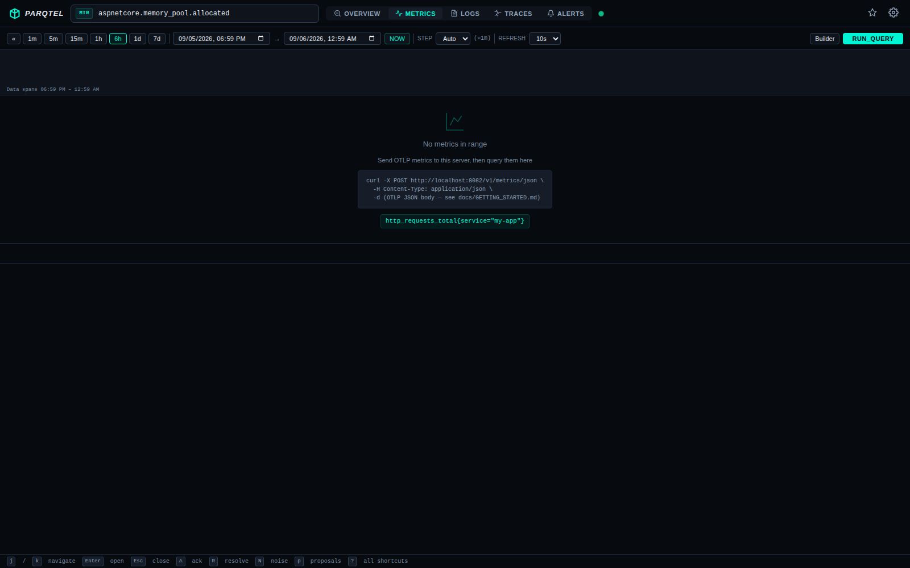
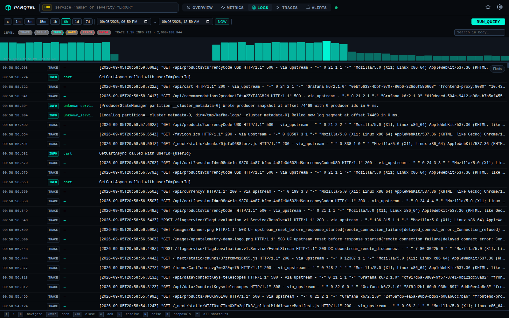
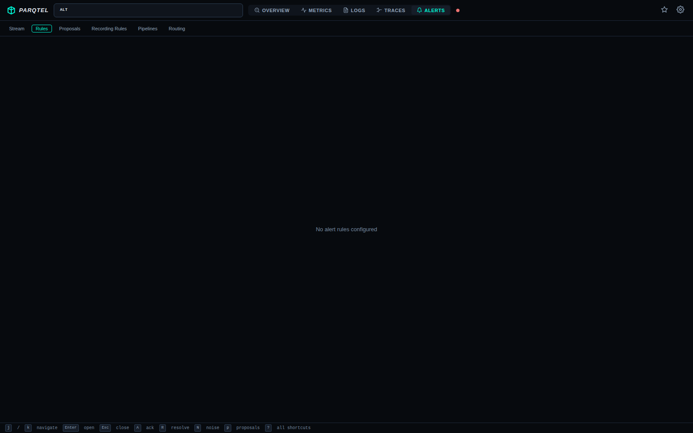

<p align="center">
  <h1 align="center">Parqtel</h1>
  <p align="center">Ultra-lightweight SRE observability engine — streaming OpenTelemetry metrics, logs, and traces into compressed Parquet</p>
</p>

<p align="center">
  <a href="https://github.com/parqtel/parqtel-oss/actions/workflows/ci.yml"></a>
  <a href="https://github.com/parqtel/parqtel-oss/releases"></a>
  <a href="https://github.com/parqtel/parqtel-oss/blob/main/LICENSE"></a>
  <a href="https://securityscorecards.dev/viewer/?uri=github.com/parqtel/parqtel-oss"></a>
  <a href="https://github.com/parqtel/parqtel-oss/pkgs/container/parqtel-oss"></a>
  <a href="https://parqtel.github.io"></a>
</p>

<p align="center">
  <a href="docs/getting-started/getting-started.md"><b>Getting Started</b></a> •
  <a href="docs/getting-started/tutorials.md">Tutorials</a> •
  <a href="CONTRIBUTING.md">Contributing</a> •
  <a href="#why-parqtel">Why Parqtel?</a> •
  <a href="#architecture--storage-design">Architecture</a> •
  <a href="#api-reference">API</a> •
  <a href="docs/guides/mcp.md">MCP</a> •
  <a href="docs/operations/deployment.md">Deployment</a> •
  <a href="docs/operations/troubleshooting.md">Troubleshooting</a>
</p>

<p align="center">
  
</p>

<details>
<summary><b>Explore all UI views (Metrics, Logs, Traces, Alerts)</b></summary>

<br>

| Metrics | Logs |
|---------|------|
|  |  |

| Traces | Alerts (live firing) |
|--------|----------------------|
|  |  |

| Alert rules |
|-------------|
|  |

The embedded console at `/ui` is a single file, gzipped, served with `gzip` +
`ETag` — no CDNs, no web fonts, no frameworks, so it works air-gapped. It
includes an Overview pane with live ingestion-rate cards, deep-linkable URLs, a
metrics query builder with a 92-function catalog and a Builder⇄Code toggle, log
field facets, a trace-grouped browse list with waterfall, an alert stream with an
Evidence tab, saved views, keyboard shortcuts (`?` for the reference), WCAG AA
contrast and reduced-motion support.

</details>

---

## Why Parqtel?

- **One ~15 MB static binary.** Scratch-based container image with no shell, no
  OS packages and no OpenSSL; Rust with `#[forbid(unsafe_code)]` workspace-wide.
  The web console ships inside the binary, so there is nothing else to deploy.
- **Columnar Parquet + Zstd on local disk.** Metric blocks carry a series table in
  the Parquet footer, so a selective query reads only the rows of the series it
  selects. Storage is **local-disk only** — the backend is a directory path
  (`storage.data_dir`), with no object-store or S3 driver.
- **Span-Metrics and tail sampling built in.** Server-kind spans automatically
  derive unsampled RED metrics (`traces_service_{requests,errors,duration_ms}_total`),
  and tail sampling is trace-coherent — no separate OTel Collector gateway needed.
- **Drop-in query surfaces and AI tooling.** Prometheus-compatible `/api/v1/*`,
  a Grafana SimpleJSON datasource, YAML log-to-metric pipelines, and an MCP server
  that lets an LLM agent query your telemetry directly.

## 60-Second Quick Start

No Rust toolchain needed — the [`docker run`](#docker) and
[Homebrew](#homebrew-linux--macos) paths install a published release
([v0.3.1](https://github.com/parqtel/parqtel-oss/releases) is the latest).
Building from source is in [CONTRIBUTING.md](CONTRIBUTING.md#3-building-and-running-from-source).

### Docker

```bash
docker run -d --name parqtel \
  -p 8080:8080 \
  -p 4317:4317 \
  -v parqtel_data:/var/lib/parqtel \
  ghcr.io/parqtel/parqtel-oss:0.3.1
```

- `8080` is the HTTP API and web console; `4317` is OTLP gRPC.
- The image runs as non-root **UID 65532** on a `scratch` base. The `parqtel_data`
  named volume is created by Docker and initially root-owned, so either
  `chown 65532` it once or pass `--user 65532:65532` with a pre-created volume.
  The image's own `/data` directory is already owned by 65532.

### Homebrew (Linux & macOS)

```bash
brew tap parqtel/tap
brew install parqtel-oss
parqtel serve          # http://localhost:8080/ui
```

The formula downloads the compiled release binary for linux-amd64/arm64 and
darwin-amd64/arm64 from GitHub releases. The tap is bumped automatically on each
release.

### Docker Compose (full stack)

```bash
make dev-setup         # copies .env.example → .env and starts everything
```

This starts Parqtel on **port `9090`**, Grafana on `3000`, Prometheus on `9091`
and a load generator, and publishes the Parqtel MCP server (`mcp-parqtel`) on `3007`.

> **Why two ports?** The single container and the bare binary use `8080`. The
> Compose stack uses `9090` (`deploy/compose/parqtel/config/dev.toml`) so it does
> not collide with Prometheus, which the stack publishes on `9091`. Use the URL
> that matches your install in the commands below.

### Verify

```bash
# 8080 for docker run / Homebrew, 9090 for Compose
curl http://localhost:8080/health

# Send a metric via OTLP JSON (stamp it "now" — instant queries look back 5 minutes)
TS=$(date +%s)000000000
curl -X POST http://localhost:8080/v1/metrics/json \
  -H "Content-Type: application/json" \
  -d '{"resourceMetrics":[{"resource":{"attributes":[{"key":"service.name","value":{"stringValue":"demo"}}]},"scopeMetrics":[{"metrics":[{"name":"http_requests_total","gauge":{"dataPoints":[{"asDouble":42,"timeUnixNano":"'$TS'","attributes":[{"key":"method","value":{"stringValue":"GET"}}]}]}}]}]}]}'

# Query it back through the Prometheus API
curl "http://localhost:8080/api/v1/query?query=http_requests_total"
```

The query returns the Prometheus envelope — the shape verified in
`handlers/query/metrics.rs`:

```json
{
  "status": "success",
  "data": {
    "resultType": "vector",
    "result": [
      {
        "metric": { "__name__": "http_requests_total", "method": "GET", "service.name": "demo" },
        "value": [1731000123.456, "42"],
        "values": [[1731000123.456, "42"]]
      }
    ],
    "totalSeriesCount": 1,
    "volumeSummary": []
  }
}
```

Open **http://localhost:8080/ui** for the console. Instant queries only look back
5 minutes (`query.lookback_delta_ns`); older points become visible through
`/api/v1/query_range` once a block is flushed. Full walkthrough:
[docs/getting-started/getting-started.md](docs/getting-started/getting-started.md).

---

## Architecture & Storage Design

**The telemetry flow** — OTLP in, Parquet down, three query surfaces up
(animated; [full diagram set](docs/development/diagrams.md)):



Parqtel uses a **block-based storage model** on the local filesystem:

- **Metric blocks**: 2-hour duration, up to 1M rows, Zstd by default
  (`storage.block_duration_secs = 7200`, `max_rows_per_block = 1_000_000`)
- **Log blocks**: shorter windows and smaller row caps, own config section
  (`logs.*`), also Zstd by default
- **Compaction**: every 5 minutes (`compaction_interval_secs = 300`); small
  blocks are merged and metric blocks rolled into 5-minute **L1** windows with a
  streaming merge
- **Retention**: configurable per signal (`storage.retention_days`, default 7)
- **Index**: `index.json` sidecar holding the block list and a shared
  label-value dictionary, written atomically (tmp + rename)
- **Series table**: metric blocks write series-by-series and record a series
  index in the Parquet footer, so a selective query reads only those rows

Each block is a self-contained Parquet file with row groups sized for pruning.

**Deep dive:** [Architecture](docs/development/architecture.md) •
[Diagrams](docs/development/diagrams.md) • [PQL Guide](docs/guides/pql-guide.md)

## Performance

Benchmarked with sustained 1000 samples/sec (metrics + logs + traces) for 15
minutes using [`scripts/bench/perf_test.py`](scripts/bench/perf_test.py):

| Metric | Result |
|--------|--------|
| **Sustained throughput** | 972 samples/sec (zero errors) |
| **Total ingested** | 875,100 samples in 15 min |
| **Ingest p50** | 4.4ms per batch |
| **Ingest p99** | 63ms per batch |
| **Query p50 (instant)** | 12.7ms |
| **Query p99 (range)** | 160ms |
| **Immediate queryability** | 1.7ms (in-memory buffer) |
| **Data durability** | Survives container restart |
| **Peak RSS memory** | `[TODO: measure RSS]` — not captured by this harness |
| **Compressed disk size** | `[TODO: measure disk]` — not captured by this harness |

The 15-minute harness records latency, throughput and errors only. Memory and
disk are measured separately: a higher-throughput end-to-end run (2.4M metric
points, 300K logs, 150K spans) measured **peak RSS 0.67 GB** on an M1 with 8 GB
RAM, alongside scan throughput of 101M points/s — see
[docs/performance/README.md](docs/performance/README.md) for the method and the
per-query numbers, including the cases where a measured optimisation was *not*
adopted.

RSS scales with the buffered row count, so `ingest.buffer_max_points` (5M) and
`ingest.buffer_max_bytes` (2 GiB estimated) bound it; under overload the oldest
buffered rows are evicted (`drop_oldest`, the default) or the batch is refused
(`reject_new`). Read
[Performance & Memory Sizing](docs/operations/performance-sizing.md) before
raising the rate.

## Query & Pipeline Example

Pipelines are plain YAML: match a signal, run stages, extract metrics. This
excerpt is from [`rules/pipelines/nginx-access-logs.yaml`](rules/pipelines/nginx-access-logs.yaml):

```yaml
pipelines:
  - name: nginx-access-logs
    match:
      signal: logs
      conditions:
        - field: service_name
          op: "="
          value: "nginx"
    stages:
      - type: processor
        processor: regex_extract
        source_field: body
        pattern: '(?P<status>\d+) (?P<bytes>\d+)'
        target_fields:
          http.status_code: status
      - type: metric_extract
        metric_name: nginx_requests_total
        metric_type: counter
        value_field: "constant:1"
        dimensions: [http.status_code, service_name]
```

Alert rules are YAML too — see
[`rules/http-error-rate.yaml`](rules/http-error-rate.yaml):

```yaml
id: http-error-rate-high
query: 'http_requests_total{status=~"5.."}'
condition:
  type: threshold
  operator: ">"
  value: 0.05
  for_duration_secs: 300
severity: warning
```

More: [PQL Guide](docs/guides/pql-guide.md) •
[Best Practices](docs/guides/best-practices.md)

---

## 🗺 Documentation Map

| Area | Guides |
|------|--------|
| **Onboarding** | [Getting Started](docs/getting-started/getting-started.md) • [Docs index](docs/README.md) • [Glossary](docs/development/glossary.md) • [FAQ](docs/getting-started/faq.md) |
| **Learning** | [Tutorials](docs/getting-started/tutorials.md) |
| **Querying** | [**PQL Guide**](docs/guides/pql-guide.md) — ParQL metrics, ParqtelQL log/trace search, cross-signal pipelines • [API Reference](docs/reference/api.md) |
| **Deep Dive** | [Architecture](docs/development/architecture.md) • [Diagrams](docs/development/diagrams.md) • [Configuration](docs/operations/configuration.md) • [Developer Guide](docs/development/developer-guide.md) • [MCP Integrations](docs/guides/mcp.md) • [Query Functions](docs/guides/query-functions.md) • [Performance](docs/performance/README.md) • [CI/CD](docs/development/ci-cd.md) |
| **Operations** | [Deployment](docs/operations/deployment.md) • [Known Issues](docs/operations/known-issues.md) • [Troubleshooting](docs/operations/troubleshooting.md) • [Best Practices](docs/guides/best-practices.md) • [Testing & Validation](docs/development/testing.md) |
| **Community** | [Contributing](CONTRIBUTING.md) • [Support](SUPPORT.md) • [Code of Conduct](CODE_OF_CONDUCT.md) • [Security](SECURITY.md) • [Changelog](CHANGELOG.md) |

## Features

| Category | Capabilities |
|----------|-------------|
| **Ingestion** | OTLP gRPC (`:4317`, the OTel SDK default) + HTTP protobuf & JSON for metrics, logs, and traces |
| **Storage** | Block-based Parquet with Zstd/Snappy/LZ4, automatic compaction, configurable retention |
| **Query** | PromQL-compatible instant & range queries, label matching, aggregations (sum, avg, rate, histogram_quantile, etc.) |
| **Alerting** | YAML-defined threshold rules, state machine (Inactive→Pending→Firing→Resolved), 15s evaluation loop, Alertmanager-style routing/inhibition/grouping, silences, Slack/Teams/PagerDuty/webhook receivers. Baseline anomaly rules use median+MAD over a configured window; noise scoring is **not implemented** |
| **Pipeline** | Recording rules and log→metric stream pipelines, applied on live ingest; extracted metrics enter the normal metrics path |
| **Span-metrics (RED)** | Auto-derived `traces_service_{requests,errors,duration_ms}_total` per service/operation from server spans — zero-config RED dashboards in Grafana |
| **Tail sampling** | Trace-coherent sampling (errors/slow traces always kept, deterministic ratio per service) — controls trace storage volume while RED metrics stay unsampled |
| **Visualization** | Built-in web UI, Grafana SimpleJSON datasource, Prometheus-compatible `/api/v1/*` |
| **MCP** | `parqtel-mcp-parqtel` server — exposes metrics, logs, alerts, ingest rates, and topology over Streamable HTTP (`/mcp`) |
| **Operations** | Health checks, `/metrics` endpoint, graceful shutdown, CLI subcommands |

## API Reference

The full endpoint list lives in [docs/reference/api.md](docs/reference/api.md),
and the machine-readable OpenAPI 3.0 description is served by any running
instance at **`/oas`** (source: [docs/api/openapi.yaml](docs/api/openapi.yaml)).

| Surface | Endpoints | Notes |
|---------|-----------|-------|
| **OTLP ingest** | `POST /v1/{metrics,logs,traces}` (protobuf), `POST /v1/{metrics,logs,traces}/json` | Plus OTLP gRPC on `:4317` |
| **Prometheus query** | `GET /api/v1/query`, `/api/v1/query_range`, `/api/v1/labels`, `/api/v1/label/:name/values` | Drop-in for Grafana's Prometheus datasource |
| **Logs & traces** | `GET /api/v1/logs`, `/v1/logs/{count,fields,field_values}`, `/v1/traces/search`, `/v1/correlate` | |
| **Grafana SimpleJSON** | `POST /search`, `/query`, `/annotations`, `/tag-keys`, `/tag-values` | |
| **Operations** | `/health`, `/ready`, `/metrics`, `/api/v1/stats`, `/ui`, `/oas` | |

## CLI Commands

```bash
parqtel serve              # Start the HTTP server (default)
parqtel compact            # Run one compaction pass and exit
parqtel inspect            # Print storage summary as JSON
parqtel export             # Export metric data to CSV
  --metric <name>
  --start <ISO8601>
  --end <ISO8601>
  --output <path>
```

### Environment Variables

Configuration is layered: built-in defaults → optional TOML file → environment
→ CLI flags (highest priority). The `PARQTEL_SECTION__KEY` and
`PARQTEL__SECTION__KEY` spellings are both accepted.

| Variable | Description | Default |
|----------|-------------|---------|
| `PARQTEL_CONFIG` | Path to TOML config file | none — `config/default.toml` is loaded only if present |
| `PARQTEL_BIND` | TCP bind address | `0.0.0.0:8080` |
| `PARQTEL__SERVER__GRPC_BIND_ADDRESS` | OTLP gRPC bind address (`""` disables) | `0.0.0.0:4317` |
| `PARQTEL__INGEST__TAIL_SAMPLING__SAMPLING_RATIO` | Fraction of traces kept after error/slow rules | `1.0` |
| `PARQTEL__INGEST__TAIL_SAMPLING__KEEP_ERRORS` | Keep traces containing ERROR spans | `true` |
| `PARQTEL_DATA_DIR` | Data directory | `data` |
| `RUST_LOG` | Log level | `info` |
| `PARQTEL__STORAGE__COMPRESSION` | Compression codec | `zstd` |
| `PARQTEL__STORAGE__RETENTION_DAYS` | Retention period (days) | `7` |
| `PARQTEL__INGEST__LABEL_INTERNER_CAPACITY` | Distinct label sets the interner holds | `1048576` |
| `PARQTEL__STORAGE__COMPACTION_INTERVAL_SECS` | Interval between compaction passes | `300` |

Full reference: [docs/operations/configuration.md](docs/operations/configuration.md).

## MCP Integration

Parqtel ships with **`parqtel-mcp-parqtel`** (port `3007` in Compose), a Model
Context Protocol server that lets LLM agents query your metrics, logs, alerts,
ingestion rates, and observed service topology over Streamable HTTP (`/mcp`).

See [docs/guides/mcp.md](docs/guides/mcp.md) for connection setup and tool
schemas.

---

## ⚠️ Before You Deploy

Parqtel is in **public beta**. Three things bite in production:

1. **Authentication is optional and off by default.** `[auth]` provides
   scoped HTTP bearer tokens (`read`/`write`/`admin`), but the OTLP gRPC listener
   has no token layer and auth is disabled unless configured. Do not expose
   `8080` or `4317` without auth plus a TLS terminator or a network boundary.
2. **The in-memory buffer is bounded and can drop pre-flush rows.** Points stay
   buffered until a block is flushed. `ingest.buffer_max_points` (5M) and
   `buffer_max_bytes` (2 GiB estimated) cap it; `drop_oldest` evicts the oldest
   buffered rows and `reject_new` refuses new batches. The writer and WAL keep
   the acknowledged rows, so this affects the pre-flush query window, not
   durability. Tune with
   [Performance & Memory Sizing](docs/operations/performance-sizing.md).
3. **Instant queries see only the last 5 minutes.** Data older than
   `query.lookback_delta_ns` is answered by `/api/v1/query_range` after the
   block flush, not by `/api/v1/query`.

See [Known Issues](docs/operations/known-issues.md) for the full list.

## Deployment

| Method | Guide |
|--------|-------|
| Docker | Single container with volume mount |
| Docker Compose | Full stack (Parqtel + Grafana + Prometheus + MCP) — `make dev-setup` |
| Kubernetes (Helm) | Production-grade with HPA, PDB, NetworkPolicy — chart at `deploy/helm/parqtel/`, image `ghcr.io/parqtel/parqtel-oss` |
| systemd | Bare-metal Linux service — unit at `deploy/systemd/parqtel.service` |

See [docs/operations/deployment.md](docs/operations/deployment.md) for details.

## Development

Contributor workflow, `make` targets, benchmark harnesses and the compiler/clippy
conventions are in [CONTRIBUTING.md](CONTRIBUTING.md) and the
[Developer Guide](docs/development/developer-guide.md). The short version:

```bash
make test      # cargo test --workspace
make lint      # cargo fmt --check && cargo clippy --workspace -- -D warnings
make dev-setup # first-time local stack (copies .env, starts Compose)
```

Conventions: `unsafe` is forbidden workspace-wide, `unwrap`/`expect`/`panic` are
denied by clippy, `thiserror` for library errors and `anyhow` at the binary
level, Tokio for async. MSRV is **1.88**.

## License

Apache License 2.0 — see [LICENSE](LICENSE).

## Contributing

Contributions are welcome. Please read [CONTRIBUTING.md](CONTRIBUTING.md) and
[CODE_OF_CONDUCT.md](CODE_OF_CONDUCT.md) first.

Performance changes need a measurement — the number, the command that produced
it, and the dataset. See
[CONTRIBUTING.md](CONTRIBUTING.md#performance-changes) and
[docs/performance/README.md](docs/performance/README.md).
