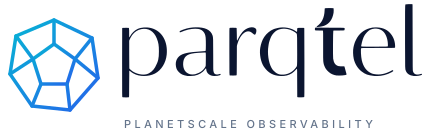
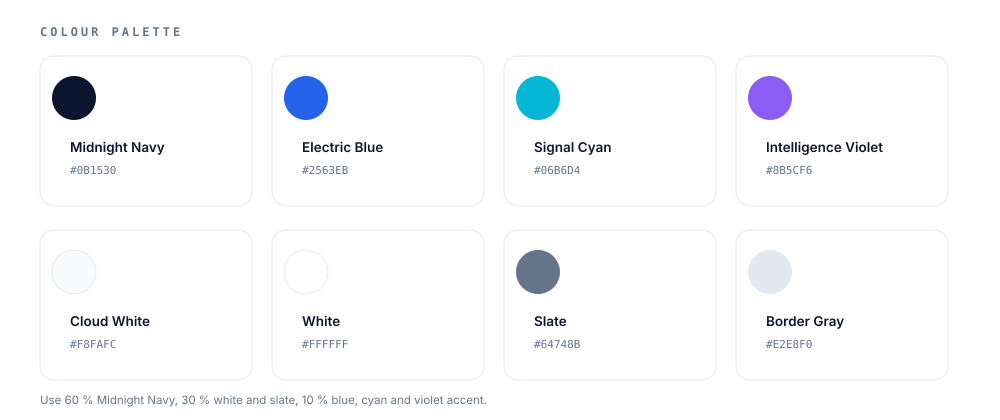

# Brand identity

Parqtel presents one product with one voice: **Planetscale observability** —
telemetry compressed into Parquet, queryable from a single binary. The identity
is dark, technical and restrained. Colour and motion point at the telemetry
path; they never decorate it.

## Brand at a glance

| Element | Value |
|---|---|
| Product name | Parqtel (capital P in prose) |
| Wordmark | `parqtel`, always lowercase, set in Playfair Display and shipped as outlined paths |
| Category line | PLANETSCALE OBSERVABILITY |
| Tagline | One platform. Complete visibility. Built for what's next. |
| Short descriptor | Ultra-lightweight observability. Parquet-native. |
| Proof points | 25× cheaper storage · <20 MB binary footprint · AI-native incident response · Open Source · Enterprise Ready |
| Licence line | Apache-2.0 |

The tagline is two sentences plus a turn: state the platform, state the
outcome, then point at the future. Keep "what's next." in Signal Cyan whenever
the surface allows colour.

## Logo system

| Primary (light surfaces) | Reverse (dark surfaces) | Icon |
|---|---|---|
|  |  |  |

| Asset | File | Use |
|---|---|---|
| Primary lockup | [`parqtel-logo-primary.svg`](../assets/brand/parqtel-logo-primary.svg) | Documentation, white papers, light backgrounds |
| Reverse lockup | [`parqtel-logo-reverse.svg`](../assets/brand/parqtel-logo-reverse.svg) | Midnight Navy banners, dark slides, README hero |
| Icon | [`parqtel-icon.svg`](../assets/brand/parqtel-icon.svg) | Favicons, compact navigation, diagrams |
| App icon | [`parqtel-app-icon.svg`](../assets/brand/parqtel-app-icon.svg) | Rounded-square contexts, store listings |

**Clear space.** Keep at least the height of the inner hexagon (about 12 % of
the lockup width) free on every side. Nothing crosses the sphere.

**Minimum size.** Primary and reverse lockups: 160 px wide. Icon: 24 px. Below
that, use the app icon or drop the mark and set the name in Inter.

**Do not:**

- recolour the sphere gradient, rotate the mark, or add shadows and outlines;
- set the navy wordmark on Midnight Navy — use the reverse lockup;
- stretch, crop, or rebuild the wordmark from a font;
- put the lockup on a busy photograph without a solid navy plate behind it;
- translate the wordmark. "parqtel" stays lowercase in every language.

## Colour palette

| Token | Hex | Role |
|---|---|---|
| Midnight Navy | `#0B1530` | Canvas for heroes and dark panels; primary text on light surfaces |
| Electric Blue | `#2563EB` | Primary action, links, second stop of the logo gradient |
| Signal Cyan | `#06B6D4` | Brand accent, active state, the tagline's "what's next."; first stop of the logo gradient |
| Intelligence Violet | `#8B5CF6` | AI and intelligence surfaces; MCP, anomaly detection, incident response |
| Cloud White | `#F8FAFC` | Page background, reverse wordmark |
| White | `#FFFFFF` | Cards and raised surfaces |
| Slate | `#64748B` | Secondary text, captions, the category line |
| Border Gray | `#E2E8F0` | Hairlines, dividers, card borders |

**Balance.** Aim for roughly 60 % Midnight Navy or Cloud White, 30 % white and
Slate structure, 10 % Electric Blue, Signal Cyan and Intelligence Violet
combined. Accents mark the telemetry path, not the page frame.

**Contrast.** Midnight Navy and Slate pass AA for body text on white; Electric
Blue passes for links. Signal Cyan reaches only about 2.4:1 on white and
Intelligence Violet about 4.2:1 — use both for graphics, large headings and
labels at 18 px or more, never for small body copy. On Midnight Navy, Cloud
White and Signal Cyan both pass comfortably.

## Typography

| Face | Role | Fallback |
|---|---|---|
| Playfair Display | Wordmark, headlines, large numerals | Georgia, "Times New Roman", serif |
| Inter | UI, body text, tables, diagrams | system-ui, -apple-system, "Segoe UI", sans-serif |
| JetBrains Mono | Code, commands, hex values, technical kickers | ui-monospace, SFMono-Regular, Menlo, monospace |

The wordmark is outlined, so products and diagrams do not need Playfair
Display installed. Body copy is sentence case and left-aligned; kickers such as
COLOUR PALETTE are uppercase JetBrains Mono with wide tracking.

Suggested scale: 40–56 px display, 24–32 px section heading, 16 px body,
14 px captions, 13 px code.

## Voice

- Lead with the mechanism: Parquet blocks, the WAL, the query engine, one binary.
- Quantify claims. A number ships with the command and dataset that produced it.
- Short declarative sentences. No superlatives, no exclamation marks, no
  "revolutionary".
- Say "Parquet-native", "single binary", "Planetscale observability". Do not
  call Parquet a verb.
- Security statements are literal. Name the gap, for example that OTLP gRPC has
  no token layer.

## Hero section

The README hero is the brand banner: Midnight Navy field, geodesic mark,
wordmark, category line, tagline and the four proof points.

| Slot | Copy |
|---|---|
| Category | PLANETSCALE OBSERVABILITY |
| Headline, line 1 | One platform. Complete visibility. |
| Headline, line 2 | Built for **what's next.** (accent) |
| Subline | OpenTelemetry metrics, logs and traces · Apache Parquet |
| Proof 1 | **25×** — Cheaper Storage |
| Proof 2 | **<20 MB** — Binary Footprint |
| Proof 3 | **AI-Native** — Incident Response |
| Proof 4 | Open Source • Enterprise Ready |

Rules for the hero: one banner per page, never stack the logo lockup above it,
keep the four proof points on one line, and keep the reduced-motion fallback
legible. The SVG carries its own `<title>` and `<desc>`; reuse that text for the
image alt attribute.

## Motion

Motion is a pulse, not a loop of novelty. Animate opacity and transform only,
hold cycles at eight seconds or longer, and stop everything under
`prefers-reduced-motion: reduce`. Diagrams follow the
[diagram contract](../development/diagrams.md); the hero follows the same
rules.

## Accessibility

- Alt text names the product and the message, not the file. Example: "Parqtel
  logo — Planetscale observability".
- Decorative repeats inside diagrams are hidden from assistive technology by
  the SVG's own title and description.
- Never rely on colour alone: pair Signal Cyan with a label, and Intelligence
  Violet with the AI-Native wording.
- Keep the tagline's line break at "Built for / what's next." so screen readers
  hear one sentence per line.

## Asset index

| File | View box | Notes |
|---|---|---|
| [`parqtel-logo-primary.svg`](../assets/brand/parqtel-logo-primary.svg) | 440 × 134 | Navy wordmark for light surfaces |
| [`parqtel-logo-reverse.svg`](../assets/brand/parqtel-logo-reverse.svg) | 440 × 134 | White wordmark for dark surfaces |
| [`parqtel-icon.svg`](../assets/brand/parqtel-icon.svg) | 100 × 100 | Transparent background |
| [`parqtel-app-icon.svg`](../assets/brand/parqtel-app-icon.svg) | 512 × 512 | Midnight Navy rounded square |
| [`palette.svg`](../assets/brand/palette.svg) | 1000 × 420 | Colour tokens with hex values |
| [`parqtel-hero.svg`](../assets/brand/parqtel-hero.svg) | 1200 × 420 | README and landing-page banner |

All assets are self-contained SVG: no external fonts, no scripts, no network
requests.
