# Architecture

Parqtel is a single Rust binary that ingests OpenTelemetry metrics, logs and
traces, stores them as compressed Parquet blocks, and serves metrics queries,
log/trace search, pipelines, alerting, a web console and MCP access. This
document describes the runtime components, the write and read paths, the
storage contract, and the boundaries that keep the system predictable.

> **Visuals.** Every diagram below is a self-contained, animated SVG. There is
> no JavaScript, no external asset, and no Mermaid rendering in the reading
> path. Motion stops under `prefers-reduced-motion: reduce`; the still image is
> fully legible. Sources and the motion contract are listed in
> [Diagrams](diagrams.md).

## High-level runtime


Parqtel has one process-wide storage engine and three query surfaces. Data is
acknowledged only after it is represented in the WAL (when enabled) or durable
in a block. The memory buffer exists for immediate queryability and is bounded
by rows and bytes; it is not the durable copy.

## 1. System context


**In scope:** metrics, logs, traces, search, dashboards, alerting, recording
rules, stream pipelines and an embedded console.

**Out of scope:** general-purpose SQL, a distributed consensus layer, and
cross-process multi-dataset serving. One process owns one dataset; independent
datasets run as separate processes with distinct data roots.

**External services:** optional S3-compatible object storage for block objects
and the shared catalog, and optional OTLP export of Parqtel's own traces/SLI
metrics. Neither is required for a local deployment.

## 2. Crate dependency graph


```text
crates/
├── parqtel-core/        models, storage engine, block index, scanner,
│                        compaction, WAL, configuration (no workspace deps)
├── parqtel-ingest/      OTLP decoding, block rotation, crash-safe Parquet writes
├── parqtel-query/       ParQL / ParqtelQL execution, label matching, aggregation
├── parqtel-alert/       alert rules, state machine, routing, receivers, presets
├── parqtel-pipeline/    recording rules, stream processing, expression evaluation
├── parqtel-server/      Axum HTTP + gRPC server, handlers, embedded web console
├── parqtel-mcp-core/    shared MCP framework (JSON-RPC, rate limiting, tools)
└── parqtel-mcp-parqtel/ MCP server querying Parqtel over HTTP
```

The invariant that keeps the graph acyclic: **`parqtel-core` depends on no
other workspace crate**. Signal crates depend on core; the server composes
them. MCP servers are separate processes and never link the engine.

## 3. Runtime components

| Component | Responsibility |
|---|---|
| HTTP server | Axum routes for ingest, query, alerts, dashboards, saved searches, UI and operations |
| OTLP gRPC server | tonic collector services on `:4317` for metrics, logs and traces |
| Ingest services | Decode, limits, live log pipelines, RED derivation, tail sampling, buffer/WAL |
| Query executor | ParQL, ParqtelQL, PQL pipelines, correlated scans, per-service stats |
| Alert engine | Rule registry, evaluation loop, state machine, history-derived noise score |
| Router/dispatcher | Alertmanager-compatible route tree, grouping, inhibition, silences, receivers |
| Scheduler | Flush tick, compaction, retention, recording rules, catalog publish/poll |
| Block store | Local files or S3-backed reads with a bounded LRU cache |
| Console | Single-file embedded `/ui`; no CDNs, fonts or external requests |

Large modules are directories with a `mod.rs` that documents the split and
re-exports the public API, so callers import from the parent module.

| Crate | Module | Contents |
|-------|--------|----------|
| `parqtel-core` | `storage/scanner/` | Block scans: reading, predicate/series pruning, metrics, logs and traces |
| | `storage/index.rs`, `series_index.rs`, `log_index.rs` | Block index, series table, log skip index |
| | `storage/` | Writer, compactor, streaming L0→L1 compactor, retention, sidecars |
| | `storage/block_store.rs`, `object_catalog.rs` | Block I/O seam, S3 cache, versioned shared catalog |
| | `wal.rs`, `buffer.rs` | Write-ahead log and bounded queryable tail |
| | `models/storage/schema.rs` | Canonical Parquet schemas |
| `parqtel-ingest` | `service/` | Rotation, flush ordering and per-signal ingest services |
| | `decode/` | OTLP protobuf/JSON and generic JSON decoding |
| | `span_metrics.rs`, `tail_sampling.rs` | RED derivation and trace sampling |
| `parqtel-query` | `parser.rs`, `ast.rs`, `eval/` | PromQL-compatible parser, AST and evaluation |
| | `logql/` | ParqtelQL tokenizer, parser, prepared predicates |
| | `executor/` | Query executor split by signal |
| `parqtel-alert` | `rule/`, `dispatcher/`, `notifier/` | Rules, routing, grouping, inhibition, retries and receivers |
| `parqtel-server` | `main.rs`, `tasks.rs`, `recovery.rs` | Startup, background tasks, WAL replay and reconciliation |
| | `router.rs`, `handlers/`, `grpc.rs`, `auth.rs` | Routes, handlers, gRPC, scoped auth and OIDC |

## 4. Ingestion

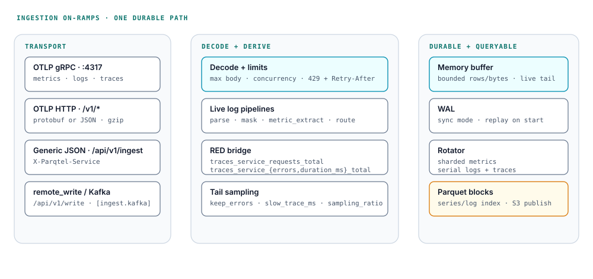

### Transports

| On-ramp | Endpoint | Notes |
|---|---|---|
| OTLP gRPC | `:4317` | OTel SDK default; all three collector services |
| OTLP HTTP | `/v1/{metrics,logs,traces}` | Protobuf or JSON by `Content-Type`; gzip accepted |
| OTLP JSON | `/v1/{metrics,logs,traces}/json` | JSON-only aliases |
| Generic JSON logs | `POST /api/v1/ingest` | Object or array; service from `X-Parqtel-Service` |
| Prometheus remote_write | `POST /api/v1/write` | Snappy-compressed protobuf; samples become gauge points |
| Kafka | `[ingest.kafka]` | JSON messages through the same decoder and WAL path |

Bodies are size-limited before decode. The HTTP ingest path has a concurrency
limit and returns `429` + `Retry-After` when saturated; gRPC has its own
per-connection limit. Query timeouts do not apply to ingest.

### Decode and derive

1. OTLP payloads become internal `Metric`, `LogRecord` and `Span` models.
2. Generic JSON maps timestamp/body/severity fields (`ingest.json_*_field`) and
   turns remaining keys into attributes.
3. Live log pipelines run first-match-wins. Stages are `preprocessor`,
   `processor` (regex extract, add fields, cast), `metric_extract`, `masker`
   and `router` (drop/route). Extracted metrics re-enter the metrics path;
   surviving logs continue through the normal WAL/buffer path.
4. Server spans derive RED metrics before sampling:
   `traces_service_{requests,errors,duration_ms}_total`.
5. Tail sampling decides per trace: keep errors, keep slow traces, then keep a
   deterministic fraction of the rest. RED rates stay exact because derivation
   happens first.

### Sequence


### Durability order

The order below is the crash-safety contract:

1. Decode and push rows into the memory buffer.
2. Frame and write WAL records for the block (metrics/logs WALs are on by
   default; traces use the shared ingest path).
3. Take the WAL commit position while every writer shard is locked.
4. Encode and rename the Parquet block on the blocking pool.
5. Publish `BlockMetadata` to the index; persist the sidecar for a durable
   flush.
6. Drain exactly the sealed rows from the buffer.

Rules that make this sound:

- **Never drain before the block is durable.** Rows would be in neither the
  buffer nor a block.
- **Acknowledge only after the sidecar is written** for a durable flush.
- **Replay is idempotent.** Each block records the WAL span it covers; startup
  advances the commit point along the chain of blocks before replaying.
- **Pipelines do not replay derivation.** WAL replay skips pipeline derivation,
  so a crash cannot duplicate derived metrics.

## 5. Query path

Parqtel ships three query surfaces over one storage engine:

| Surface | Signal | Endpoint | Language |
|---|---|---|---|
| ParQL | metrics | `/api/v1/query`, `/api/v1/query_range` | PromQL-compatible |
| ParqtelQL | logs, traces | `/api/v1/logs`, `/v1/traces/search` | fielded boolean search |
| PQL pipelines | all three | `POST /v1/search` | `fetch │ filter │ parse │ stats │ correlate` |


### Pruning ladder


1. **Block index** filters by time range and metric name. A reconciled block
   with an empty name set means "unknown", not "matches nothing".
2. **Series table** in the metric footer maps label name → value → series ids
   and row ranges. It narrows candidates; the full matcher still judges every
   candidate, so a missing table falls back to a plain scan with identical
   results.
3. **Row-group and page pruning** use timestamp statistics and the page index.
   Blocks without a page index fall back to row-group statistics.
4. **Column projection** reads only the columns a scan needs. Metric scans read
   timestamps and values; labels come from the series table. Log searches read
   timestamp, severity and body first, then materialise the remaining columns
   for selected rows. Trace searches do the same for attributes, events and
   links.
5. **Evaluation** runs on the blocking pool, folding each step into the result
   instead of holding every step's vector.

Log search additionally uses the per-block skip index (`parqtel.log_index`):
per 4,096-row granule it stores time bounds, the highest severity, and a bloom
filter over body three-byte windows and attribute `name=value` pairs. A granule
is skipped only when it provably cannot match.

### Semantics

- Instant selectors use `query.lookback_delta_ns` (default 5 minutes).
- Range steps are evaluated from `start` while `ts < end`, matching Prometheus;
  the final partial step is not evaluated.
- Trace predicates are pushed into the scan before result caps are applied.
- The memory buffer is merged with block results; drained rows never
  double-count.
- Alert evaluation reserves its own scan slot, so dashboard load cannot starve
  the alert loop.

## 6. Storage


### On-disk layout


```text
data/
├── m_l0_*.parquet        metric ingest blocks
├── m_l1_*.parquet        coalesced five-minute metric windows
├── index.json            metric block index (zstd PQZ1 sidecar)
├── label_values.json     bounded autocomplete dictionary
├── logs/
│   ├── *.parquet         log blocks
│   └── index.json
├── traces/
│   ├── traces_*.parquet  trace blocks
│   └── index.json
└── wal/
    ├── metrics/          metric WAL segments
    ├── logs/             log WAL segments
    └── traces/           trace WAL segments (gated by ingest.wal_enabled)
```

Trace blocks live under `<data_dir>/traces`; this is required for restart
reconciliation to keep trace index entries.

### Parquet schemas

Schemas live in `crates/parqtel-core/src/models/storage/schema.rs` and are
written with the Arrow/Parquet 60 stack (PARQUET_2_0, configured codec).

- **Metrics (14 columns):** `timestamp_ns`, `metric_name`, `metric_kind`, seven
  dedicated correlation columns (`service_name`, `service_version`,
  `k8s_namespace`, `k8s_pod_name`, `k8s_pod_uid`, `k8s_container_name`,
  `k8s_node_name`), `resource_attributes`, and three value columns
  (`value_float`, `value_int`, `value_complex`). New indexed blocks omit the
  repeated per-row `labels` column; labels live in the footer series table.
  Legacy blocks remain readable.
- **Logs (19 columns):** timestamps, severity, body, trace/span ids, flags,
  scope, attributes, resource attributes and the correlation columns.
- **Traces (25 columns):** span and parent ids, name, kind, correlation
  columns, status, start/end/duration, flags, trace state, events, links and
  attributes.

Rows in a metric block are series-ordered: each series occupies a contiguous
row range and the footer table records its labels, rows and time bounds. This
makes the series table an inverted index and keeps a series' labels out of
every row.

### Metrics levels and compaction

| Prefix | Meaning |
|---|---|
| `m_l0_` | One ingest flush, series-sorted by query-visible labels |
| `m_n_` | A legacy block normalised into the same order |
| `m_l1_` | A coalesced five-minute window |

The leveled compactor validates source WAL ranges, performs a streaming k-way
merge one Arrow batch at a time, and records source files under
`parqtel.compacted_sources`. Sources are deleted after a five-minute grace
period so an in-flight query can still read them. The pass is bounded (8
sources, 2 groups, 16M rows) and reserves scan capacity instead of monopolising
the disk.

Logs use a separate compaction policy: small adjacent blocks are merged, and
older blocks are merged within a six-hour tier.

### Object storage and the shared catalog

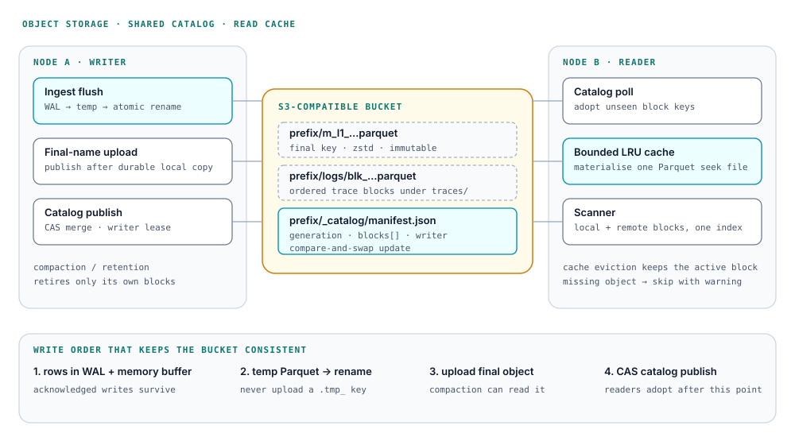

`[object_store]` uploads a block **after** its local temp file has been renamed
to the final Parquet name. The bucket key is the block filename under the
configured prefix. The catalog lives at
`<prefix>/_catalog/manifest.json` and is updated with compare-and-swap; a
writer retires only blocks it wrote. Readers poll the catalog, adopt unseen
keys, and materialise a cache file for Parquet seeks. The cache is LRU-bounded
by `object_store.cache_bytes` and never evicts the block it is opening.

Object storage is optional. Local disk remains the WAL staging area and the
default backend. See the [object-storage guide](../operations/object-storage.md)
for deployment and failure behaviour.

## 7. Security and tenant boundary

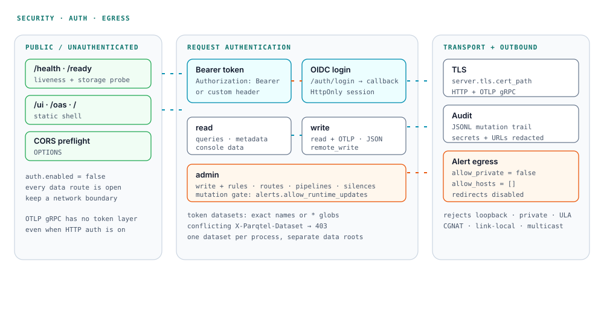

- Auth is **optional and off by default**. When enabled, static tokens and/or
  OIDC protect every route except health, readiness, the static console shell,
  `/oas`, `/` and CORS preflight.
- Scopes are cumulative: `read < write < admin`. Ingest requires `write`;
  mutations require `admin`. The OTLP gRPC listener has no token layer even when
  HTTP auth is enabled — put it behind a proxy or mesh.
- `server.dataset` is the tenant key. A non-default value prefixes storage
  paths; token `datasets` accept exact names or `*` globs; a conflicting
  `X-Parqtel-Dataset` header is rejected with 403.
- TLS is in-process (`server.tls`) and covers HTTP and OTLP gRPC. There is no
  hot reload.
- Configuration mutations append JSONL audit records with secrets redacted.
- Alert delivery is checked against an egress policy immediately before the
  POST. The default rejects loopback, private, link-local, CGNAT, ULA,
  multicast and reserved addresses and disables redirects.

See [Security](../operations/security.md) for the full model.

## 8. Alert path


1. Rules load from `alerts.rules_dir` and embedded presets. A file or API rule
   with the same id always overrides a built-in.
2. The evaluation loop runs every `server.alert_interval_secs` and uses a
   dedicated scan slot; it skips a cycle rather than waiting behind dashboards.
3. Threshold rules evaluate the last sample of every result series. Learned
   anomaly rules compute a median + MAD baseline and require at least five
   samples.
4. The state machine is `Inactive → Pending → Firing → Resolved`, with
   acknowledged, suppressed and noise-flagged states. Transition history is
   persisted. Each firing captures a bounded evidence snapshot (query, window,
   points) and deterministic analysis. `noise_score` comes from the recent
   firing window and suppresses delivery after repeated unacknowledged clears.
5. When `[alerting.routing]` is configured, firing and resolved alerts go
   through the hierarchical route tree, grouping, inhibition and silences, then
   to native Slack, PagerDuty, Teams or webhook receivers. The legacy
   `[alerts.notifications.routes]` table is a fallback only.

## 9. Configuration

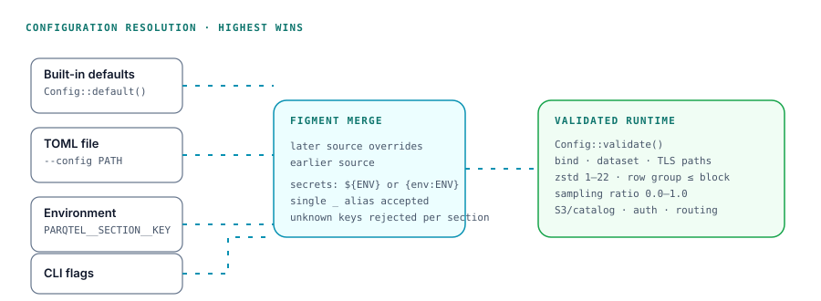

Configuration priority, highest wins:

1. CLI flags (`--config`, `--bind`, `--data-dir`, `--log-level`)
2. Environment variables (`PARQTEL__SECTION__KEY`)
3. TOML file (`--config` / `PARQTEL_CONFIG`, or `config/default.toml` if present)
4. Built-in defaults

`Config::validate()` runs at startup. Sections map 1:1 to
`crates/parqtel-core/src/config/`: `server`, `storage`, `logs`, `ingest`,
`object_store`, `auth`, `audit`, `query`, `ui`, `telemetry`, `k8s_provider`,
`alerts`, `alerting`.

## 10. Concurrency and admission control


- Tokio async workers serve HTTP/gRPC and background ticks.
- Parquet encode/compress/IO, scans, OTLP decode and evaluation run on the
  blocking pool with a permit acquired before spawning.
- The metrics rotator has per-shard locks (`ingest.rotator_shards`, default 4);
  log and trace services use one lock each.
- One process-wide scan budget (4 slots) gates block scans. Low-priority work
  reserves without waiting and skips its cycle when none is free.
- The memory buffer is drained by durability, not by scheduling.
- The label interner shares one label set per series; capacity should be at
  least twice the active series count.
- jemalloc is the global allocator on non-MSVC targets, returning freed block
  encode memory to the OS.

## 11. Pipeline path

1. Recording rules and pipeline definitions are loaded from YAML and validated.
2. `RulerScheduler` evaluates recording groups on their interval against the
   query executor and writes results through the metrics ingest path.
3. Live log pipelines apply their stages on ingest; extracted metrics go
   through a bounded channel to the metrics service.
4. Invalid definitions are rejected before storage with `400` and the failing
   stage or rule name.

## 12. Console and MCP

The console at `/ui` is a single-file vanilla-JS app embedded with
`include_str!`, pre-gzipped at startup with an ETag. It has no CDN or external
font dependency. It provides deep-linkable state, a function-aware query
builder, log facets, trace waterfall, alert evidence and rule editing.

`parqtel-mcp-parqtel` is a separate process built on `parqtel-mcp-core`. It
speaks Streamable HTTP (`/mcp`) and translates tool calls into Parqtel HTTP
queries. It is not in the ingest path and does not link the storage engine.

## 13. Error handling and lint policy

- Library crates use `thiserror` typed errors; the binary uses `anyhow`.
- `unsafe_code` is forbidden at workspace level.
- `unwrap`, `expect` and `panic` are denied by clippy.
- The server reports panics as 500s rather than aborting; release builds use
  unwinding.

## 14. Compatibility boundaries

| Change | Effect | Upgrade rule |
|---|---|---|
| Arrow2 → Arrow 60 | Old Parquet encoding is unreadable by the current reader | Wipe the data directory or accept skipped blocks with scan warnings |
| Label-less indexed metric blocks | Labels live only in the footer series table | Forward-compatible; older binaries cannot read them |
| Compressed `index.json` (`PQZ1`) | Plain JSON sidecars still load | Forward-compatible; older binaries cannot read the compressed shape |
| Sibling `label_values.json` | Autocomplete values moved out of `index.json` | Forward-compatible; older binaries ignore the sibling |
| Trace blocks under `data/traces/` | Restart reconciliation keeps trace index entries | Required; blocks left beside metric blocks are not reconciled |

Roll back only after superseded L0 sources have been removed and trace blocks
have been moved back with their index.
