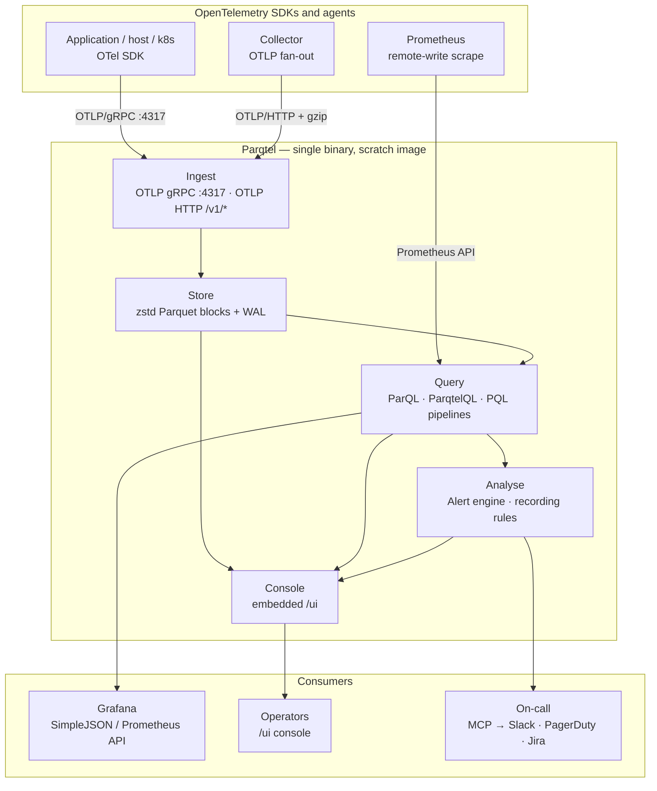
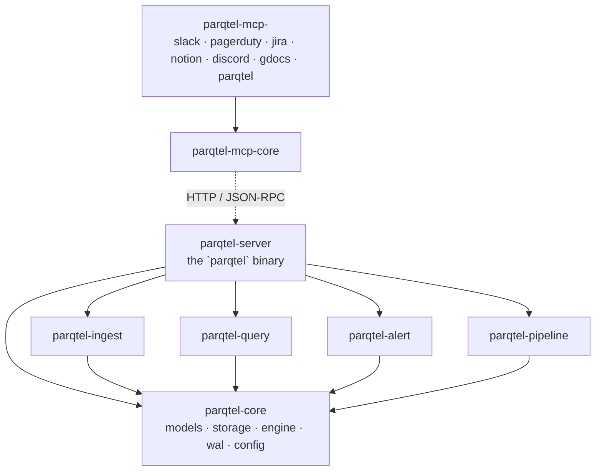
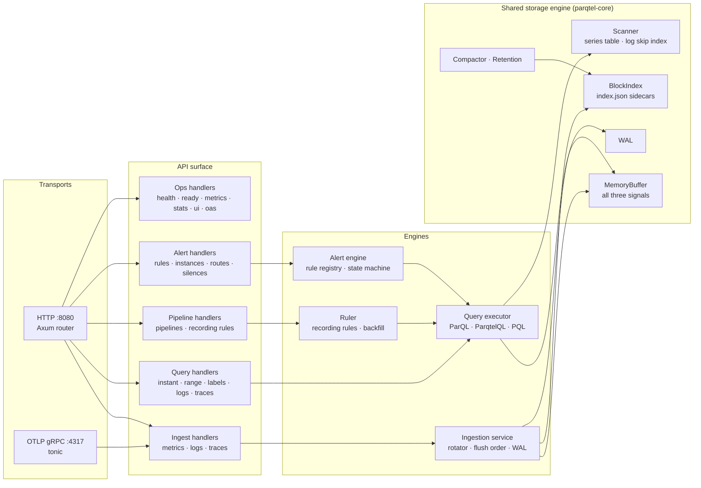
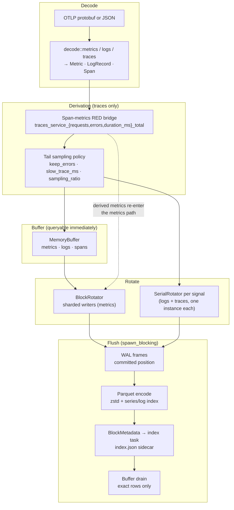
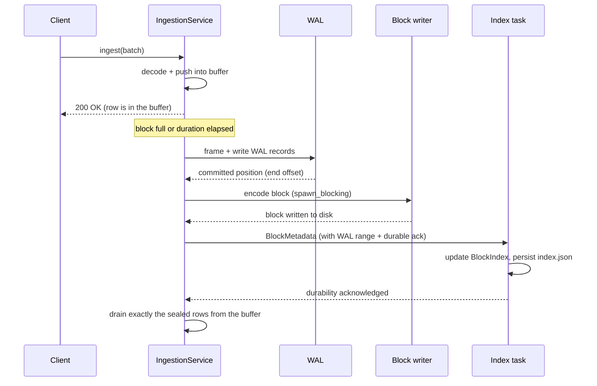
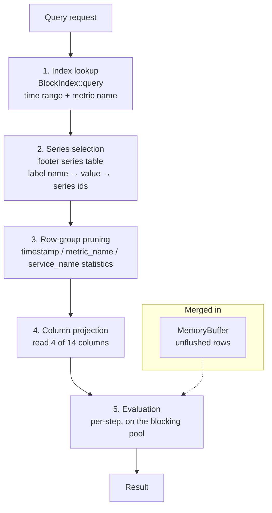
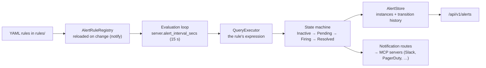
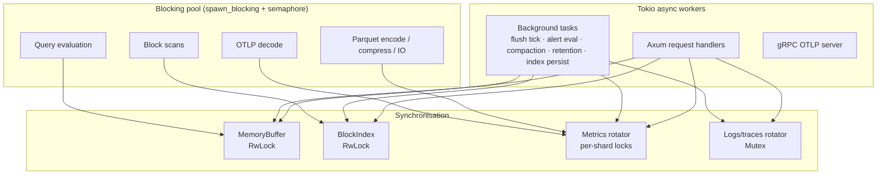

# Architecture

This document describes the internal architecture of Parqtel: its crate
boundaries, the data flow from OTLP to Parquet, the query path, and the design
decisions behind them.

> **Diagrams.** [Diagrams](diagrams.md) holds the visual version of everything
> below — system context, crate graph, ingest and query paths, block lifecycle,
> storage layout and admission control — as Mermaid diagrams.

## High-Level Overview

Parqtel is a Rust workspace organized into focused crates that communicate through well-defined interfaces. The system follows a pipeline architecture: data enters through OTLP endpoints, flows through ingestion and optional pipeline processing, and lands in compressed Parquet blocks on the filesystem.



**Data durability.** Everything a block contains is written to the WAL before the
block is acknowledged. A crash between "rows accepted" and "block written" is
recovered by replaying the WAL, so an acknowledged write is never lost. See
[Durability](../performance/durability.md).

## Diagram index

| # | Diagram | Section |
|---|---------|---------|
| 1 | System context — where Parqtel sits | [System context](#1-system-context) |
| 2 | Crate dependency graph | [Crates](#2-crate-dependency-graph) |
| 3 | Runtime components inside the `parqtel` binary | [Runtime components](#3-runtime-components) |
| 4 | Ingestion path, end to end | [Ingestion path](#4-ingestion-path) |
| 5 | Query path and its three pruning stages | [Query path](#5-query-path) |
| 6 | Block lifecycle on disk | [Storage engine](#6-storage-engine) |
| 7 | Concurrency model | [Concurrency model](#10-concurrency-model) |
| 8 | Alert evaluation loop | [Alert path](#8-alert-path) |

---

## 1. System context

Parqtel sits between OpenTelemetry SDKs and a query/alerting surface. It is a
**metrics, logs and traces store with an SRE console and alerting** — not a
general-purpose log aggregator, and not a metrics warehouse replacement.


**Data durability.** Everything a block contains is written to the WAL before the
block is acknowledged. A crash between "rows accepted" and "block written" is
recovered by replaying the WAL, so an acknowledged write is never lost. See
[Durability](../performance/durability.md).

---

## 2. Crate dependency graph

The workspace lives under `crates/`, one directory per concern. Every signal
crate depends only on `parqtel-core`; `parqtel-mcp-parqtel` depends only on
`parqtel-mcp-core`.



```
crates/
├── parqtel-core/        data models, storage engine, block index, scanner,
│                        compaction, WAL, config           (no workspace deps)
├── parqtel-ingest/      OTLP decoding, block rotation, crash-safe Parquet writes
├── parqtel-query/       PromQL / LogQL execution, label matching, aggregation
├── parqtel-alert/       alert rules, evaluation, state machine, preset packs
├── parqtel-pipeline/    recording rules, stream processing, expression evaluation
├── parqtel-server/      Axum HTTP + gRPC server, handlers, embedded web console
│                        (the `parqtel` binary)
├── parqtel-mcp-core/    shared MCP framework (JSON-RPC, rate limiting, tool registry)
└── parqtel-mcp-parqtel/ MCP server querying Parqtel metrics, logs, alerts & topology

parqtel-server ──► parqtel-{ingest,query,alert,pipeline,core}
parqtel-{ingest,query,alert,pipeline} ──► parqtel-core
parqtel-mcp-parqtel ──► parqtel-mcp-core
```

See [Diagrams](diagrams.md#2-crate-dependency-graph) for the same graph as a
diagram.

The rule that keeps this graph acyclic: **`parqtel-core` depends on nothing
inside the workspace.** Every other crate may depend on it, never the other way
round. The MCP servers are the exception — they are separate binaries that talk
to Parqtel over HTTP, so they never link the engine in.

---

## 3. Runtime components

Everything below runs in one process (`parqtel serve).



### Module map

Large modules are directories with a `mod.rs` that documents the split and
re-exports the public API, so callers import from the parent module.

| Crate | Module | Contents |
|-------|--------|----------|
| `parqtel-core` | `storage/scanner/` | Block scans: block reading, predicate and series pruning, metrics, logs and traces scans |
| | `storage/index.rs`, `series_index.rs`, `log_index.rs` | Block index, per-block series table, log skip index |
| | `storage/` | Block file writer, compactor, **stream compactor (L0 → L1)**, retention, index persistence |
| | `wal.rs` | Write-ahead log |
| | `buffer.rs` | `MemoryBuffer` — the queryable in-memory tail |
| | `models/storage/schema.rs` | Canonical Parquet schemas for the three signals |
| `parqtel-ingest` | `service/` | Block rotation and flush ordering (`rotator`, `flush`, `serial`) and the per-signal ingestion services |
| | `decode/` | OTLP protobuf and JSON decoding |
| | `span_metrics.rs`, `tail_sampling.rs` | RED metric derivation and trace tail sampling |
| `parqtel-query` | `parser.rs`, `ast.rs` | PromQL-compatible parser and AST |
| | `eval/` | AST evaluation: selectors, calls, range functions, aggregation, binary operators |
| | `logql/` | ParqtelQL: tokenizer, parser, prepared predicates, log and span matching |
| | `executor/` | `QueryExecutor` split by signal (metrics, logs, traces, pipeline, correlate, series) |
| | `pipeline.rs`, `pipeline_exec.rs` | Pipeline query language and its executor |
| `parqtel-server` | `main.rs`, `cli.rs`, `commands.rs` | Configuration, startup and subcommands |
| | `server.rs`, `tasks.rs`, `recovery.rs` | Server wiring, background tasks, startup recovery and WAL replay |
| | `router.rs`, `handlers/` | Routes and HTTP handlers (`handlers/query/` holds the query API) |
| | `grpc.rs` | OTLP gRPC collector server |
| | `state.rs` | `AppState` — the shared, cheaply-clonable handle |

---

## 4. Ingestion path



1. **Transport** → OTLP payloads arrive via HTTP (`/v1/{metrics,logs,traces}` — content negotiation via `Content-Type` between protobuf and JSON) or via the dedicated **OTLP gRPC server on `:4317`** (tonic; implements all three collector services and routes through the identical `ingest_proto` decode path). gRPC is the OTel SDK default transport. Request bodies are gunzipped outside the size limits.
2. **Decode** → `parqtel-ingest::decode` converts OTLP payloads to internal `Metric`/`LogRecord`/`Span` models. JSON `attributes` must be OTLP arrays of `{key, value}` objects.
3. **Derivation (traces)** → server-kind spans automatically derive `traces_service_{requests,errors,duration_ms}_total` metrics (labels: `service`, `operation`, `service.name`) and feed them back through the ordinary metrics path, so services get out-of-the-box RED metrics. Trace decode merges resource attributes (service.name, k8s.\*) into span attributes, span attrs winning on conflict.
4. **Tail sampling** → after RED derivation (which sees the full span set, keeping metric rates accurate), traces are evaluated per trace against the `ingest.tail_sampling` policy: `keep_errors` (ERROR-status spans), `slow_trace_ms` (server spans above threshold), then a deterministic trace_id-hash probabilistic `sampling_ratio` (trace-coherent — whole traces live or die together). Per-service overrides replace the global policy. Dropped spans count in `dropped_spans` stats; the default policy keeps everything at zero cost.
5. **Buffer** → metrics, logs, and traces are all immediately queryable via `MemoryBuffer` (metrics indexed by name; spans matched by interval overlap). The buffer injects `service.name` from resource attributes into point labels, so label matchers behave identically before and after flush, and drains on every flush so buffered + flushed rows never double-count.
6. **Rotate** → `IngestionService` accumulates data points in memory via `BlockRotator`. Metrics flush across writer shards (all shards are held for the swap so the WAL position the block commits is exact); logs and traces share the same generic `SerialRotator` implementation — one instance per signal — which frames a request's WAL records before taking its lock, writes them with one `write`, and encodes each block on a detached task with one flush in flight per signal.
7. **Flush** → when the block duration expires or the row limit is reached, `BlockWriter` serialises to Parquet with the configured compression. Blocking work (encode/compress/IO) runs on `spawn_blocking`; the rotator swaps out its writer so ingest continues during flushes.
8. **Index** → `BlockMetadata` is sent via `mpsc::unbounded_channel` to the index task, which updates the in-memory `BlockIndex` and persists the sidecar before acknowledging durability.
9. **Background** → a periodic flush task (`server.flush_interval_secs`, 5 s) calls `check_and_flush()` on all three services.

### Durability ordering

The order below is the whole crash-safety story; nothing may be reordered.



Two rules make this sound:

- **The buffer is drained only when the block is durable.** Draining when a flush is merely *scheduled* would leave rows in neither the buffer nor any block — invisible to every query until the encode landed.
- **Acknowledgement happens after the sidecar is written.** A block on disk but absent from the index would be invisible after a restart.

At startup, `recovery.rs` reconciles the index against the data directory, then
runs `advance_wal_commit` so replayed WAL records that are already inside a
block are not ingested twice.

---

## 5. Query path

Parqtel ships **three query surfaces** over one storage engine:

| Surface | Signal | Endpoint | Language |
|---------|--------|----------|----------|
| **ParQL** | metrics | `/api/v1/query`, `/api/v1/query_range` | PromQL-compatible |
| **ParqtelQL** | logs, traces | `/api/v1/logs`, `/v1/traces/search` | fielded boolean search |
| **PQL pipelines** | all three | `POST /v1/search` | `fetch │ filter │ parse │ stats │ correlate` |

See the [PQL guide](../guides/pql-guide.md) for the language itself and the
[query functions](../guides/query-functions.md) for the supported function
surface.



1. **Index lookup** — `BlockIndex::query` filters by time range and by metric name. A block recovered by reconciliation carries an *empty* name set, which means "unknown" rather than "matches nothing", so it stays visible.
2. **Series selection** — a metric block lists its series in its footer (`parqtel.series_index`): labels, the contiguous rows each series occupies and its time bounds. Loaded once per block and cached, the table is also an inverted index (label name → value → series ids). Equality matchers and positive regexes narrow the candidates from it; the candidates' row ranges become a Parquet row selection, so pages holding no candidate row are not read. The matcher still judges every candidate series, so the table only ever narrows. A block without a valid table falls back to step 3.
3. **Row-group pruning** — inside each candidate block, timestamp statistics skip whole row groups, and `metric_name` / `service_name` statistics skip the rest. Exact, and free: rows are written grouped by metric, so a row group's min and max on those columns are usually the same value. Page statistics and a column index are also written and loaded.
4. **Column projection** — a scan through the series table reads 4 of 14 block columns (`timestamp_ns` and the three value columns); labels come from the table. Legacy blocks with a row-level `labels` column use a 7-column fallback.

Label matchers are pushed into the block scan: a predicate over the series'
label set runs once per distinct series per block. New metric blocks store
labels only in the series table; legacy blocks retain their row-level labels
column. Rows of series that cannot match are never turned into points.

Log search first asks the block's skip index (`parqtel.log_index` in the footer:
per 4 096-row granule, time bounds, highest severity and a bloom filter over
body three-byte windows and `name=value` attribute pairs) which granules can
hold a match, and reads only those. It then rejects rows from the timestamp,
severity and body columns alone before decoding the other columns. The
prefilter is derived only from the query's AND conjuncts; unless it is the whole
predicate (`exact`), the full predicate still judges every row that passes.
When it is the whole predicate, matches are counted from three columns and the
remaining columns are decoded only for the rows returned. Unflushed log rows are
filtered inside the memory buffer, so only matches are copied out.

Evaluation is then handed to the blocking pool. Series labels are shared behind
an `Arc` (`ast::SharedLabels`), so a series' labels are cloned once per block
rather than once per *step* — at 1 000 series × 1 000 steps that was ~20 M
string allocations producing identical answers 1 000 times over. Aggregation
groups are keyed by a fingerprint with the group's label set built once per
distinct group for the whole query.

Log and trace search build a *prepared* query once per request — regexes and
wildcards compiled, needles lowercased — instead of per row. Substring matching
uses an allocation-free ASCII-case-folded scan, so no per-row lowercase is
needed at all.

The original step path remains (`eval_steps`); the streaming path
(`eval_steps_into`) folds each step into the result as it is produced, so peak
memory is one step's vector rather than every step's.

### Evaluation semantics

1. **ParQL (PromQL-compatible, metrics)** — a Pratt parser builds an expression AST (selectors, calls, aggregations with `by/without`, binary ops with `on()/ignoring()/group_left`, subqueries, `offset`). The evaluator runs **per step** over pre-loaded series data: instant selectors use the 5-minute lookback (`query.lookback_delta_ns`); range functions (`rate/increase/irate/delta`, the `_over_time` family, `predict_linear`, `double_exponential_smoothing`) evaluate windows `[t-range, t+step)` with per-segment counter-reset accumulation. Simple single-function shapes keep the legacy plan path (`needs_ast` dispatch); a conformance corpus (`crates/parqtel-query/src/conformance.rs` — 32 hand-derived cases, 132 in total with the parameterised variants) gates semantic changes.
2. **ParqtelQL (logs/traces)** — a lenient boolean grammar (terms, phrases, wildcards, `-exclusion`, `OR/AND/NOT`, field ops `=/!=/=~/>=/</:`, ranges `a-b`, `field:*` exists, `body:` contains, severity thresholds). Trace predicates are **pushed down into the scan** (before result caps). Log queries scan blocks + buffer and apply clauses post-scan; `label_values` merges flush-time dictionaries from block metadata (index first, scan only pre-index blocks).
3. **PQL pipelines (`POST /v1/search`)** — `fetch logs|metrics|traces | filter <pql> | parse "<re>" as f | stats count/avg/min/max/sum/p50/p95/p99 by … interval=… | limit | correlate traces|logs window=…`. Rows are a unified field map; correlate joins by `trace_id` with service+window fallback.

**Scan layer (shared)**: `Scanner` reads Parquet on the blocking pool
(pre-acquired semaphore), applies time/metric pruning via row-group statistics,
and merges the dedicated `service_name` column back as `service.name`.
In-memory buffer results merge with block results (drained on flush — no
double-counting). Trace scans cap at 256 blocks; filtered scans raise the span
cap 200 → 10 000.

**Instant query semantics**: `/api/v1/query` uses the Prometheus-default 5-minute
lookback ending at `time`.

---

## 6. Storage engine

Parqtel stores data in time-bounded blocks. Each block is a self-contained
Parquet file:

| Signal | Block duration | Max rows | Default retention |
|--------|----------------|----------|-------------------|
| Metrics | 2 hours | 1 000 000 | 7 days |
| Logs | 30 minutes | 200 000 | 3 days |
| Traces | 2 hours (metrics config) | 1 000 000 | 7 days |

Trace blocks are written into the metrics data directory as `traces_*.parquet`
and indexed by their own sidecar in `data/traces/index.json`; they reuse the
metrics `BlockConfig`.

### On-disk layout

```text
data/
├── *.parquet            ← metric blocks (zstd)
├── traces_*.parquet     ← trace blocks (zstd)
├── index.json           ← metric block index (JSON sidecar, atomic tmp+rename)
├── logs/
│   ├── *.parquet        ← log blocks (zstd)
│   └── index.json
├── traces/
│   └── index.json       ← trace block index
└── wal/
    └── *.wal            ← write-ahead log (one segment per signal)
```

Trace blocks are written next to the metric blocks (they share the metrics
`BlockConfig`); only the trace **index sidecar** lives in `data/traces/`.

Metric blocks are named by level, which makes their provenance readable from
the filesystem alone:

| Prefix | Meaning |
|--------|---------|
| `m_l0_` | An ingest flush. Series-sorted by the final query-visible labels. |
| `m_n_` | A legacy block normalised into the same order (one per pass, ≤500 K rows). |
| `m_l1_` | A coalesced 5-minute window produced by the streaming compactor. |

### Parquet schemas

Schemas are defined canonically in
`crates/parqtel-core/src/models/storage/schema.rs` and written with the
`arrow`/`parquet` 60 stack (WriterProperties: PARQUET_2_0, configured codec).

**Metrics** (14 block columns): `timestamp_ns` (Timestamp ns), `metric_name`
(Dictionary<Int32, Utf8>), `metric_kind` (Utf8), dedicated correlation columns
`service_name`, `service_version`, `k8s_namespace`, `k8s_pod_name`, `k8s_pod_uid`,
`k8s_container_name`, `k8s_node_name` (all Dictionary, nullable),
`resource_attributes` (Dictionary, JSON), and value columns `value_float` (F64),
`value_int` (I64), `value_complex` (Utf8, JSON for histograms/summaries). The
per-row `labels` column remains readable in legacy blocks but is omitted from
new indexed blocks.

At write time `extract_correlation_labels` pulls `service.name`,
`service.version` and `k8s.*` out of resource attributes into their dedicated
dictionary columns (fast equality filtering); everything else stays in the
`resource_attributes` JSON. At read time the scanner injects `service_name`
back as the `service.name` label so PromQL matchers work.

**Logs** (19 columns): `timestamp_ns`, `observed_timestamp_ns`,
`severity_number` (Int32), `severity_text` (Dictionary<Int32, Utf8>, nullable),
`body`, `trace_id` (FixedSizeBinary 16), `span_id` (FixedSizeBinary 8), `flags`
(UInt32), `scope_name`, `scope_version`, `attributes` (Utf8 JSON),
`resource_attributes`, and the same seven dedicated correlation columns as
metrics.

**Traces** (25 columns): `timestamp_ns`, `span_id` (FixedSizeBinary 8),
`span_name` (Dictionary), `span_kind`, the seven dedicated correlation
columns, `trace_id` (FixedSizeBinary 16), `parent_span_id`, `status_code` /
`status_message`, `start` / `end` timestamps, `duration_ns`, `flags` (UInt32),
`trace_state`, events, links, `attributes` and `resource_attributes`.

**Row order and the series table.** Within a metric (per kind and resource) a
block's rows are ordered by series, then by timestamp, so every series is one
contiguous row range. The ingest flush, the compactor and the engine writer
all produce this layout through `metric_runs_to_block`, which returns the record
batch together with its `SeriesTable`; `write_block_file` is the single place
the footer, bloom filters and page statistics are applied. An unordered run is
still described correctly (a series simply appears as several entries).
Time-range row group pruning is weaker inside a metric than with time-ordered
rows, because a row group now holds whole series; the table's per-series time
bounds take over. The table is zstd-compressed in new block footers; readers
also accept legacy plain-JSON tables. New blocks omit the repeated row-level
`labels` column.

### Block index

The `BlockIndex` is an in-memory structure that tracks all blocks per signal:

- **Dataset boundary**: `server.dataset` is the tenant key. Non-default values
  prefix every signal's data directory, and auth tokens carry a `datasets`
  allowlist with `*` globs. The process serves exactly one dataset; independent
  datasets are separate processes, so no query path can cross the boundary.
- **Block I/O seam**: scanner reads and retention deletes go through
  `storage::block_store::BlockStore`. Local mode installs `LocalBlockStore`
  rooted at the data directory; absolute block paths behave exactly as before.
  An object-store backend implements `open` (materialising a cache file) and
  `publish`, without changing scanner code. `ObjectBlockStore` uses the
  `object_store` crate's S3 client, uploads blocks on close, and keeps a
  bounded LRU read cache (`object_store.cache_bytes`).
- **Persistence**: Serialized to `index.json` (zstd-compressed JSON, `PQZ1` magic, atomic tmp+rename) in each signal's data directory — one index for metrics, one for logs, one for traces. Plain-JSON sidecars from older builds still load and are rewritten compressed on the next persist.
- **Queries**: Supports time-range filtering and metric-name filtering
- **Statistics**: Tracks total blocks, rows, bytes, metric names, and label names
- **Label-value dictionaries**: one shared dictionary per signal, capped at 10 K values per field, is written to a sibling `label_values.json` so the block sidecar (`index.json`, `{"blocks": [...]}`) stays small. `label_values` endpoints and the console's autocomplete read it instead of decoding blocks. The loader accepts the legacy bare-array sidecar and folds its per-block values in; forward migration happens on first start. Values do not expire with retention (they are bounded by the cap). An older binary can still read the block sidecar but will not see the sibling dictionary.
- **Write path**: a mutation marks the index dirty and hands persistence to the index task, which serialises the sidecar at most every `server.index_persist_interval_secs` (2 s). The payload is zstd-compressed at level 3 before the atomic write; the serialisation buffer is pre-sized from the last uncompressed payload length, and no payload copy is retained in memory — an earlier version kept a clone alive for the process lifetime and pinned the sidecar's size permanently.

### Compaction

One background loop drives compaction. It runs every
`storage.compaction_interval_secs` (default: **5 minutes**, so a closed window
rolls up promptly rather than waiting an hour), and each cycle runs three
passes:

1. **Small log blocks** — adjacent log blocks under 10 000 rows are merged into
   one file. Bounded by `storage.compaction_max_merge_blocks` (default 12).
2. **Metric levels** — the bounded streaming L0 → L1 pass described below.
3. **Tiered log compaction** — log blocks older than 6 hours under 500 000 rows
   are merged within a 6-hour window. Bounded by
   `storage.compaction_max_merges_per_pass` (default 8) so one cycle cannot
   monopolise the disk.

Metrics do **not** use the classic small-block merge: they use the leveled
streaming path, so the row layout stays series-ordered.

**`stream_compactor` — the leveled path that produces the 5-minute L1
blocks:**

1. **Validate first.** A group is only merged when every source's WAL range is
   at or below the metrics WAL commit point — those records can no longer be
   replayed. Mixed or non-contiguous ranges are skipped, so the merge never
   races the WAL.
2. **Streaming merge.** A k-way merge reads one Arrow batch (8 192 rows) at a
   time from each source, coalesces series by their final query-visible labels,
   and writes a single output block. Memory does not grow with block size.
3. **Provenance.** The output footer records its source files under
   `parqtel.compacted_sources`. After a crash, reconcile drops the superseded
   sources; the sources are deleted only after a 5-minute grace period, so a
   query already running against them still finds them.
4. **Bounds.** One pass merges at most 8 sources, coalesces at most 2 groups,
   normalises at most 1 legacy block, and moves at most 16 M rows. It reserves
   2 of the 4 process-wide scan slots and skips the pass when they are not
   free.

`parqtel compact` runs the same bounded metrics pass offline, for operators who
want the rollup done without waiting for the background task.

See [Diagrams](diagrams.md#6-block-lifecycle) for the level transitions.

### Retention

The `RetentionPolicy` runs alongside compaction:

1. Scans the index for blocks whose `end_timestamp_ns` is older than the retention window
2. Deletes expired Parquet files from disk
3. Removes entries from the index

### Storage engine registry

The `StorageEngineRegistry` provides a pluggable backend system
(`crates/parqtel-core/src/engine/):

```rust
#[async_trait]
pub trait StorageEngine: Send + Sync {
    async fn write_metrics_batch(&self, metrics: Vec<Metric>) -> Result<WrittenBlockMeta>;
    async fn write_logs_batch(&self, logs: Vec<LogRecord>) -> Result<WrittenBlockMeta>;
    async fn scan_metrics(&self, request: MetricScanRequest) -> Result<Vec<DataPoint>>;
    async fn scan_logs(&self, request: LogScanRequest) -> Result<Vec<LogRecord>>;
    async fn compact_metrics(&self) -> Result<CompactionStats>;
    async fn compact_logs(&self) -> Result<CompactionStats>;
    // ... expiry, stats
}
```

Currently ships with the `"parquet"` backend (`ParquetStorageEngine`). The
registry pattern allows future backends (e.g., object storage) without changing
the core API.

---

## 7. Configuration system

Parqtel uses [Figment](https://github.com/SergioBenitez/Figment) for layered
configuration with this priority (highest wins):

1. CLI flags (`--config`, `--bind`, `--data-dir`, `--log-level`)
2. Environment variables (`PARQTEL__STORAGE__COMPRESSION`)
3. TOML config file (optional `config/default.toml` if present, or the path given by `--config`/`PARQTEL_CONFIG`)
4. Built-in defaults

All configuration is validated at startup via `Config::validate()`.

Configuration sections map 1:1 to the structs in
`crates/parqtel-core/src/config/` (`server`, `storage`, `logs`, `ingest`,
`query`, `ui`, `telemetry`, `alerts`, `k8s_provider`) — see
[Configuration](../operations/configuration.md) for the full key reference.

The `[telemetry]` section also drives self-observability: `otlp_enabled` exports
Parqtel's own traces + SLI metrics to `otlp_endpoint` (at `export_interval_secs`,
span level `otlp_trace_level`), and `profiling_enabled` gates the
`/debug/pprof/{profile,summary,memory}` endpoints (they return 404 while
disabled).

---

## 8. Alert path



1. **Rule loading** → `AlertRuleRegistry` loads YAML rules from the `rules/` directory and watches for changes via `notify`. The built-in preset packs are embedded in the binary and stay inert until copied into the rules directory.
2. **Evaluation** → a background loop (15 s interval) evaluates enabled rules against current data using the query executor.
3. **State machine** → each alert instance transitions through `Inactive → Pending → Firing → Resolved`; invalid transitions are rejected with `409 Conflict`.
4. **Storage** → `AlertStore` persists alert instances with full transition history, plus acknowledgement, noise score and notification state.
5. **Notification** → firing alerts can trigger MCP server actions (Slack, PagerDuty, etc.) through the configured routes.

---

## 9. Pipeline path

1. **Rule loading** → recording rules and pipeline definitions are loaded from YAML and validated (`crates/parqtel-pipeline/src/rule/validator.rs`).
2. **Evaluation** → the `Ruler` evaluates PromQL/DQL expressions on a schedule, with backfill support for windows that already elapsed.
3. **Processing** → stream pipelines process incoming data through configurable stages (`preprocessor → processor → metric extractor → router`).
4. **Output** → derived metrics are written back into the ordinary ingestion path, so they are queryable and alertable like any other metric.

---

## 10. Concurrency model



- **Async runtime**: Tokio with `features = ["full"]`
- **Shared state**: `Arc<Inner>` wrapped in `AppState` (cheaply cloneable)
- **Ingestion services**: Log and trace services are protected by a
  `tokio::sync::Mutex`. The **metrics** service is not: its rotator holds one
  writer buffer per shard (`ingest.rotator_shards`, default 4) behind per-shard
  locks, so unrelated metrics ingest concurrently.
- **Block index**: Protected by `tokio::sync::RwLock` (readers don't block each other)
- **Background tasks**: `tokio::spawn` for the flush tick
  (`server.flush_interval_secs`, 5 s), alert evaluation
  (`server.alert_interval_secs`, 15 s), compaction, retention, index persistence
  and the flush worker.
- **Channel communication**: `mpsc::unbounded_channel` for metadata propagation
  from writers to the index; `mpsc::channel(max_inflight_flushes)` for the
  background flush worker.
- **Blocking pool**: Parquet encode/compress/IO, block scans and OTLP decode run
  on `spawn_blocking` with a semaphore acquired before spawning, so async workers
  are never parked on disk or on CPU.
- **Query evaluation** runs on the blocking pool (`evaluate_steps_to_series`), so
  a wide range query cannot starve an async worker.
- **Flush**: a request that crosses the block cap swaps the shard writers out
  under their own short locks and hands the encode to a background worker,
  bounded by `ingest.max_inflight_flushes`. A full queue encodes inline, so
  backpressure degrades to synchronous rather than growing a backlog. The
  worker only starts when a WAL is attached — acknowledging before the block is
  durable is only sound when the rows are already logged.
- **Buffer draining**: the memory buffer is drained by the rotator when a block
  becomes **durable**, never when a flush is merely scheduled. Draining early
  would leave rows in neither the buffer nor any block, and they would be
  invisible to every query until the encode landed.
- **Scan admission**: one process-wide budget of 4 slots gates every block scan.
  A query waits for a slot; low-priority work (alert evaluation, the compaction
  pass) reserves a slot without waiting and skips its cycle when none is free,
  so background work can never starve interactive queries. Concurrent footer or
  series-index misses for the same block share a single load. The budget and
  its counters are exported at `/metrics` as `parqtel_scan_slots_in_use`,
  `parqtel_scan_slots_limit`, `parqtel_scan_low_priority_skips_total` and
  `parqtel_scan_admission_wait_seconds_total`.
- **Allocator**: the server links `tikv-jemallocator` as the global allocator on
  non-MSVC targets. glibc kept freed memory resident after a large block encode
  and the label churn around it; jemalloc returned it, halving idle RSS
  (1.5–1.8 GiB → 0.9–1.0 GiB at 578 K series). It is statically linked, so the
  runtime image's library set is unchanged.

---

## 11. Embedded web UI

The console at `/ui` is a single-file vanilla-JS app
(`crates/parqtel-server/src/ui.html`) embedded via `include_str!`:

- **Serving**: pre-gzipped at startup with a content-hash ETag; `Cache-Control: public, max-age=3600` + 304 responses — zero per-request server cost
- **Zero external requests**: no CDNs, no fonts, no frameworks; system font stacks only — works air-gapped
- **Budget**: ≤1000 KB gzipped (soft, keep lean)
- **Features**: the Overview pane is a three-row dashboard — per-signal stat cards, storage + a 6-hour ingest-volume chart, and live ingestion-rate cards (one per signal: 60 s average, per-second spike/gap sparkline, status dot, wire bytes/sec) backed by `/api/v1/ingest_rates`. The metrics query builder is a 92-entry catalog (91 functions plus a raw-selector placeholder) covering the entire engine function surface, with typed argument editors, `by`/`without` grouping, window-function wrapping, a live PromQL preview, and label filters backed by bounded high-cardinality autocomplete (top-10 recent values with server-side prefix match). The Builder ⇄ Code toggle reverse-parses a typed query on open, preserving the metric and its filters. Also: hash-based deep-linkable URLs, log facets sidebar, trace-grouped browse list + waterfall, alert stream with an Evidence tab (metric chart + correlated logs), form-based rule editor with a YAML escape hatch, saved views (localStorage), keyboard shortcuts with a `?` help modal, WCAG AA contrast and reduced-motion support.

---

## 12. MCP architecture

`parqtel-mcp-parqtel` is a separate binary built on `parqtel-mcp-core`:

```rust
pub struct McpServer {
    config: ServerConfig,
    tools: Vec<McpTool>,
    handlers: HashMap<String, ToolHandler>,
    rate_limiter: Arc<Mutex<RateLimiter>>,
}
```

The MCP server:

- Exposes Streamable HTTP (`POST /mcp`) and `/health`
- Registers tools with typed input schemas (JSON Schema)
- Implements rate limiting (token bucket, configurable per-minute)
- Runs independently — queries the Parqtel HTTP API via `PARQTEL_API_URL`

The `parqtel-mcp-parqtel` server is the one that talks to a Parqtel instance;
the others (Slack, PagerDuty, Jira, Notion, Discord, Google Docs) are
notification and action targets reached from alert routes.

---

## 13. Error handling

- **Library crates** (`parqtel-core`, `parqtel-ingest`, …): use `thiserror` with typed error enums
- **Binary** (`parqtel-server`): uses `anyhow` for top-level error propagation
- **No panics**: `unwrap`, `expect` and `panic` are denied by clippy workspace lints
- **No unsafe**: `unsafe_code` is forbidden at the workspace level

---

## 14. Build and release

| Setting | Value | Purpose |
|---------|-------|---------|
| `lto` | `"fat"` | Full link-time optimization |
| `codegen-units` | `1` | Maximum optimization (single compilation unit) |
| `strip` | `"symbols"` | Remove debug symbols from binary |
| `panic` | `"unwind"` | Keep unwinding (the server reports panics as 500s rather than aborting) |
| `opt-level` | `3` | Maximum runtime performance |

The Docker image uses a multi-stage build: Rust builder → minimal glibc rootfs assembled in a `runtime-libs` stage → `FROM scratch` runtime (~15 MB final image). Requires Rust 1.88+ (`ARG RUST_VERSION=1.88`).

---

## 15. Data compatibility

Three on-disk shapes changed recently. Each has a different upgrade rule.

| Change | Effect | Upgrade rule |
|--------|--------|--------------|
| arrow2 → arrow 60 (RUSTSEC-2025-0038) | The Parquet encoding changed. **Blocks written by arrow2-era builds are unreadable by the current reader.** | Wipe the data directory, or accept that old blocks are skipped with scan warnings |
| Label-less indexed blocks | New metric blocks store labels only in the footer series table; the row-level `labels` column is gone. Legacy blocks are still read. | Forward-compatible; **rollback is not** — an older binary cannot read a label-less block |
| Shared label-value dictionary in the sidecar | `index.json` is now `{"blocks": [...], "label_values": {...}}`. The loader still accepts the legacy bare-array sidecar. | Forward-compatible and migrates on first start; **rollback is not** — an older binary cannot parse the new shape |

**Rolling back.** Roll back only after the superseded L0 sources have been
removed. Until then the old binary would find blocks it cannot read.

---
