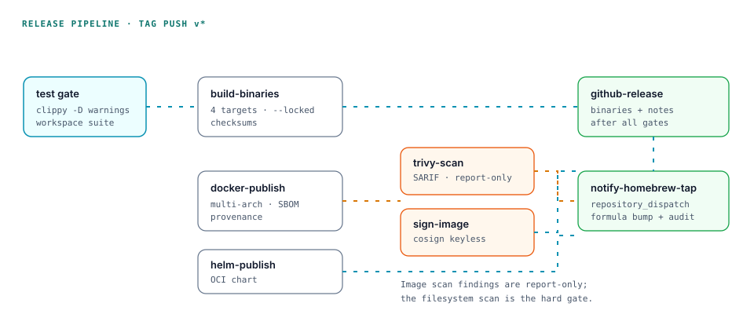

# CI/CD Pipeline

## Design goals

1. **Fast PR feedback** — contributors get lint/test results in minutes, not an hour. Expensive jobs (Docker, Helm) are skipped unless their inputs changed.
2. **No wasted compute** — jobs that duplicate release work (cross-platform binary builds) were removed from PRs entirely.
3. **Quality releases** — a tag can never publish untested binaries: the release workflow re-runs clippy + the full test suite as a hard gate before any artifact is built or pushed.

## Pipeline layout

### `ci.yml` — pull requests & pushes to `main`

| Job | Runs when | Typical duration |
|-----|-----------|------------------|
| `changes` | always | ~10 s |
| `lint` | Rust sources / manifests changed | ~4–6 min |
| `test` | Rust sources changed | ~5–7 min |
| `msrv` | Rust sources changed | ~4 min |
| `security` | Rust sources changed, or push to `main` | ~2 min |
| `helm-lint` | `deploy/helm/**` or `deploy/compose/**` changed | <1 min |
| `docs` | Documentation, Markdown, the router or the docs checker changed | <1 min |
| `release-metadata` | always | <1 min |
| `docker` + smoke test | Dockerfile/sources/deps changed **and** lint+test pass | ~10–15 min |

Typical docs-only PR: ~20 s (changes detection plus the docs check — `security` is gated on Rust sources, so it is skipped too).
Typical code PR: ~15–20 min wall clock, ~35–45 worker-minutes.

Key mechanics:

- **Concurrency**: `cancel-in-progress` kills superseded runs on the same branch — pushing five commits in a row bills once.
- **Path gating** (`dorny/paths-filter`): Helm lint doesn't run because you edited a README; Docker doesn't build because you touched a chart.
- **Docker smoke test**: after building the image, the job boots it, waits for `/health`, and checks `/metrics`. A scratch-based image that compiles but doesn't serve fails the PR.
- **Docs check**: `scripts/checks/check_docs.py` (run locally with `make docs-check`) verifies that every relative link, anchor, embedded image and quoted repository path resolves, that the OpenAPI spec and the Axum router describe the same endpoints, and that no Markdown file contains a Mermaid fence. Diagrams render as self-contained animated SVG.
- **`--locked` everywhere**: CI builds exactly what's pinned in `Cargo.lock`; dependency drift fails loudly instead of silently changing the tested surface.
- **`-D warnings` scoped to clippy only**: setting it globally via `RUSTFLAGS` also compiles *dependencies* with warnings-as-errors and breaks spuriously when new rustc lints land upstream.
- **Least privilege**: workflow-level `permissions: contents: read`; no write tokens in the PR lane.
- **Removed from PRs**: the 4-target cross-compile release matrix (linux/amd64+arm64, macOS ×2). Those binaries were uploaded and never used by the PR flow, and `release.yml` rebuilds identical targets on tags anyway. This was ~45–50 min of compute per PR, mostly on 10×-billed macOS runners.

### `release.yml` — tag push (`v*`)



The `test` gate re-runs the release-metadata check (with `--tag`), clippy `-D warnings` and the full workspace suite on the tagged commit. Tags can point at stale commits — without this gate a tag could publish binaries that were never validated, and a tag whose version disagrees with `Cargo.toml` could publish under the wrong version.

`linux/arm64` builds on `ubuntu-24.04-arm`, not cross-compiled from `x86_64`: `rdkafka-sys` compiles librdkafka with cmake and needs an `aarch64` C++ compiler. macOS targets keep using the Apple toolchain's cross-target support on `macos-latest`.

The container image reuses those binaries rather than recompiling the
workspace: `docker-image` runs once per architecture on a native runner
(`--target runtime-prebuilt`, the tarball as the `dist` build context), pushes
`X.Y.Z-amd64` / `X.Y.Z-arm64`, and `docker-manifest` merges them into the
`X.Y.Z`, `X.Y`, `X` and `latest` refs. Before this split, one buildx build
compiled `linux/arm64` through QEMU and the job ran for hours — one full Rust
workspace plus librdkafka, ring, zstd and jemalloc, emulated.

The GitHub release body is generated from the tag's `CHANGELOG.md` section (`scripts/release/release_tool.py notes`), not from `generate_release_notes`, so the release page and the changelog cannot disagree. Full release procedure: [Release process](release.md).

Supply chain guarantees retained: build provenance attestation, SBOM, cosign signing, Trivy image scan, checksums for every binary asset.

**Homebrew tap coordination** — after the GitHub release, `notify-homebrew-tap` fires a `repository_dispatch` (`event-type: parqtel-oss-release`) at `parqtel/homebrew-tap`, carrying the version + tag. The tap's own pipeline then builds its four per-platform tarballs from that tag, publishes them as a tap release, opens a formula-bump PR, and audits a real `brew install` before merge (full contract: `parqtel/homebrew-tap` → `docs/RELEASE_COORDINATION.md`). Users get `brew upgrade parqtel-oss`. Requires the `HOMEBREW_TAP_DISPATCH_TOKEN` secret (PAT, `repo` scope); without it the tap's daily schedule poll is the fallback trigger.

### `scorecard.yml` — weekly OpenSSF Scorecard analysis

## Worker-hour impact (approx., per typical code PR)

| Lane | Before | After |
|------|--------|-------|
| Lint | 6 min | 5 min |
| Test | 8 min | 6 min |
| MSRV | 5 min | 4 min |
| Security audit | 7 min (compiled cargo-audit every run!) | 2 min (prebuilt action) |
| Build matrix | ~48 min (4 targets) | **0 min (moved to release)** |
| Docker | 15 min (always) | 0–15 min (path-gated) |
| Helm | 1 min (always) | 0–1 min (path-gated) |
| **Total** | **~90 min** | **~17–33 min** |

≈ 60–80% reduction in CI compute per PR; wall-clock feedback drops from ~25 to ~12 minutes since heavy lanes are gone.

## Local equivalents

```bash
make lint          # fmt --check + clippy -D warnings
cargo test --workspace     # same suite CI runs
make release-check # version sites + changelog contract (the release-metadata job)
make changelog     # refresh the generated CHANGELOG.md block (needs git-cliff)
make docker      # same multi-stage build CI validates
helm lint deploy/helm/parqtel
```

Local builds of `parqtel-ingest` need `protoc` (prost-build compiles the OTLP schema in `build.rs`): `sudo apt-get install protobuf-compiler`. CI installs it via the shared composite action `.github/actions/setup-rust`, which also owns toolchain setup and cache keys — change toolchain/cache config there, not per-job.

## Maintenance notes

- **The `main` ruleset's required status checks are named after the job names**
  (`Lint`, `Test`, `MSRV (1.88)`, `Security Audit`, `Docker Build & Smoke
  Test`, `Docs Check`, `Release Metadata`). Renaming a job in `ci.yml` without
  updating the ruleset
  leaves the PR permanently blocked: the required context can never be
  produced. When the MSRV moved to 1.88, the ruleset still required
  `MSRV (1.87)` and every PR to `main` was stuck until it was fixed.
- **MSRV is 1.88** and lives in three places that must move together: `ci.yml` (`MSRV` env + toolchain matrix), `Cargo.toml` `[workspace.package].rust-version`, `Dockerfile` `RUST_VERSION`, the compose Dockerfiles under `deploy/compose/`, and the `main` ruleset's required-check name. It's pinned by the lockfile: arrow 60.2.0 requires rustc 1.88, so lowering it needs precise dependency pins.
- CI installs `cargo-audit` via `taiki-e/install-action` and runs `cargo audit --deny warnings` plus a Trivy filesystem scan (CRITICAL/HIGH). Both read `Cargo.lock`/the tree only — run `cargo update` deliberately and review the audit diff. (The old `rustsec/audit-check` action was dropped: its embedded cargo exited 101 under the Node 24 runner migration.)
- If runner minutes ever matter less than latency again, the Docker job is safe to promote back to always-on via the `changes.outputs.docker` condition.
- **The image scan is advisory and must not gate the release.** `trivy-scan`
  used to be in `github-release`'s `needs`; when `trivy-action`'s bundled
  `setup-trivy` failed to download its binary on a cold cache, the tag
  produced no release at all. The scanner now comes from
  `taiki-e/install-action` (`skip-setup-trivy: true`) and the release job no
  longer waits on it. The CI filesystem scan stays a hard gate.
- **The `Release Metadata` job needs the release tag in its clone.** A cut
  pushes the release commit to `main` and the tag in quick succession, so a
  clone can start before the tag lands; `git-cliff --unreleased` then reports
  the entire history as unreleased and the job fails on a stale block that is
  not stale. The job fetches `refs/tags/v*` first, and `release_tool.py`
  refuses to rewrite the block when the newest released tag is missing.
