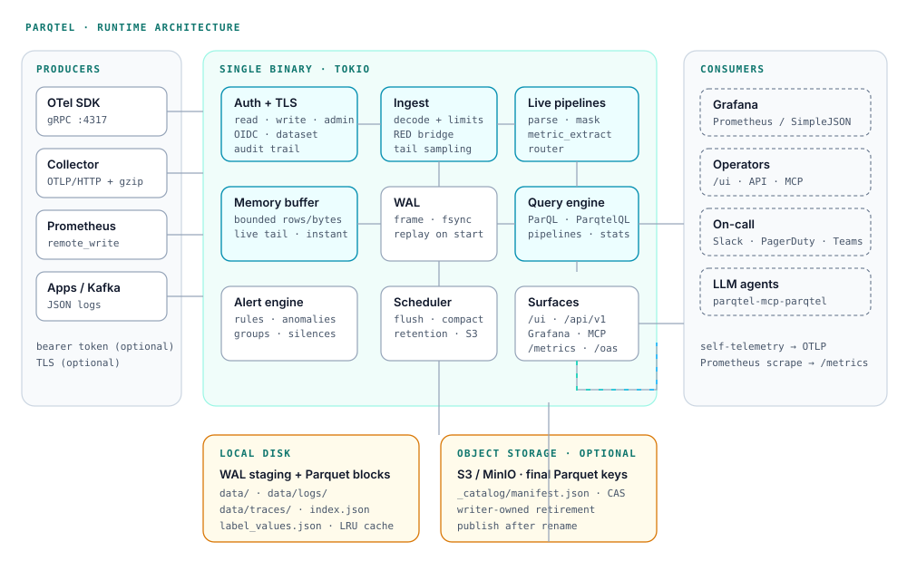

# Architecture diagrams

Every diagram in the documentation is a **self-contained animated SVG**. The
SVG is the canonical asset: it is what the docs embed, and it is what a reader
sees. There is no JavaScript, no external font, no CDN and no Mermaid runtime in
the reading path.

The motion carries meaning: dashes travel along data-flow edges, nodes breathe
in a staggered wave, and frames lift to separate planes. Motion stops under
`prefers-reduced-motion: reduce`; the still image remains fully legible.

## Diagram set

| Diagram | Asset | Used by |
|---|---|---|
| Runtime architecture | [`architecture-overview.svg`](../assets/diagrams/architecture-overview.svg) | [Architecture](architecture.md), README |
| System context | [`system-context.svg`](../assets/diagrams/system-context.svg) | [Architecture](architecture.md) |
| Crate graph | [`crate-graph.svg`](../assets/diagrams/crate-graph.svg) | [Architecture](architecture.md) |
| Ingest sequence | [`ingest-path.svg`](../assets/diagrams/ingest-path.svg) | [Architecture](architecture.md) |
| Ingestion on-ramps | [`ingestion-onramps.svg`](../assets/diagrams/ingestion-onramps.svg) | [Ingestion](../guides/ingestion.md) |
| Query pruning | [`query-pruning.svg`](../assets/diagrams/query-pruning.svg) | [Architecture](architecture.md) |
| Query surfaces | [`query-surfaces.svg`](../assets/diagrams/query-surfaces.svg) | [Architecture](architecture.md) |
| Block lifecycle | [`block-lifecycle.svg`](../assets/diagrams/block-lifecycle.svg) | [Architecture](architecture.md) |
| Storage layout | [`storage-layout.svg`](../assets/diagrams/storage-layout.svg) | [Architecture](architecture.md) |
| Admission control | [`admission-control.svg`](../assets/diagrams/admission-control.svg) | [Architecture](architecture.md) |
| Trace RED + sampling | [`trace-red-sampling.svg`](../assets/diagrams/trace-red-sampling.svg) | [Architecture](architecture.md) |
| Alert delivery | [`alert-delivery.svg`](../assets/diagrams/alert-delivery.svg) | [Alerting](../operations/alerting.md) |
| Object storage | [`object-storage.svg`](../assets/diagrams/object-storage.svg) | [Object storage](../operations/object-storage.md) |
| Security boundaries | [`security-boundaries.svg`](../assets/diagrams/security-boundaries.svg) | [Security](../operations/security.md) |
| Configuration layers | [`config-layers.svg`](../assets/diagrams/config-layers.svg) | [Configuration](../operations/configuration.md) |
| Edge topology | [`edge-topology.svg`](../assets/diagrams/edge-topology.svg) | [Edge mode](../operations/edge-mode.md) |
| MCP topology | [`mcp-topology.svg`](../assets/diagrams/mcp-topology.svg) | [MCP](../guides/mcp.md) |
| Argo Rollouts flow | [`argo-rollouts-flow.svg`](../assets/diagrams/argo-rollouts-flow.svg) | [Argo Rollouts](../guides/argo-rollouts.md) |
| Release pipeline | [`ci-release-pipeline.svg`](../assets/diagrams/ci-release-pipeline.svg) | [CI/CD](ci-cd.md) |

The README hero is [`hero.svg`](../assets/hero.svg).

## Contract for a new diagram

1. Write a standalone `.svg` with a `viewBox`; do not rely on a page stylesheet.
2. Keep it static in structure: no `<script>`, no animation library, no
   external `href`. New hand-authored diagrams use native SVG text rather than
   `foreignObject`; older generated assets may contain it.
3. Put styles in one internal `<style>` block. Use class selectors, not inline
   animation attributes spread across nodes.
4. Animate only transform, opacity and stroke properties. Avoid filters on
   nodes (they flicker in some renderers).
5. Include a `<title>` and `<desc>` for accessibility.
6. End with:

   ```css
   @media (prefers-reduced-motion: reduce) {
     * { animation: none !important; }
     .flow { stroke-dasharray: none; }
   }
   ```

7. Embed with a relative Markdown image and descriptive alt text:

   ```markdown
   
   ```

## Mermaid policy

Markdown **must not contain Mermaid fences**. `make docs-check` rejects them so a
diagram cannot regress to a diagram-as-code block. Historical `.mmd` files under
`docs/assets/diagrams/src/` are archival only and are not part of the rendering
path; do not add new ones.

## Verification

```bash
make docs-check     # links, anchors, source paths, OpenAPI coverage, no Mermaid
python3 - <<'PY'
import glob, xml.etree.ElementTree as ET
for path in glob.glob('docs/assets/**/*.svg', recursive=True):
    ET.parse(path)
print('SVG XML OK')
PY
```

Open the Markdown preview or the GitHub page and check that the animation runs
and the diagram is readable as a still. A renderer that blocks CSS animation
will show the first frame, which is why every diagram must make sense without
motion.
