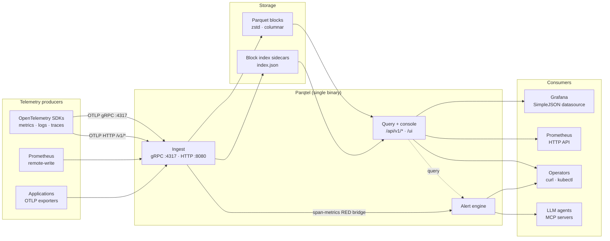
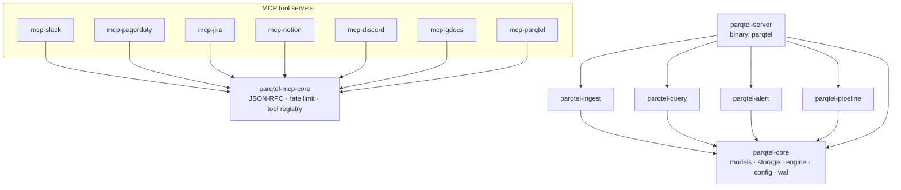
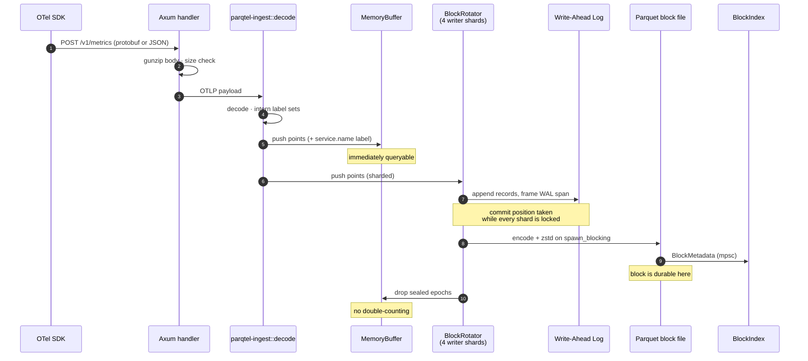
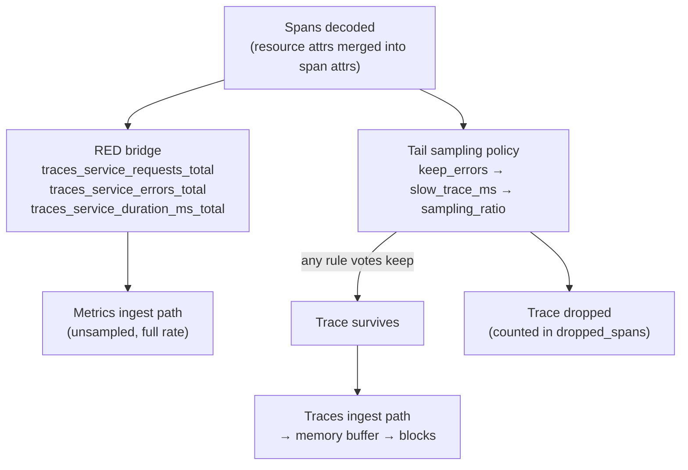
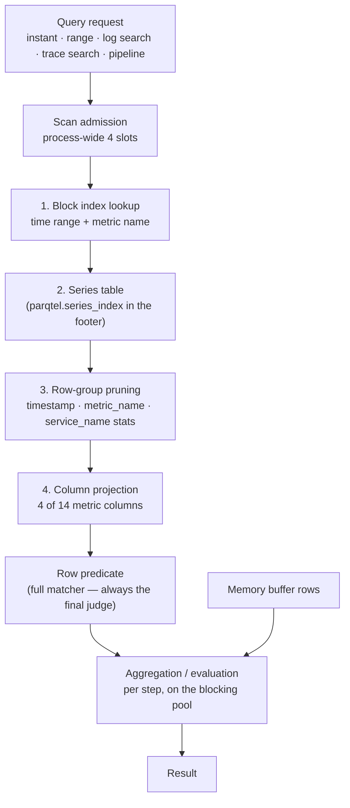
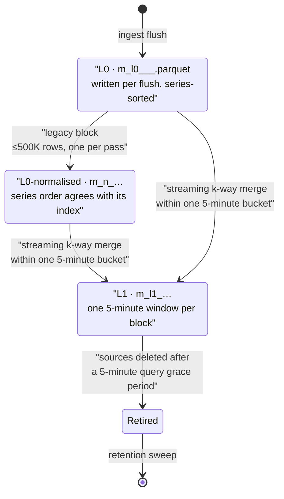
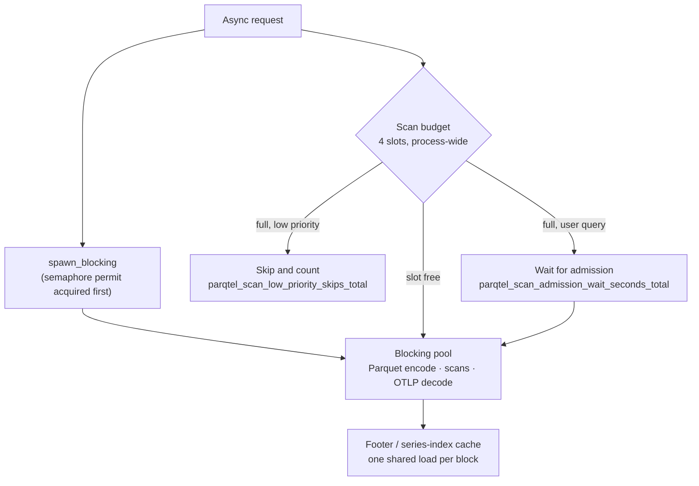
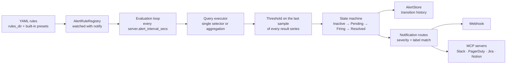
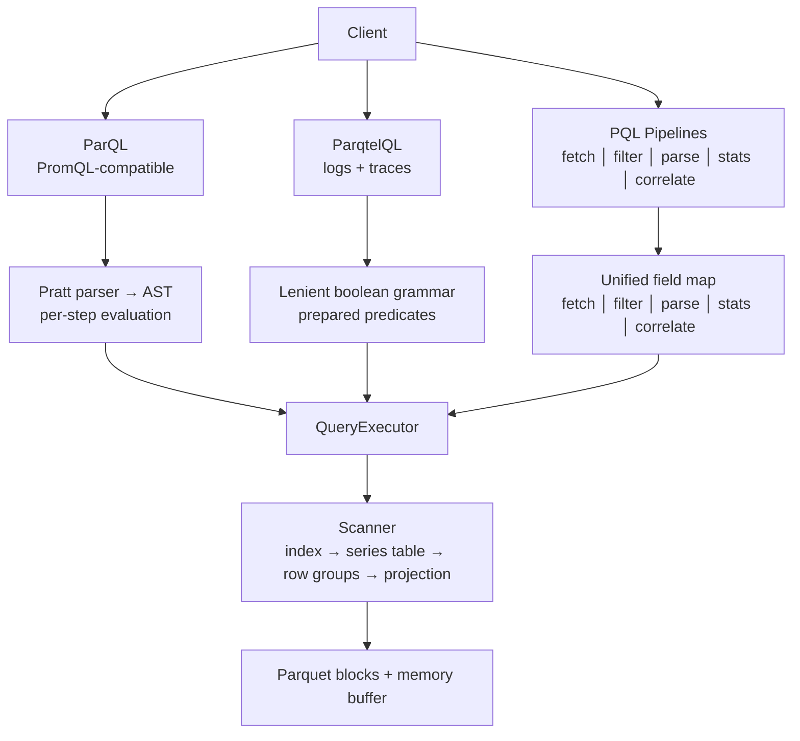

# Architecture diagrams

Visual reference for Parqtel's internal structure. Every diagram is
[Mermaid](https://mermaid.js.org/), so it renders on GitHub, in the docs site and
in any Mermaid-aware Markdown viewer. The prose around each diagram carries the
detail; the diagram carries the shape.

Related reading:

- [Architecture](architecture.md) — the narrative version of these diagrams.
- [Developer guide](developer-guide.md) — where the code lives.
- [Glossary](glossary.md) — the terms used in the labels.

## 1. System context

What talks to Parqtel, and what Parqtel talks to.



**Facts behind the picture.** Ingest is unauthenticated in the OSS build — put
a proxy in front of `:8080` and `:4317` (see
[known issues](../operations/known-issues.md)). The MCP servers are separate
binaries that query Parqtel over HTTP; they are not in the ingest path.

## 2. Crate dependency graph

Fifteen workspace members; every signal crate depends only on `parqtel-core`.



Crates are one directory per concern under `crates/`. `parqtel-core` holds the
data models, the storage engine, the write-ahead log and the layered
configuration; it depends on no other workspace crate.

## 3. Ingest path (metrics)

One request, end to end. The same shape applies to logs and traces.



**Ordering guarantee.** A block's WAL commit position is the WAL's end taken
while every writer shard is locked, and buffer drops are released in flush
order. Each block records the WAL span `(from, to]` it covers
(`parqtel.wal_range` in the Parquet footer), so startup can advance the commit
point and skip records already in a block.

## 4. Trace ingest: RED bridge and tail sampling

Trace ingestion does two things before a span reaches storage: it derives RED
metrics, then it samples the trace.



Sampling runs **after** RED derivation, so RED metric rates stay exact while
storage volume shrinks. Probabilistic decisions hash the `trace_id`, so a whole
trace lives or dies together — no orphaned fragments. Per-service overrides
replace the global policy for that service entirely.

## 5. Query path

Three surfaces, one storage engine. The pruning cascade is the same for all of
them.



- The series table only ever **narrows** candidates; the full matcher still
  judges every candidate series, so a block without a valid table falls back to
  a plain scan with identical results.
- Log search consults the block's skip index (`parqtel.log_index`) first: per
  4096-row granule it holds time bounds, the highest severity and a bloom
  filter over body three-byte windows and `name=value` attribute pairs. Only
  granules that can hold a match are read.
- The memory buffer is merged with the block results. It is drained when the
  block holding those rows becomes durable, so buffered and flushed rows never
  double-count.
- Instant queries use the Prometheus-default 5-minute lookback
  (`query.lookback_delta_ns`).

## 6. Block lifecycle

Metric blocks form two levels. The streaming compactor coalesces canonical
blocks into 5-minute windows.



**How a merge works.** A streaming k-way merge reads one Arrow batch at a time
from each source, coalesces series by their final query-visible labels, and
writes a single output block. The output footer records its source files
(`parqtel.compacted_sources`), so a crash after the merge but before the source
deletion is repaired at startup: reconcile drops the superseded sources.
Sources are deleted only after a 5-minute grace period, so a query that was
already running against them still finds them.

**Bounds.** One pass merges at most 8 sources, coalesces at most 2 groups,
normalises at most 1 block, and moves at most 16 M rows. Passes run every 5
minutes, and `parqtel compact` runs the same bounded passes offline.

**WAL safety.** A merge is only attempted when every source's WAL range is at
or below the metrics WAL commit point — those records can no longer be
replayed. Mixed or non-contiguous ranges are skipped.

## 7. Storage layout on disk

```text
data/
├── m_l0_<start>_<end>_<id>.parquet   metric blocks (L0 — one per flush)
├── m_l1_<start>_<end>_<id>.parquet   metric blocks (L1 — one per 5-minute window)
├── m_n_<start>_<end>_<id>.parquet    metric blocks (normalised legacy layout)
├── index.json                        metric block index sidecar
├── logs/
│   ├── <id>.parquet                  log blocks
│   └── index.json                    log block index sidecar
├── traces/
│   ├── <id>.parquet                  trace blocks
│   └── index.json                    trace block index sidecar
└── wal/
    ├── metrics/                      metrics WAL segments
    ├── logs/                         logs WAL segments
    └── traces/                       traces WAL segments
```

Each sidecar is written atomically (temp file + rename) and holds the block
metadata plus **one shared label-value dictionary** for the whole signal:

```json
{
  "blocks": [ { "path": "m_l1_…parquet", "row_count": 8123, "…": "…" } ],
  "label_values": { "http_method": ["GET", "POST"], "…": "…" }
}
```

The dictionary is capped at 10 000 values per field and is shared by every
block, which is why the sidecar shrank from 73.5 MiB to 12.6 MiB (17 %) on a
97-block dataset. The loader still accepts the legacy bare-array shape and
folds its per-block values in, so existing sidecars migrate on first start.
Older binaries cannot parse the new shape.

## 8. Concurrency and admission control



- **Metrics rotator shards** (`ingest.rotator_shards`, default 4) let unrelated
  metric ingest proceed while a flush is in flight. The shards are not
  independent blocks — a flush merges them into one file.
- **The memory buffer is drained by durability, not by scheduling.** Draining
  early would leave rows in neither the buffer nor any block, invisible to
  every query until the encode landed.
- **Alert evaluation reserves a scan slot without waiting** and skips the
  cycle when none is free, so alerting never starves interactive queries.
- **The label interner** (`ingest.label_interner_capacity`, default 1 048 576)
  lets every point of a series share one copy of its labels. Set it to at
  least twice the active series count.

## 9. Alert path



## 10. Query surfaces

One storage engine, three syntaxes.



- **ParQL** — instant and range queries, aggregations with `by`/`without`,
  binary operators with `on()`/`ignoring()`/`group_left`, subqueries, offset.
  Instant selectors use the 5-minute lookback.
- **ParqtelQL** — terms, phrases, wildcards, `-exclusion`, `OR`/`AND`/`NOT`,
  field operators (`=/!=/=~/>=/</:`), ranges (`a-b`), `field:*` exists, `body:`
  contains, severity thresholds. Trace predicates are pushed into the scan
  before result caps are applied.
- **Pipelines** — `fetch logs|metrics|traces | filter <pql> | parse "<re>" as f |
  stats count/avg/min/max/sum/p50/p95/p99 by … interval=… | limit | correlate
  traces|logs window=…`.
