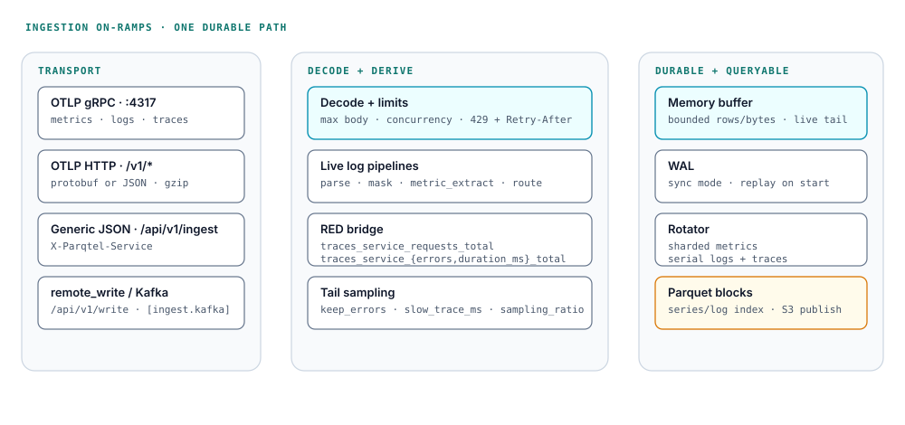

# Ingestion on-ramps

Parqtel accepts OpenTelemetry natively and also exposes narrower on-ramps for
applications that do not run an OTel SDK. Every path shares the same decode,
WAL, buffer, block and index code.



## OTLP

### gRPC — recommended

Point an OTel SDK or Collector at `http://parqtel:4317`:

```yaml
exporters:
  otlp:
    endpoint: parqtel:4317
    tls:
      insecure: true
```

The server implements all three collector services. gRPC has no token
authentication; keep the port private or put a proxy/mesh in front of it.

### HTTP

Use `/v1/metrics`, `/v1/logs` and `/v1/traces` with protobuf or JSON,
determined by `Content-Type`. `/v1/{signal}/json` are JSON-only aliases.

```bash
TS=$(date +%s)000000000
curl -X POST http://localhost:8080/v1/metrics/json \
  -H 'Content-Type: application/json' \
  -d '{"resourceMetrics":[{"resource":{"attributes":[{"key":"service.name","value":{"stringValue":"demo"}}]},"scopeMetrics":[{"metrics":[{"name":"http_requests_total","sum":{"dataPoints":[{"asDouble":1,"timeUnixNano":"'$TS'","attributes":[{"key":"method","value":{"stringValue":"GET"}}]}]}}]}]}]}'
```

OTLP JSON attributes are arrays of `{key, value}` objects, not plain maps.
Request bodies may be gzip-compressed; `ingest.max_body_size` applies to the
decompressed size.

## Generic JSON logs

`POST /api/v1/ingest` accepts an object or an array. The service name comes from
`X-Parqtel-Service` (or the resource attributes if present).

```bash
curl -X POST http://localhost:8080/api/v1/ingest \
  -H 'Content-Type: application/json' \
  -H 'X-Parqtel-Service: checkout' \
  -d '{"timestamp":"2026-11-18T10:00:00Z","level":"error","message":"payment declined","order_id":"o-42"}'
```

Field mapping:

| Config | Default | Behaviour |
|---|---|---|
| `ingest.json_timestamp_field` | `timestamp` | RFC3339, or integer seconds/ms/µs/ns; absent uses receive time |
| `ingest.json_body_field` | `message` | Absent uses the whole object |
| `ingest.json_severity_field` | `level` | Maps trace/debug/info/warn/error/fatal |

Remaining keys become attributes. Rows run through live log pipelines and the
normal WAL/buffer path.

## Prometheus remote_write

`POST /api/v1/write` accepts the standard snappy-compressed protobuf
`WriteRequest`. Samples become gauge points with millisecond timestamps.

```yaml
remote_write:
  - url: http://parqtel:8080/api/v1/write
```

This is the on-ramp for Prometheus agents and collectors that cannot emit OTLP.
It does not make Parqtel a Prometheus TSDB; labels are stored in the same
metric block format as OTLP metrics.

## Kafka JSON logs

`[ingest.kafka]` polls a topic and decodes each message with the generic JSON
parser. The offset commits only after the batch is durable, so a failed batch
is redelivered.

```toml
[ingest.kafka]
enabled = true
brokers = "kafka-1:9092,kafka-2:9092"
topic = "parqtel-logs"
group_id = "parqtel"
service = "kafka-apps"
format = "json"
```

Validation requires brokers, topic, a non-empty group id and `format = "json"`.

## Live log pipelines

Pipelines are evaluated first-match-wins during ingest. Stages can parse,
enrich, cast, extract metrics, mask PII and drop/route records. Extracted
metrics go through a bounded channel to the metrics service; surviving logs
continue through the normal WAL/buffer/writer path.

See [Configuration](../operations/configuration.md#pipeline-yaml) for the YAML
schema and the shipped Nginx example.

Pipelines created through the API require
`alerts.allow_runtime_updates = true` and are validated/compiled before storage.

## Tracing: RED metrics and tail sampling

For traces, Parqtel derives RED metrics **before** sampling:

- `traces_service_requests_total`
- `traces_service_errors_total`
- `traces_service_duration_ms_total`

Tail sampling then keeps error traces, slow traces (`slow_trace_ms`) and a
deterministic fraction of the rest (`sampling_ratio`). Decisions hash the trace
id, so a whole trace lives or dies together. Per-service policies replace the
global policy entirely.

## Limits and overload

| Control | Default | Behaviour |
|---|---|---|
| `ingest.max_body_size` | 10 MiB | Reject oversized decompressed bodies |
| `ingest.max_concurrent_requests` | 64 | HTTP ingest returns `429` + `Retry-After` |
| `server.grpc_concurrency_limit` | 64 | Per-connection gRPC exports |
| `ingest.buffer_max_points` | 5M rows | Buffer eviction or rejection |
| `ingest.buffer_max_bytes` | 2 GiB | Approximate byte bound |
| `ingest.series_limit_per_metric` | 1M | New series rejected, existing continue |

Counters: `parqtel_ingest_rejected_total`,
`parqtel_buffer_dropped_total{signal,reason}` and
`parqtel_series_rejected_total{metric}`.

Ingest is not wrapped in `query.timeout_secs`; a slow ingest is backpressure,
not a query timeout.

## Verify ingestion

```bash
curl -s localhost:8080/api/v1/ingest_rates | jq
curl -s localhost:8080/metrics | grep -E 'parqtel_(batches_received|ingested_points|ingest_rejected)'
curl -s 'localhost:8080/api/v1/label/__name__/values' | jq
curl -sG localhost:8080/api/v1/query --data-urlencode 'query=http_requests_total' | jq
```

If an instant query returns nothing, check the 5-minute lookback and use a
range query over flushed blocks. See
[Known issues](../operations/known-issues.md).
