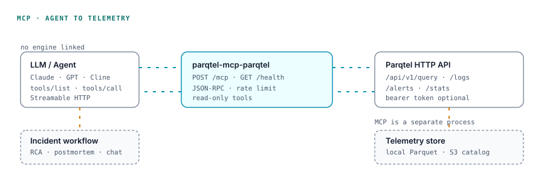

# MCP (Model Context Protocol) Integration

Parqtel ships with **`parqtel-mcp-parqtel`**, a standalone MCP server built on
`parqtel-mcp-core` that gives AI agents read access to Parqtel's metrics, logs,
alerts, ingestion rates, and service topology.

## Overview

The Model Context Protocol enables AI agents (Claude, GPT, etc.) to query
observability data through a standardized JSON-RPC interface:

- Run instant and range PromQL queries
- Discover metric names and label values
- Search stored log records with severity and time filters
- Inspect live per-signal ingestion rates and stall gaps
- Read alert history, observed service topology, and rule noise statistics

## Architecture



The MCP server:

- Exposes `POST /mcp` — MCP Streamable HTTP (spec `2025-06-18`), the endpoint
  every agent/SDK speaks (`initialize` → `notifications/initialized` →
  `tools/list` / `tools/call` / `ping`; `GET /mcp` SSE keepalive,
  `DELETE /mcp` session close). Stateless: no session required; one is
  minted on `initialize` for stateful clients.
- Exposes `/health` for liveness probes
- Implements rate limiting (token bucket, configurable per-minute)
- Registers tools with typed JSON Schema inputs
- Sanitizes sensitive parameters before writing them to the audit log

### Connecting from Cline / Claude Desktop / any agent

```json
{
  "mcpServers": {
    "parqtel": { "type": "streamableHttp", "url": "http://localhost:3007/mcp" }
  }
}
```

> Host port is `3007` (`MCP_PARQTEL_PORT:-3007` in `deploy/compose/docker-compose.yml`);
> `3000` inside the container is Grafana on the host. The legacy
> `GET /tools/list` / `POST /tools/call` aliases still work but are
> deprecated — point agents at `/mcp`.

## Configuration

| Variable | Description | Default |
|----------|-------------|---------|
| `MCP_HOST` | Bind address | `0.0.0.0` |
| `MCP_PORT` | Listen port | `3000` |
| `MCP_RATE_LIMIT` | Requests per minute | `60` |
| `PARQTEL_API_URL` | Parqtel server URL (e.g., `http://parqtel:9090` in Compose) | `http://localhost:8080` |

## Tools (`parqtel-mcp-parqtel`)

`parqtel-mcp-parqtel` registers **ten** tools:

### `query_metrics`
Execute a PromQL expression. Only `query` is required; the mode is chosen by the other parameters:

| Parameter | Type | Required | Description |
|-----------|------|----------|-------------|
| `query` | string | ✓ | PromQL expression, e.g. `sum(rate(http_requests_total[5m])) by (service.name)` |
| `start` | number | | Range start, **epoch seconds** (range mode) |
| `end` | number | | Range end, **epoch seconds** (range mode) |
| `step_secs` | number | | Range step interval in seconds (default 60, range mode only) |
| `window_secs` | number | | Convenience trailing-N-seconds range (used when `start`/`end` omitted) |
| `start_ns` / `end_ns` | number | | Legacy aliases: same instants in nanoseconds (converted) |

With only `query`, the tool evaluates the expression instantly at the current time.

### `query_metrics_labels`
Discover metric/label metadata — call this before `query_metrics` to build selectors.

| Parameter | Type | Required | Description |
|-----------|------|----------|-------------|
| `label` | string | | Label name (`__name__` for metric names, `service_name`, `service.name`, `host`, …). Dotted names are accepted and URL-encoded automatically. Omit to list all indexed label names. |

### `query_logs`
Search stored log records. Defaults to the last hour, newest first; returns matched records plus the true match count and a 60-bucket volume summary.

| Parameter | Type | Required | Description |
|-----------|------|----------|-------------|
| `query` | string | | Label selector, e.g. `{}` (all) or `{service_name="api"}` (default `{}`) |
| `start` / `end` | number | | Range bounds, **epoch seconds** (default now-1h … now) |
| `limit` | number | | Max records returned, capped at 2000 (default 100) |
| `order` | string | | `asc` or `desc` by timestamp (default `desc` = newest first) |
| `severity_min` | string | | Minimum severity: `TRACE`…`FATAL`, or a numeric OTLP severity 1–24 |

### `query_traces`
Search spans with a ParqtelQL predicate. Returns spans with `trace_id`; pass
`trace_id` to fetch one trace.

| Parameter | Type | Required | Description |
|-----------|------|----------|-------------|
| `query` | string | | ParqtelQL span predicate |
| `start` / `end` | number | | Epoch seconds (default now-1h … now) |
| `limit` | number | | Max spans (default 200) |
| `trace_id` | string | | Fetch one trace by id |

### `get_storage_stats`
Storage, buffer, and config snapshot. Pass `dataset=<service.name>` for matching
blocks/rows/bytes, metric count, sidecar bytes, and compaction lag.

### `get_pipelines`
Recording-rule and pipeline registry status: generation, definitions, load
errors, ruler enabled flag, and persisted evaluation state.

### `ingest_rates`
Live per-signal ingestion rates (metrics/logs/traces): current + 60s/5m/15m averages, wire bytes/sec, seconds since the last ingested item (gap), lifetime totals, and per-second event counts. Use to detect ingestion spikes, stalls, or gaps.

| Parameter | Type | Required | Description |
|-----------|------|----------|-------------|
| `history_secs` | number | | Length of the per-second history arrays, 1–900 (default 180; the server keeps a 15-minute wheel) |

### `get_alert_history`
Return alert instances fired within a lookback window, optionally filtered by service or pod. Includes state, severity, labels, and annotations. `noise_score` is the fraction of recent firings that resolved without acknowledgement (0..1). It drives delivery suppression after repeated noisy firing cycles.

| Parameter | Type | Required | Description |
|-----------|------|----------|-------------|
| `service_name` | string | | Service name filter (`service.name` / `service_name` / `service`) |
| `pod_name` | string | | Pod name filter (`pod` / `pod_name` / `k8s.pod.name`) |
| `since_hours` | number | | Lookback window in hours (default 24) |

### `get_topology`
Snapshot the observed service landscape: indexed service names, storage stats, and alert rule counts.

| Parameter | Type | Required | Description |
|-----------|------|----------|-------------|
| `namespace` | string | | Optional namespace filter |

### `get_noise_statistics`
Return per-rule alert noise statistics: total/firing/resolved alert counts, average and maximum `noise_score`. The score is derived from each instance's transition history: unacknowledged firings that later resolve score high; acknowledged or still-firing alerts score low.

| Parameter | Type | Required | Description |
|-----------|------|----------|-------------|
| `rule_id` | string | | Specific rule ID (omit for all) |

## Running the MCP Server

### Standalone

```bash
cargo build --release -p parqtel-mcp-parqtel
PARQTEL_API_URL=http://localhost:8080 MCP_PORT=3007 ./target/release/parqtel-mcp-parqtel
```

### Docker Compose

`mcp-parqtel` is enabled by default in `deploy/compose/docker-compose.yml` on port `3007`:

```bash
make mcp-up     # Start Parqtel + mcp-parqtel and wait until healthy
make mcp-smoke  # Verify tools/list responds
```

### Kubernetes (Helm)

Enable `mcp.parqtel` in your Helm values:

```yaml
mcp:
  parqtel:
    enabled: true
    env:
      PARQTEL_API_URL: "http://parqtel:8080"
```
