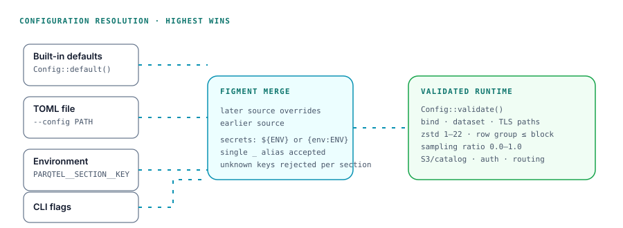

# Configuration Reference

Parqtel uses [Figment](https://github.com/SergioBenitez/Figment) for layered
configuration. Settings resolve in this order, highest priority first:

1. **CLI flags** — `--bind`, `--data-dir`, `--config`, `--log-level`
2. **Environment variables** — prefix `PARQTEL__`, separator `__`
   (`PARQTEL_SERVER__BIND_ADDRESS` with a single underscore is accepted as an
   alias)
3. **TOML file** — `--config PATH` / `PARQTEL_CONFIG`, or `config/default.toml`
   if present
4. **Built-in defaults** — hardcoded in `parqtel-core/src/config/`

The merged configuration is validated at startup. Invalid values fail the
process with every error listed, rather than starting with a silent fallback.



## Annotated example

This is a complete, valid starting point. Every section is optional; omitted
keys take the defaults in the tables below.

```toml
[server]
dataset = "default"                 # one dataset per process; non-default prefixes data dirs
bind_address = "0.0.0.0:8080"
grpc_bind_address = "0.0.0.0:4317"  # "" disables OTLP gRPC
max_connections = 1024
shutdown_timeout_secs = 30
flush_interval_secs = 5
alert_interval_secs = 15
retention_interval_secs = 3600
grpc_concurrency_limit = 64
index_persist_interval_secs = 2
# [server.tls]
# cert_path = "/etc/parqtel/tls.crt"
# key_path = "/etc/parqtel/tls.key"

[storage]
backend = "parquet"
data_dir = "data"
block_duration_secs = 7200
max_rows_per_block = 1000000
compression = "zstd"                # zstd | snappy | lz4 | none
# compression_level = 1             # zstd 1..22; unset = codec default
retention_days = 7
compaction_interval_secs = 300
row_group_size = 100000
compaction_max_merge_blocks = 12
compaction_max_merges_per_pass = 8

[logs]
data_dir = "data/logs"
block_duration_secs = 1800
max_rows_per_block = 200000
compression = "zstd"
# compression_level = 1
retention_days = 3
compaction_interval_secs = 3600
row_group_size = 20000
compaction_max_merge_blocks = 12
compaction_max_merges_per_pass = 8

[ingest]
max_body_size = 10485760            # decompressed body limit
wal_enabled = true                  # metrics WAL + background flush worker
log_wal_enabled = true
wal_sync_mode = "interval"          # none | interval | always
wal_sync_interval_ms = 1000
wal_max_segment_bytes = 67108864
max_inflight_flushes = 4
rotator_shards = 4                  # clamped 1..256
label_interner_capacity = 1048576   # >= 2x active series count
buffer_max_points = 5000000         # 0 disables the row bound
buffer_max_bytes = 2147483648       # 0 disables the byte bound
buffer_overflow_policy = "drop_oldest" # drop_oldest | reject_new
max_concurrent_requests = 64
load_shed_retry_after_secs = 1
json_timestamp_field = "timestamp"
json_body_field = "message"
json_severity_field = "level"
series_limit_per_metric = 1000000  # 0 disables

[ingest.tail_sampling]
keep_errors = true
# slow_trace_ms = 1000
sampling_ratio = 1.0

# Per-service overrides replace the global policy for that service:
# [ingest.tail_sampling.per_service.noisy-service]
# keep_errors = false
# sampling_ratio = 0.05

# Optional Kafka JSON log consumer:
# [ingest.kafka]
# enabled = true
# brokers = "kafka-1:9092,kafka-2:9092"
# topic = "parqtel-logs"
# group_id = "parqtel"
# service = "kafka-apps"
# format = "json"                   # only json

[query]
max_series = 1000
max_samples_per_series = 10000
timeout_secs = 30
lookback_delta_ns = 300000000000    # 5 minutes

[ui]
enabled = true

[telemetry]
log_level = "info"
log_format = "text"                 # text | json
otlp_enabled = false
otlp_endpoint = "http://127.0.0.1:4317"
otlp_trace_level = "info"
export_interval_secs = 30           # clamped 5..300
profiling_enabled = false
profiling_frequency = 99            # clamped 10..999

# Optional object storage. See object-storage.md for the deployment guide.
# [object_store]
# enabled = true
# bucket = "parqtel-blocks"
# region = "eu-north-1"
# endpoint = "http://127.0.0.1:9000" # MinIO; omit for AWS
# access_key = "${AWS_ACCESS_KEY_ID}"
# secret_key = "${AWS_SECRET_ACCESS_KEY}"
# prefix = "parqtel"
# cache_dir = "/var/lib/parqtel/cache"
# cache_bytes = 1073741824
# catalog_interval_secs = 5

# Optional scoped authentication.
# [auth]
# enabled = true
# header = "authorization"
#
# [[auth.tokens]]
# name = "grafana"
# token = "${PARQTEL_READ_TOKEN}"    # or token_sha256 = "<64 lowercase hex>"
# actions = ["read"]
# datasets = ["api-*"]
#
# [auth.oidc]
# issuer = "https://idp.example.com"
# client_id = "parqtel"
# client_secret = "${OIDC_CLIENT_SECRET}"
# redirect_url = "https://parqtel.example.com/auth/callback"
# scopes = ["openid", "profile", "email"]
# roles_claim = "roles"
# admin_role = "parqtel-admin"
# write_role = "parqtel-write"

[audit]
enabled = true
path = "audit.jsonl"                # relative to storage.data_dir, or absolute

[alerts]
rules_dir = "rules"
noise_window_firings = 30           # parsed; not read by this build
refinement_enabled = true           # parsed; not read by this build
noise_suppression_threshold = 0.7   # parsed; not read by this build
allow_runtime_updates = false       # required for REST mutations
recording_rules_enabled = true

[alerts.presets]
mode = "auto"                       # auto | all | off
include = []
exclude = []

# Not implemented in this build; parsed for forward compatibility.
# [alerts.postmortem]
# enabled = false
# auto_draft = false
# postmortem_delay_minutes = 5
# auto_publish_slack = false

[alerts.notifications]
send_timeout_secs = 30              # only this key is read by this build
# dedup_flush_interval_secs = 300
# max_concurrent_sends = 10
# self_monitoring_failure_threshold = 0.5

[alerts.notifications.egress]
allow_private = false
allow_hosts = []

# Alertmanager-compatible routing. When present, it replaces the legacy
# [alerts.notifications.routes] table. Secrets may be ${ENV_VAR} or {env:ENV_VAR}.
# [alerting.routing.global]
# resolve_timeout = "5m"
# http_timeout = "10s"
# retry_initial_backoff = "1s"
# retry_max_backoff = "30s"
# retry_max_attempts = 3
#
# [alerting.routing]
# max_active_groups = 10000
#
# [alerting.routing.egress]
# allow_private = false
# allow_hosts = ["*.internal.example"]
#
# [alerting.routing.route]
# receiver = "slack-default"
# group_by = ["service.name"]
# group_wait = "30s"
# group_interval = "5m"
# repeat_interval = "4h"
#
# [[alerting.routing.route.routes]]
# matchers = ["severity = critical"]
# receiver = "pagerduty-oncall"
# continue = true
#
# [[alerting.routing.inhibit_rules]]
# source_matchers = ["severity = critical"]
# target_matchers = ["severity = warning"]
# equal = ["service.name"]
#
# [[alerting.routing.receivers]]
# name = "slack-default"
# [[alerting.routing.receivers.slack_configs]]
# webhook_url = "${SLACK_WEBHOOK_URL}"
# send_resolved = true
#
# [[alerting.routing.receivers]]
# name = "pagerduty-oncall"
# [[alerting.routing.receivers.pagerduty_configs]]
# routing_key = "${PAGERDUTY_ROUTING_KEY}"
# send_resolved = true

# Not implemented in this build; parsed and validated.
[k8s_provider]
enabled = false
bind_address = "0.0.0.0:6443"
cache_expiry_secs = 30
query_timeout_secs = 10
max_concurrent = 10
tls_secret_name = "parqtel-provider-tls"
```

## `[server]`

| Key | Type | Default | Description |
|-----|------|---------|-------------|
| `dataset` | String | `"default"` | Logical dataset served by this process. Non-default values prefix the metrics and logs data directories. Allowed characters: letters, digits, `-`, `_`, `.`. |
| `bind_address` | String | `"0.0.0.0:8080"` | HTTP listen address. Must not be empty. |
| `grpc_bind_address` | String | `"0.0.0.0:4317"` | OTLP gRPC listen address; empty disables it. |
| `max_connections` | Integer | `1024` | Maximum simultaneous TCP connections. |
| `shutdown_timeout_secs` | Integer | `30` | Grace period for in-flight requests. |
| `flush_interval_secs` | Integer | `5` | How often the flush tick asks each rotator whether its block duration elapsed. It bounds flush lateness, not write frequency. |
| `alert_interval_secs` | Integer | `15` | Alert evaluation interval. |
| `retention_interval_secs` | Integer | `3600` | Retention sweep interval. |
| `grpc_concurrency_limit` | Integer | `64` | Concurrent OTLP exports per gRPC connection. |
| `index_persist_interval_secs` | Integer | `2` | Debounce for block-index sidecar writes. A durable flush forces an immediate write. |
| `tls` | Table | unset | Optional [`server.tls`](#servertls). |

### `[server.tls]`

| Key | Type | Default | Description |
|-----|------|---------|-------------|
| `cert_path` | String | required | PEM certificate chain. |
| `key_path` | String | required | PEM private key (PKCS#8, PKCS#1 or SEC1). |

When set, HTTP serves TLS only — there is no plaintext listener — and the OTLP
gRPC listener uses the same identity. There is no hot reload.

```toml
[server.tls]
cert_path = "/etc/parqtel/tls.crt"
key_path = "/etc/parqtel/tls.key"
```

## `[storage]` and `[logs]`

Both blocks carry the same keys; only the defaults differ. Validation is
shared, so a rule cannot drift between metrics and logs.

| Key | Metrics default | Logs default | Description |
|-----|-----------------|--------------|-------------|
| `backend` | `"parquet"` | — | Storage backend. Only `parquet` is implemented. |
| `data_dir` | `"data"` | `"data/logs"` | Block directory. Must not be empty. |
| `block_duration_secs` | `7200` | `1800` | Nominal block span. The flush tick checks this every 5 s. |
| `max_rows_per_block` | `1000000` | `200000` | Row cap that forces rotation. |
| `compression` | `"zstd"` | `"zstd"` | `zstd`, `snappy`, `lz4` or `none`. |
| `compression_level` | unset | unset | Zstd level `1`–`22`; unset uses the codec default. Out-of-range values are rejected; snappy/lz4/none ignore the level. |
| `retention_days` | `7` | `3` | Time-based retention. |
| `compaction_interval_secs` | `300` | `3600` | Compaction pass interval. Metric passes are floored at 60 s. |
| `row_group_size` | `100000` | `20000` | Rows per Parquet row group. Must be `> 0` and `<= max_rows_per_block`. |
| `compaction_max_merge_blocks` | `12` | `12` | Maximum source blocks merged into one output. |
| `compaction_max_merges_per_pass` | `8` | `8` | Maximum merges one cycle performs. |

**Trace blocks** use the metrics `BlockConfig` and live under
`<storage.data_dir>/traces`, with their own `index.json`. Do not set
`logs.data_dir` equal to `storage.data_dir`; that would mix signal directories.

**Compaction pass.** Every `compaction_interval_secs` the loop merges small log
blocks, rolls metric L0 blocks into five-minute L1 windows, and runs the tiered
log merge. Metric files are readable by level:

| Prefix | Meaning |
|---|---|
| `m_l0_` | One ingest flush, series-sorted by query-visible labels |
| `m_n_` | A legacy block normalised into the same order |
| `m_l1_` | A coalesced five-minute window |

The L1 pass is bounded and reserves scan capacity. `parqtel compact` runs the
same pass offline.

## `[ingest]`

| Key | Type | Default | Description |
|-----|------|---------|-------------|
| `max_body_size` | Integer | `10485760` | Maximum **decompressed** body size. gzip is expanded before this check. |
| `wal_enabled` | Boolean | `true` | Metrics WAL. Also gates the background flush worker; without it flushing falls back to synchronous. A WAL that cannot open fails startup. |
| `log_wal_enabled` | Boolean | `true` | Log WAL. |
| `wal_sync_mode` | String | `"interval"` | `none` (process-crash safe only), `interval`, or `always`. |
| `wal_sync_interval_ms` | Integer | `1000` | fsync period in `interval` mode. |
| `wal_max_segment_bytes` | Integer | `67108864` | WAL segment roll size. |
| `max_inflight_flushes` | Integer | `4` | Concurrent block encodes and queue depth. Full queue encodes inline. |
| `rotator_shards` | Integer | `4` | Metrics writer shards. Clamped to 1–256; shards are merged into one block. |
| `label_interner_capacity` | Integer | `1048576` | Distinct label sets interned. Set to at least twice the active series count. |
| `buffer_max_points` | Integer | `5000000` | Maximum buffered rows across signals; `0` disables. |
| `buffer_max_bytes` | Integer | `2147483648` | Approximate buffered bytes; `0` disables. |
| `buffer_overflow_policy` | String | `"drop_oldest"` | `drop_oldest` or `reject_new`. Both count drops. |
| `max_concurrent_requests` | Integer | `64` | Concurrent HTTP ingest requests. Saturation returns `429` + `Retry-After`. |
| `load_shed_retry_after_secs` | Integer | `1` | `Retry-After` value; clamped to at least 1 s. |
| `json_timestamp_field` | String | `"timestamp"` | Generic JSON timestamp field. RFC3339 or integer s/ms/µs/ns. |
| `json_body_field` | String | `"message"` | Generic JSON body field; absent uses the whole object. |
| `json_severity_field` | String | `"level"` | Generic JSON severity field. |
| `series_limit_per_metric` | Integer | `1000000` | New-series cap per metric; existing series continue. `0` disables. |

Buffer and rejection counters:

- `parqtel_buffer_points{signal}`
- `parqtel_buffer_bytes`
- `parqtel_buffer_limit_points`
- `parqtel_buffer_limit_bytes`
- `parqtel_buffer_dropped_total{signal,reason}`
- `parqtel_ingest_rejected_total`
- `parqtel_series_rejected_total{metric}`

### `[ingest.tail_sampling]`

| Key | Type | Default | Description |
|-----|------|---------|-------------|
| `keep_errors` | Boolean | `true` | Keep traces containing ERROR-status spans. |
| `slow_trace_ms` | Integer | unset | Keep traces whose server spans exceed this duration. |
| `sampling_ratio` | Float | `1.0` | Fraction of remaining traces kept; deterministic trace-id hash. |
| `per_service` | Table | `{}` | Per-service policy that replaces the global policy entirely. |

### `[ingest.kafka]`

| Key | Type | Default | Description |
|-----|------|---------|-------------|
| `enabled` | Boolean | `false` | Start the consumer. |
| `brokers` | String | `""` | Comma-separated broker list; required when enabled. |
| `topic` | String | `""` | Topic name; required when enabled. |
| `group_id` | String | `"parqtel"` | Consumer group. |
| `service` | String | `"kafka"` | Service name attached to decoded logs. |
| `format` | String | `"json"` | Only `json` is implemented. |

Offsets commit only after the batch is written through the normal durable
ingest path; a failed batch remains uncommitted and is redelivered.

## `[query]` and `[ui]`

| Key | Type | Default | Description |
|-----|------|---------|-------------|
| `query.max_series` | Integer | `1000` | Maximum series returned. |
| `query.max_samples_per_series` | Integer | `10000` | Maximum samples per series. |
| `query.timeout_secs` | Integer | `30` | Scan-endpoint timeout. Ingest is excluded. |
| `query.lookback_delta_ns` | Integer | `300000000000` | Instant-query lookback (5 minutes). |
| `ui.enabled` | Boolean | `true` | Serve the embedded console at `/ui`. |

`GET /api/v1/query` accepts `lookback_delta` as a duration or float seconds
(positive, maximum 30 days), overriding the configured default for that request.

## `[object_store]`

Object storage is optional. When enabled, blocks are uploaded to an
S3-compatible bucket after the local file is durable and renamed to its final
Parquet name. Local disk remains the WAL staging area and read cache.

| Key | Type | Default | Description |
|-----|------|---------|-------------|
| `enabled` | Boolean | `false` | Upload blocks and use the shared catalog. |
| `bucket` | String | `""` | Bucket name; required when enabled. |
| `region` | String | `"us-east-1"` | AWS region; required when enabled. |
| `endpoint` | String | unset | Custom S3 endpoint (MinIO, Ceph, R2). `http://` permits plaintext for local endpoints. |
| `access_key` | String | unset | Static access key. Unset uses the AWS credential chain. |
| `secret_key` | String | unset | Static secret key. |
| `prefix` | String | `"parqtel"` | Key prefix; must not be empty. |
| `cache_dir` | Path | unset | Read-cache directory; defaults to `<storage.data_dir>/cache`. |
| `cache_bytes` | Integer | `1073741824` | LRU cache quota; must be greater than 0. |
| `catalog_interval_secs` | Integer | `5` | Catalog publish/poll interval; must be greater than 0. |

Validation: enabled requires non-empty bucket, region and prefix, a non-zero
cache quota, and a non-zero catalog interval. See the
[object-storage guide](object-storage.md) for bucket policy, multi-node
topology and failure behaviour.

```toml
[object_store]
enabled = true
bucket = "parqtel-blocks"
region = "eu-north-1"
prefix = "prod"
cache_dir = "/var/lib/parqtel/cache"
cache_bytes = 4294967296
catalog_interval_secs = 5
```

## `[auth]`

Authentication is optional and off by default. When enabled, every data route
needs a token or OIDC identity. Public routes: `/health`, `/ready`, `/ui`,
`/oas`, `/`, `/auth/login`, `/auth/callback`, and CORS preflight.

| Key | Type | Default | Description |
|-----|------|---------|-------------|
| `enabled` | Boolean | `false` | Require authentication on non-public routes. |
| `header` | String | `"authorization"` | Header carrying the token. `Bearer <token>` and a raw value are accepted. |
| `tokens` | Array | `[]` | Static token entries. |
| `oidc` | Table | unset | Optional OpenID Connect login and bearer validation. |

### `[[auth.tokens]]`

| Key | Type | Default | Description |
|-----|------|---------|-------------|
| `name` | String | required | Actor name used in logs and audit records. Must be unique. |
| `token` | String | unset | Plaintext token; hashed at startup. Prefer `${ENV_VAR}`. |
| `token_sha256` | String | unset | Lowercase hex SHA-256 instead of `token`. |
| `actions` | Array | `["read"]` | `read`, `write`, `admin`. Empty means read. |
| `datasets` | Array | `[]` | Allowed dataset names or `*` globs. Empty means all. |

At least one of `token` or `token_sha256` is required for each token.
`auth.enabled = true` requires at least one token or an OIDC block.

### `[auth.oidc]`

| Key | Type | Default | Description |
|-----|------|---------|-------------|
| `issuer` | String | required | Issuer URL; discovery from `/.well-known/openid-configuration`. |
| `client_id` | String | required | OIDC client id and expected token audience. |
| `client_secret` | String | unset | Required for the authorization-code flow. |
| `redirect_url` | String | required | Registered callback URL. |
| `scopes` | Array | `["openid","profile","email"]` | Requested scopes. |
| `roles_claim` | String | `"roles"` | Claim carrying role names. |
| `admin_role` | String | `"parqtel-admin"` | Role mapped to `admin`. |
| `write_role` | String | unset | Optional role mapped to `write`. |

Every authenticated user gets `read`; the configured roles add `write` or
`admin`. JWKS is cached and refreshed once when a new key id appears. Tokens
must carry `exp`, `iss` and `aud`.

Generate a hash with:

```bash
printf %s "$TOKEN" | sha256sum
```

Auth does not add TLS. Pair it with in-process TLS or a TLS terminator.

## `[audit]`

| Key | Type | Default | Description |
|-----|------|---------|-------------|
| `enabled` | Boolean | `true` | Append one JSON line per configuration mutation. |
| `path` | String | `"audit.jsonl"` | Relative to `storage.data_dir`, or absolute. |

Recorded mutations: alert rules, routes, silences, recording rules and
pipelines. Each record carries timestamp, actor, action, target and
before/after values. Webhook URLs and secrets are redacted.

## `[alerts]`

| Key | Type | Default | Description |
|-----|------|---------|-------------|
| `rules_dir` | String | `"rules"` | Alert rule YAML directory. |
| `noise_window_firings` | Integer | `30` | Parsed; not read by this build. |
| `refinement_enabled` | Boolean | `true` | Parsed; not read by this build. |
| `noise_suppression_threshold` | Float | `0.7` | Parsed; not read by this build. |
| `allow_runtime_updates` | Boolean | `false` | Permit REST mutations of routes, rules and pipelines. |
| `recording_rules_enabled` | Boolean | `true` | Evaluate `rules/recording/` groups and write results through ingest. |

`noise_score` is **implemented**: it is derived from an alert instance's
transition history (unacknowledged firing→resolved events raise it). The
global suppression knobs above are not wired into delivery; use routing
matchers, silences or per-rule tuning instead.

### `[alerts.presets]`

| Key | Type | Default | Description |
|-----|------|---------|-------------|
| `mode` | String | `"auto"` | `auto` (activate on canary metric), `all`, or `off`. |
| `include` | Array or comma string | `[]` | Include-only pack keys; wins over `exclude`. |
| `exclude` | Array or comma string | `[]` | Pack keys to skip when `include` is empty. |

Built-in pack keys: `kubernetes`, `coredns`, `external-secrets`,
`service-red`, `parqtel`. Packs are embedded in the binary; a rule with the
same id in `rules_dir` or via the API always wins.

### `[alerts.notifications]` — legacy routes

| Key | Type | Default | Description |
|-----|------|---------|-------------|
| `send_timeout_secs` | Integer | `0` in a running default config | Effective webhook timeout, clamped to at least 1 s. Set it explicitly. |
| `dedup_flush_interval_secs` | Integer | `0` | Parsed; not read by this build. |
| `max_concurrent_sends` | Integer | `0` | Parsed; not read by this build. |
| `self_monitoring_failure_threshold` | Float | `0.0` | Parsed; not read by this build. |
| `routes` | Array | `[]` | Legacy severity/label webhook table. |
| `egress` | Table | fail-closed | Outbound destination policy. |

`[[alerts.notifications.routes]]` fields: `name`, `match_severity` (minimum
severity, default `info`), `match_labels`, `webhook_url`, `repeat_minutes`
(parsed; repeats are tracked by the router). The first matching route wins.
This table is used only when `[alerting.routing]` is absent.

### Egress policy

Both the legacy router and the Alertmanager dispatcher check every outbound
destination immediately before the POST.

| Key | Type | Default | Description |
|-----|------|---------|-------------|
| `allow_private` | Boolean | `false` | Permit loopback, private, link-local, CGNAT and ULA destinations. |
| `allow_hosts` | Array | `[]` | Exact hosts or `*.suffix` patterns that bypass the address check. |

Redirects are disabled. A receiver on an internal network must opt in
explicitly:

```toml
[alerts.notifications.egress]
allow_private = false
allow_hosts = ["*.internal.example"]
```

`[alerting.routing.egress]` is a separate policy for the dispatcher; set both
when both paths are configured.

### `[alerts.postmortem]` — not implemented

The section is parsed and validated but no postmortem engine is wired up. All
keys are inert: `enabled`, `auto_draft`, `postmortem_delay_minutes`,
`template_path`, `auto_publish_notion`, `auto_publish_gdocs`,
`auto_publish_slack`, `auto_create_jira_actions`, `min_duration_minutes`,
`min_severity`, `max_knowledge_entries`.

## `[alerting.routing]`

Alertmanager-compatible routing, grouping, inhibition, silences and native
receivers. When present, firing and resolved alerts flow through it; the legacy
`[alerts.notifications.routes]` table is disabled. Configuring both logs a
warning. Validation rejects bad matchers, bad durations, or a route naming an
unknown receiver.

| Key | Type | Default | Description |
|-----|------|---------|-------------|
| `global` | Table | defaults below | Resolve timeout, HTTP timeout and retry policy. |
| `max_active_groups` | Integer | `10000` | Bound on in-memory alert groups. |
| `route` | Table | unset | Hierarchical route tree. |
| `inhibit_rules` | Array | `[]` | Source/target matcher rules. |
| `receivers` | Array | `[]` | Named Slack, PagerDuty, Teams and webhook receivers. |
| `egress` | Table | fail-closed | Outbound policy for receivers. |

### `[alerting.routing.global]`

| Key | Default | Description |
|-----|---------|-------------|
| `resolve_timeout` | `"5m"` | Resolve timeout. |
| `http_timeout` | `"10s"` | Per-request HTTP timeout. |
| `retry_initial_backoff` | `"1s"` | First retry delay. |
| `retry_max_backoff` | `"30s"` | Maximum retry delay. |
| `retry_max_attempts` | `3` | Attempt count. |

Durations accept `ms`, `s`, `m`, `h`, `d`, `w` and compound forms (`1h30m`).

### Route fields

| Key | Default | Description |
|-----|---------|-------------|
| `matchers` | `[]` | `=` / `!=` / `=~` (anchored) / `!~`; empty matches everything. |
| `continue` | `false` | Continue evaluating sibling routes after a match. |
| `group_by` | inherits | Labels to group by; `["..."]` disables grouping. |
| `group_wait` | `"30s"` | First-notification buffer for a new group. |
| `group_interval` | `"5m"` | Minimum gap when new alerts join a group. |
| `repeat_interval` | `"4h"` | Re-notify an unchanged firing group. |
| `receiver` | inherits | Receiver for matched alerts. |
| `routes` | `[]` | Child routes, evaluated depth-first. |

### Inhibition

`source_matchers`, `target_matchers`, `equal`. A target is suppressed when a
source alert matches and every `equal` label has the same value.

### Receivers

`[[alerting.routing.receivers]]` has a `name` plus one or more channel arrays.

- `slack_configs`: `webhook_url`, `channel`, `username`, `icon_emoji`,
  `send_resolved`.
- `pagerduty_configs`: `routing_key`, `url`, `severity`, `send_resolved`.
- `teams_configs`: `webhook_url`, `title`, `send_resolved`.
- `webhook_configs`: `url`, `headers`, `send_resolved`.

Transient failures (`429` honoring `Retry-After`, `5xx`, timeouts) retry with
exponential backoff and jitter; `400`/`401`/`403`/`404` fail immediately.

`POST /api/v1/alerts/test_route` dry-runs a label set and reports matched
routes, receivers, grouping keys and silence/inhibition state.
`GET /api/v1/alerts/routes` returns the configured tree with secrets redacted.

## `[k8s_provider]` — not implemented

Parsed and validated, but no custom-metrics provider is started. Keys:
`enabled` (false), `bind_address` (`0.0.0.0:6443`), `cache_expiry_secs` (30),
`query_timeout_secs` (10), `max_concurrent` (10), `tls_secret_name`
(`parqtel-provider-tls`).

## `[telemetry]`

| Key | Type | Default | Description |
|-----|------|---------|-------------|
| `log_level` | String | `"info"` | `trace`, `debug`, `info`, `warn`, `error`. |
| `log_format` | String | `"text"` | `text` or `json`. |
| `otlp_enabled` | Boolean | `false` | Export Parqtel's own traces and SLI metrics. |
| `otlp_endpoint` | String | `"http://127.0.0.1:4317"` | OTLP/gRPC endpoint; `https://` uses TLS. |
| `otlp_trace_level` | String | `"info"` | Span export level, independent of console log level. |
| `export_interval_secs` | Integer | `30` | SLI push interval; clamped 5–300. |
| `profiling_enabled` | Boolean | `false` | Enable `/debug/pprof/profile` and `/summary`; `/memory` is always available. |
| `profiling_frequency` | Integer | `99` | CPU sampling Hz; clamped 10–999. |

If OTLP self-telemetry fails to initialise, the reason is printed to stderr and
the server continues with console logging. Ingest is never blocked.

## Environment variables

Use `PARQTEL__` with `__` between sections and `_` inside a key. The single
underscore alias after `PARQTEL` is accepted.

```bash
# Server
export PARQTEL__SERVER__BIND_ADDRESS="0.0.0.0:9090"
export PARQTEL__SERVER__DATASET="api-prod"
export PARQTEL__SERVER__GRPC_BIND_ADDRESS="0.0.0.0:4317"
export PARQTEL__SERVER__GRPC_CONCURRENCY_LIMIT=64
export PARQTEL__SERVER__INDEX_PERSIST_INTERVAL_SECS=2

# Storage
export PARQTEL__STORAGE__DATA_DIR="/var/lib/parqtel/data"
export PARQTEL__STORAGE__COMPRESSION="zstd"
export PARQTEL__STORAGE__COMPRESSION_LEVEL=1
export PARQTEL__STORAGE__RETENTION_DAYS=14
export PARQTEL__STORAGE__ROW_GROUP_SIZE=50000
export PARQTEL__LOGS__DATA_DIR="/var/lib/parqtel/logs"
export PARQTEL__LOGS__RETENTION_DAYS=7

# Ingest
export PARQTEL__INGEST__MAX_BODY_SIZE=20971520
export PARQTEL__INGEST__ROTATOR_SHARDS=8
export PARQTEL__INGEST__WAL_ENABLED=true
export PARQTEL__INGEST__LABEL_INTERNER_CAPACITY=2097152
export PARQTEL__INGEST__BUFFER_MAX_POINTS=5000000
export PARQTEL__INGEST__BUFFER_MAX_BYTES=2147483648
export PARQTEL__INGEST__SERIES_LIMIT_PER_METRIC=1000000
export PARQTEL__INGEST__TAIL_SAMPLING__SAMPLING_RATIO=0.5

# Query
export PARQTEL__QUERY__TIMEOUT_SECS=60
export PARQTEL__QUERY__MAX_SERIES=5000
export PARQTEL__QUERY__LOOKBACK_DELTA_NS=300000000000

# Object storage
export PARQTEL__OBJECT_STORE__ENABLED=true
export PARQTEL__OBJECT_STORE__BUCKET="parqtel-blocks"
export PARQTEL__OBJECT_STORE__REGION="eu-north-1"
export PARQTEL__OBJECT_STORE__PREFIX="prod"
export PARQTEL__OBJECT_STORE__CACHE_BYTES=4294967296

# Auth
export PARQTEL__AUTH__ENABLED=true
export PARQTEL_READ_TOKEN="..."
export PARQTEL__AUTH__OIDC__ISSUER="https://idp.example.com"

# Telemetry
export PARQTEL__TELEMETRY__LOG_LEVEL="debug"
export PARQTEL__TELEMETRY__LOG_FORMAT="json"

# Alerts
export PARQTEL__ALERTS__RULES_DIR="/etc/parqtel/rules"
export PARQTEL__ALERTS__ALLOW_RUNTIME_UPDATES=false
export PARQTEL__ALERTS__PRESETS__MODE=auto
export PARQTEL__ALERTS__PRESETS__INCLUDE=kubernetes,parqtel
```

Array values in environment variables are comma-separated (`include`,
`exclude`, `scopes`, `actions`). Nested tables use the same `__` path.

## CLI

```text
parqtel [OPTIONS] [COMMAND]

Options:
  -c, --config <PATH>      TOML configuration file [env: PARQTEL_CONFIG]
  -b, --bind <ADDRESS>     TCP bind address [env: PARQTEL_BIND]
  -d, --data-dir <PATH>    Data directory [env: PARQTEL_DATA_DIR]
      --log-level <LEVEL>  Log level [env: RUST_LOG]
  -h, --help
  -V, --version

Commands:
  serve     Start the HTTP server (default)
  compact   Run one compaction pass and exit
  inspect   Print storage summary as JSON
  export    Export metric data to CSV
```

`--data-dir` overrides `storage.data_dir`; it does not automatically move the
logs directory. Set `PARQTEL__LOGS__DATA_DIR` or `[logs].data_dir` separately.

## Alert rule YAML

Rules live in `alerts.rules_dir` (non-recursive) and are loaded at startup and
on change. One rule per `---` document.

```yaml
id: http-error-rate-high
name: HTTP error rate high
signal: metrics                 # metrics | logs | traces
query: "rate(http_errors_total[5m])"
condition:
  type: threshold
  operator: ">"
  value: 0.5
  for_duration_secs: 300
severity: critical              # critical | warning | info
labels:
  team: platform
annotations:
  summary: "HTTP error rate above 0.5/sec"
  description: "Tune to your traffic profile."
  runbook: "https://wiki.example.com/runbooks/http-errors"
enabled: true
```

Threshold rules evaluate the last sample of every result series. Rule queries
are a single selector with optional aggregation; cross-metric arithmetic and
`histogram_quantile` are not available in the alert plan path.

Learned anomaly rules use a `source` block with `type: learned_anomaly`,
`baseline_window_days` and `sensitivity`. The loop queries the baseline, computes
median + MAD per series, and requires at least five samples. `noise_score` is
reported on alert instances from transition history; it is not a suppression
input.

Presets ship under `rules/presets/` (embedded). See
[its README](../../rules/presets/README.md).

## Recording rule YAML

Files under `rules/recording/` contain a `groups:` list. Each group runs on its
`interval`; each rule writes its expression result under `record` through the
normal metrics ingest path.

```yaml
groups:
  - name: http_service_aggregations
    interval: 1m
    rules:
      - record: service:http_requests:rate5m
        expr: sum by (service_name) (rate(http_requests_total[5m]))
        labels:
          aggregation: rate5m
        description: "Pre-aggregated request rate per service"
```

Invalid expressions are rejected at creation and logged/skipped on file load.
Ruler state is persisted under `data/ruler/state.json`.

## Pipeline YAML

Pipelines are a `pipelines:` list. Stage settings are flat fields — there is no
nested `config:` object. The first matching pipeline wins; unmatched logs pass
through unchanged.

```yaml
pipelines:
  - name: nginx-access-logs
    description: "Parse Nginx access logs and extract request counters"
    match:
      signal: logs
      conditions:
        - field: service_name
          op: "="
          value: "nginx"
    stages:
      - type: processor
        name: parse_nginx_log
        processor: regex_extract
        source_field: body
        pattern: '(?P<client_ip>\d+\.\d+\.\d+\.\d+) .* "(?P<method>[A-Z]+) (?P<path>[^ ]*)"'
        target_fields:
          http.client_ip: client_ip
          http.method: method
          http.target: path
        on_parse_failure: keep_original
      - type: metric_extract
        name: requests
        metric_name: nginx_requests_total
        metric_type: counter
        value_field: "constant:1"
        dimensions: [http.method, http.target, service_name]
      - type: masker
        name: mask_ips
        rules:
          - field: body
            pattern: '\d{1,3}\.\d{1,3}\.\d{1,3}\.\d{1,3}'
            replacement: "[IP_MASKED]"
      - type: router
        name: drop_health
        conditions:
          - field: http.target
            op: "=~"
            value: '^/(health|ready|live)'
        action: drop
```

Stage types: `preprocessor`, `processor` (`regex_extract`, `add_fields`, `cast`),
`metric_extract` (`gauge`, `counter`, `histogram`), `masker`, and `router`
(`drop` or `route` + `destination`). Condition operators: `=`, `!=`, `>`, `>=`,
`<`, `<=`, `contains`, `=~`, `exists`, `in`, `between`.

The shipped example is
[`rules/pipelines/nginx-access-logs.yaml`](../../rules/pipelines/nginx-access-logs.yaml).
Pipelines created through the API require `alerts.allow_runtime_updates = true`;
they are validated and compiled before storage.

## Validation rules

| Section | Rule |
|---|---|
| `server` | `bind_address` non-empty; `dataset` non-empty and limited to letters, digits, `-`, `_`, `.` |
| `server.tls` | Both `cert_path` and `key_path` set |
| `storage` / `logs` | `data_dir` non-empty; codec in `zstd`, `snappy`, `lz4`, `none`; zstd level 1–22; `row_group_size` > 0 and ≤ `max_rows_per_block` |
| `object_store` | Enabled requires bucket, region, prefix, `cache_bytes > 0`, `catalog_interval_secs > 0` |
| `ingest.kafka` | Enabled requires brokers, topic, non-empty group, format `json` |
| `ingest.tail_sampling` | Every ratio in `[0.0, 1.0]` |
| `telemetry` | `log_format` is `text` or `json` |
| `auth` | Enabled requires a token or OIDC; token names unique; each token has a secret; OIDC issuer/client/redirect set |
| `alerting.routing` | Matchers, regexes, durations and receiver names valid; route receivers exist |

Errors are joined into one startup message, for example:

```text
Error: storage.compression must be one of: zstd, snappy, lz4, none; object_store.bucket is required when enabled
```

For the operational view, see [Deployment](deployment.md),
[Object storage](object-storage.md), [Security](security.md) and
[Known issues](known-issues.md).
