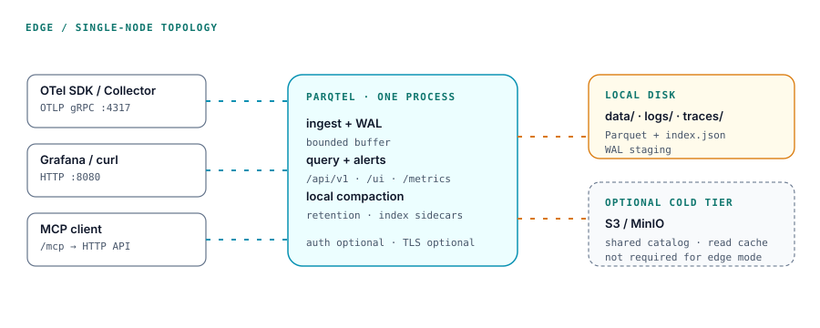

# Edge / single-node mode

Parqtel's default shape is a single small process with a local data directory.
That is a product, not a limitation to apologise for: one binary, one disk, no
external services, useful on a laptop, a single VM, or a sidecar host.

## Topology



Recommended settings for an edge host:

```toml
[storage]
block_duration_secs = 300          # shorter pre-flush window, lower RAM
retention_days = 3

[ingest]
buffer_max_points = 1000000
buffer_max_bytes = 536870912       # 512 MiB estimate
series_limit_per_metric = 100000

[auth]
enabled = false                    # only on a trusted host/network
```

Put the listener behind the host firewall or a local reverse proxy when the
network is not trusted. TLS and scoped bearer tokens are available if needed.

## Deliberate non-goals

- No replication, sharding, or multi-writer operation. Object storage can
  share a catalog and serve read replicas, but there is no writer fencing; use
  one writer per prefix.
- No per-tenant isolation. Use one instance per team/dataset if that matters.
- No DataFusion/SQL surface. PromQL, ParqtelQL, and the API are the contract.
- The console is a query/alert surface, not a full dashboard builder. Use
  Grafana for durable production dashboards.
- No GCS/Azure object storage. S3-compatible endpoints only.

## When to leave edge mode

The object-storage `BlockStore` and shared catalog are implemented. A reader
node can adopt blocks from the same prefix, but production still needs one
writer and an external load balancer. For a multi-writer design, keep separate
prefixes/data roots and aggregate at query time or with recording rules.

## Operating checks

```bash
curl -s localhost:8080/health
curl -s localhost:8080/ready
curl -s localhost:8080/metrics | grep -E 'parqtel_(buffer|scan|ingest_rejected|series_rejected)'
```

Watch buffer drops, series rejections, scan admission skips, and RSS. A flat
RSS with a rising drop counter means the ingest rate exceeds the configured
budget; raise it or shorten the block duration.
