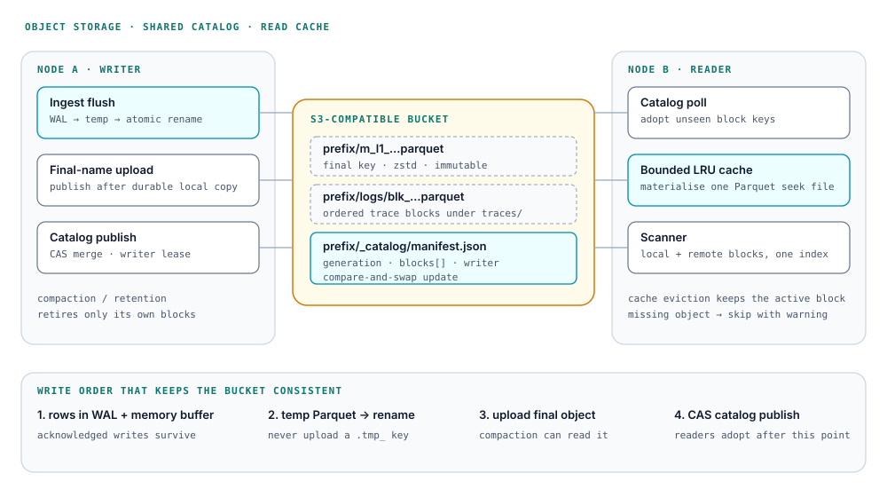

# Object storage (S3-compatible)

Parqtel can keep Parquet blocks in an S3-compatible bucket and share their
catalog across nodes. Local disk remains the WAL staging area and the read
cache: Parquet reading needs `Seek`, so a remote block is materialised into the
cache before a scan opens it.



## What is supported

| Capability | Status |
|---|---|
| S3 and S3-compatible endpoints (MinIO, Ceph, R2) | Yes |
| AWS credential chain (instance role, env, profile) | Yes |
| Static access/secret keys | Yes |
| Upload on block close | Yes |
| Shared catalog with compare-and-swap | Yes |
| Multi-node block adoption | Yes |
| Writer fencing / lease enforcement | **No** — use one writer per prefix |
| GCS / Azure Blob | No |
| Object Lock / immutability policy | Not enforced by Parqtel |
| SSE-KMS | Depends on bucket policy; not managed by Parqtel |

Object storage is **not** a distributed consensus system. Run one writer per
prefix. Additional nodes may read from the same prefix and adopt blocks; run
compaction and retention on the writer, not on every reader.

## Minimal configuration

```toml
[object_store]
enabled = true
bucket = "parqtel-blocks"
region = "eu-north-1"
prefix = "prod"
cache_dir = "/var/lib/parqtel/cache"
cache_bytes = 4294967296
catalog_interval_secs = 5
```

Credentials come from the standard AWS chain. To pin static credentials:

```toml
access_key = "${AWS_ACCESS_KEY_ID}"
secret_key = "${AWS_SECRET_ACCESS_KEY}"
```

`${ENV_VAR}` is resolved at startup. Do not commit secrets to TOML.

For MinIO or another local S3 endpoint:

```toml
endpoint = "http://minio:9000"
region = "us-east-1"
```

`http://` enables plaintext for that endpoint. Use `https://` outside a trusted
network.

## Bucket policy

The identity needs, on the configured prefix:

- `s3:PutObject`
- `s3:GetObject`
- `s3:HeadObject`
- `s3:DeleteObject`
- `s3:ListBucket` on the bucket, restricted to the prefix

Example policy (replace account, bucket and prefix):

```json
{
  "Version": "2012-10-17",
  "Statement": [
    {
      "Effect": "Allow",
      "Action": ["s3:ListBucket"],
      "Resource": "arn:aws:s3:::parqtel-blocks",
      "Condition": {"StringLike": {"s3:prefix": ["prod/*"]}}
    },
    {
      "Effect": "Allow",
      "Action": ["s3:GetObject", "s3:PutObject", "s3:DeleteObject"],
      "Resource": "arn:aws:s3:::parqtel-blocks/prod/*"
    }
  ]
}
```

Parqtel writes:

```text
<prefix>/<block>.parquet
<prefix>/_catalog/manifest.json
```

The manifest is a normal object. The bucket does **not** need versioning for
the CAS loop to work, but versioning makes accidental deletion recoverable.

## Write path

1. The ingest flush writes the Parquet block to a temporary path.
2. The temporary file is renamed to its final block name.
3. `BlockStore::publish` uploads the final object.
4. The local catalog task publishes metadata with a compare-and-swap update.

The upload is deliberately **after** the rename. A `.tmp_` key is never a
readable block, and compaction never sees a half-written name.

The catalog merge:

- keys blocks by filename;
- increments `generation`;
- records a `writer` (the node's `HOSTNAME`);
- lets a writer retire only blocks it wrote;
- retries on `Precondition`/`AlreadyExists` up to eight races.

A reader polls the catalog every `catalog_interval_secs`, adopts keys it has not
seen, and marks its sidecar dirty. Local indexes remain authoritative for the
local cache; the manifest is the cross-node catalog.

## Read path and cache

`BlockStore::open` downloads the object into `cache_dir` if it is absent, then
opens that file. The cache is LRU-bounded by `cache_bytes`.

Two safety properties matter:

- **A missing object is not a query failure.** The scan treats it as not found,
  records a warning, and continues with the remaining blocks.
- **Eviction never removes the block currently being opened.** A quota smaller
  than one block still serves that query; the cache may temporarily exceed the
  quota by the size of the active block.

A corrupt Parquet object is different: the footer decode fails and the query
returns an error. Remove or replace the object, or narrow the range to exclude
it. See [Troubleshooting](troubleshooting.md).

## Compaction and retention

Compaction and retention operate through the same `BlockStore`:

- merged sources are read through the cache;
- the output is written and published like any other block;
- sources are deleted from the bucket and local cache after the five-minute
  query grace period;
- a node retires only blocks it wrote.

An abandoned source remains readable until the grace period ends. This is
intentional: a query already running against it must still find it.

## Restart and multi-node behaviour

Startup reconciliation covers the local data directory and the local sidecar.
With object storage enabled, the catalog task then:

1. publishes local metadata for blocks present on local disk;
2. reads the manifest;
3. adopts remote keys into the local index;
4. materialises a block only when a query first opens it.

Remote blocks that this node adopted are **not** republished as local. This
prevents a reader from resurrecting a block the writer has retired.

A second node with an empty data directory can query the shared prefix after
one catalog interval. It does not need a copy of the bucket, only read access
and cache space for the blocks it touches.

## Failure behaviour

| Failure | Behaviour |
|---|---|
| Invalid credentials | Process starts; catalog uploads/polls log repeated auth errors; local ingest continues |
| Wrong region | Process starts; catalog logs an incorrect-region/redirect warning |
| Missing bucket | Process starts; catalog logs 404s; local ingest continues |
| Temporary S3 outage | Upload/catalog calls retry on the next tick; local blocks remain authoritative |
| Missing block object | Query skips it with a warning; other blocks return normally |
| Corrupt block object | Query returns an error for that scan; remove or replace the object |
| Cache disk full | Cache materialisation fails; query fails for that remote block. Free space or raise the cache disk |
| Cache eviction race | Active block is retained; another cached block is evicted |

Readiness (`/ready`) checks the local storage path, not S3 reachability. Use
the catalog/upload error warnings and object-store metrics for alerting.

## Docker and TLS trust

The runtime image is `scratch` based and ships `ca-certificates.crt` at the
standard path. A custom CA must be mounted **at that same path**; do not mount
a single file at `/etc/ssl/certs` and expect it to replace the bundle.

```bash
docker run \
  -v /path/to/ca-bundle.crt:/etc/ssl/certs/ca-certificates.crt:ro \
  ...
```

## Verification checklist

```bash
# 1. Upload: final names, no .tmp_ keys
aws s3 ls --recursive s3://parqtel-blocks/prod/ | head

# 2. Catalog exists and is normal JSON
aws s3 cp s3://parqtel-blocks/prod/_catalog/manifest.json - | jq '.generation, (.blocks|length)'

# 3. Restart with an empty cache and query over the block range
curl -sG http://localhost:8080/api/v1/query_range \
  --data-urlencode 'query=up' --data-urlencode 'start=...' --data-urlencode 'end=...' --data-urlencode 'step=60'

# 4. Second node with a different empty data dir
PARQTEL__OBJECT_STORE__ENABLED=true \
PARQTEL__OBJECT_STORE__BUCKET=parqtel-blocks \
PARQTEL__OBJECT_STORE__PREFIX=prod \
parqtel --data-dir /var/lib/parqtel-node-b serve
```

For a full local execution runbook, including an OTLP loader, restart/cache
purge, compaction, bad credentials, missing objects and a second node, see the
QA results in the project workspace (outside this repository).

## Limits and operational rules

- One writer per prefix. There is no fencing; two writers can race catalog
  updates and compaction.
- The manifest is eventually consistent for readers; expect one
  `catalog_interval_secs` propagation delay.
- Compaction and retention should run only on the writer.
- The cache is a read cache, not a second durable copy. Losing it is safe.
- Retention deletes objects; bucket lifecycle rules must not delete live
  blocks behind Parqtel's back.
- Object storage does not change dataset isolation. One process serves one
  dataset and uses one prefix.
- S3 request cost scales with block fan-out and cache misses. Keep the L1
  rollup healthy so queries touch fewer blocks.
