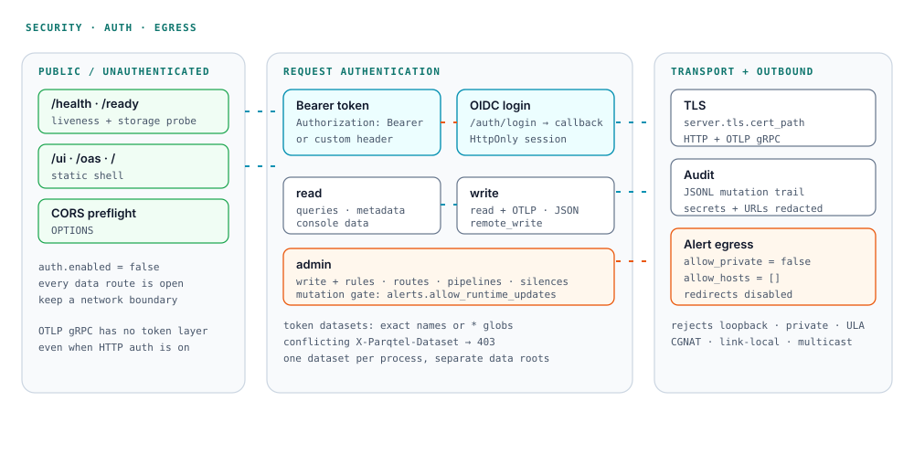

# Security

Parqtel is safe to run on a trusted host with defaults. It is **not** safe to
expose directly to an untrusted network with authentication disabled. This
guide describes the boundaries, the supported controls and the parts that still
need a proxy or mesh.



## Default posture

| Control | Default | Effect |
|---|---|---|
| HTTP auth | off | Every data route is open when `auth.enabled = false` |
| OTLP gRPC auth | none | gRPC has no token layer even when HTTP auth is on |
| TLS | off | Plaintext HTTP and gRPC |
| REST mutations | disabled | `alerts.allow_runtime_updates = false` returns 403 |
| Alert egress | fail-closed | Private, loopback and redirect targets rejected |
| Audit | on | Mutations append JSONL with secrets redacted |

For a production deployment, do at least one of:

- enable `[auth]` with scoped tokens and/or OIDC, and put gRPC behind a proxy or
  mesh;
- or keep both listeners on a private network with a NetworkPolicy/firewall.

## Authentication

```toml
[auth]
enabled = true
header = "authorization"

[[auth.tokens]]
name = "grafana"
token = "${PARQTEL_READ_TOKEN}"
actions = ["read"]

[[auth.tokens]]
name = "otel-collector"
token = "${PARQTEL_WRITE_TOKEN}"
actions = ["write"]

[[auth.tokens]]
name = "operator"
token_sha256 = "<64 lowercase hex characters>"
actions = ["admin"]
```

- A plaintext `token` is hashed at startup and never stored.
- `token_sha256` is the lowercase hex SHA-256 of the raw token.
- `Bearer <token>` and a raw value are both accepted.
- Token names are unique and become the audit actor.
- `actions` are cumulative: `read < write < admin`; empty means `read`.

Generate a hash with:

```bash
printf %s "$TOKEN" | sha256sum
```

### Public routes

`/health`, `/ready`, `/ui`, `/oas`, `/`, `/auth/login`, `/auth/callback`, and
CORS preflight stay public. The `/ui` shell is public; the data it requests is
not.

### Scope mapping

| Scope | Allows |
|---|---|
| `read` | GET queries, labels, logs, traces, alerts, dashboards, stats |
| `write` | read + OTLP/HTTP ingest, generic JSON ingest, `remote_write` |
| `admin` | write + rule/route/silence/recording-rule/pipeline mutations |

The OTLP gRPC listener is outside HTTP middleware. A token cannot protect
`:4317`; use a TLS-terminating proxy, a service mesh, or a private listener.

## OIDC

```toml
[auth.oidc]
issuer = "https://idp.example.com"
client_id = "parqtel"
client_secret = "${OIDC_CLIENT_SECRET}"
redirect_url = "https://parqtel.example.com/auth/callback"
scopes = ["openid", "profile", "email"]
roles_claim = "roles"
admin_role = "parqtel-admin"
write_role = "parqtel-write"
```

- Discovery is read from `<issuer>/.well-known/openid-configuration`.
- JWKS is cached and refreshed once when a new key id appears.
- Tokens must carry `exp`, `iss` and the configured client id as `aud`.
- The console uses the authorization-code flow and an HttpOnly
  `parqtel_session` cookie.
- API clients send the ID token as `Authorization: Bearer <id_token>`.
- Every authenticated user gets `read`; `admin_role` adds `admin`,
  `write_role` adds `write`.

A role change takes effect on the next request. Enabling auth does not add TLS.

## TLS

```toml
[server.tls]
cert_path = "/etc/parqtel/tls.crt"
key_path = "/etc/parqtel/tls.key"
```

When set, HTTP serves TLS only (there is no plaintext port) and OTLP gRPC uses
the same identity. There is no hot reload; restart after renewal. Certificate
and key must both be non-empty. Supported key formats: PKCS#8, PKCS#1 and SEC1.

If TLS terminates at a proxy, keep Parqtel on a private listener and do not
publish `:8080`/`:4317`.

## Dataset isolation

`server.dataset` is the tenant key for one process:

```toml
[server]
dataset = "api-prod"

[[auth.tokens]]
name = "api-prod-reader"
token = "${TENANT_TOKEN}"
actions = ["read"]
datasets = ["api-*"]
```

- A non-default dataset prefixes `<storage.data_dir>/<dataset>` and
  `<logs.data_dir>/<dataset>`.
- A token with a non-empty `datasets` list may access only matching names;
  `*` is a glob.
- A conflicting `X-Parqtel-Dataset` header returns 403.
- One process serves one dataset. Run separate processes for independent
  datasets; there is no cross-dataset query path.

## Mutation gate

Routes, alert rules, recording rules and pipelines persist to disk when
mutated. The REST mutation endpoints return 403 unless:

```toml
[alerts]
allow_runtime_updates = true
```

Enable this only behind authentication (`admin` scope) or an authenticating
proxy. The gate is separate from `[auth]`; auth alone does not enable writes.

## Audit trail

```toml
[audit]
enabled = true
path = "audit.jsonl"
```

`path` is relative to `storage.data_dir` or absolute. Each mutation appends one
JSON line with timestamp, actor (`anonymous` when auth is off), action, target
and before/after values. Webhook URLs and secrets are redacted.

Protect the file with filesystem permissions; it can still contain internal
hostnames and rule logic.

## Alert delivery egress

Every webhook destination is checked immediately before the POST, for both the
legacy table and the Alertmanager dispatcher.

```toml
[alerts.notifications.egress]
allow_private = false
allow_hosts = ["*.internal.example"]

[alerting.routing.egress]
allow_private = false
allow_hosts = ["*.internal.example"]
```

- Default rejects loopback, private, link-local, CGNAT, ULA, multicast and
  reserved addresses.
- HTTP redirects are disabled.
- `allow_hosts` accepts exact hosts or `*.suffix` patterns.
- `allow_private = true` disables the address-class check; use it only for a
  trusted receiver network.

Set both policies when both paths are configured. A receiver naming a private
address fails delivery, not server startup.

## Reverse-proxy pattern

If you terminate TLS and authenticate at a proxy:

- bind Parqtel to `127.0.0.1` or a private interface;
- do not publish `:4317`;
- forward the authenticated actor in a header only if you also restrict
  direct access to Parqtel;
- keep `/metrics` and `/debug/pprof/*` on an internal path;
- set `alerts.allow_runtime_updates = true` only for the admin surface.

## Profiling endpoints

`telemetry.profiling_enabled = false` keeps `/debug/pprof/profile` and
`/debug/pprof/summary` at 404. `/debug/pprof/memory` is always available and
exposes process/buffer counts. Restrict all three with a NetworkPolicy.

## Known gaps

- OTLP gRPC has no token authentication.
- No per-query row-level authorization; the dataset boundary is the process.
- No writer fencing for object storage; one writer per prefix.
- Audit covers configuration mutations, not queries.
- Secrets in TOML are resolved at startup; there is no secret manager
  integration beyond environment substitution.

See [Configuration](configuration.md#auth) for every auth key and
[Object storage](object-storage.md) for bucket permissions.
